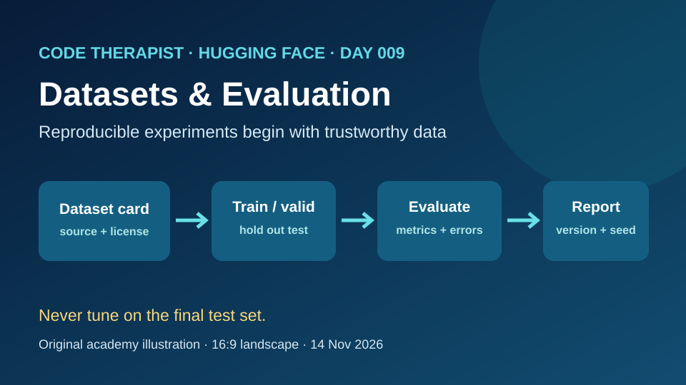
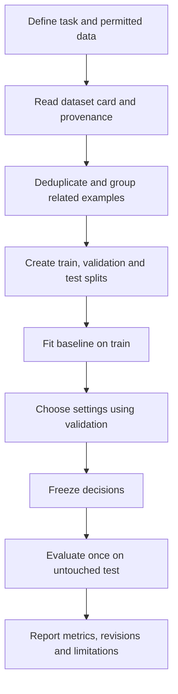

# Day 009 — Datasets, Evaluation and Reproducibility

**Department:** 03 — Platforms · **Platform:** Hugging Face · **Season:** 01 · **Day:** 009  
**Published:** 14 November 2026 · **Status:** Published educational lesson; no experiment executed  
[← Season index](./README.md) · [← Platform overview](../README.md)

## Learning outcomes

By the end, explain dataset provenance and cards; split data without leakage; choose a meaningful metric; document an experiment so another learner can reproduce it; and distinguish a provider's claim from a measured result.

## Lecture 1 — A dataset is evidence, not just a file

A **dataset** is a collection of examples used for training, validating or evaluating a system. A CSV file alone says little about its reliability. Ask who collected the data, when and why, what permissions and license apply, how labels were created, and which populations may be missing. Hugging Face **dataset cards** are repository README files that document context, fields, intended uses, limitations, and sometimes license and metadata. Missing documentation is a risk to investigate, not permission to assume consent.

**Example:** A fictional Kampala bookshop wants to classify messages as *order*, *availability question* or *other*. If its dataset contains only English messages, it cannot claim reliable performance on Luganda messages without testing.

## Lecture 2 — Split before you optimize

- **Train:** examples used to fit model parameters.
- **Validation:** held-out examples used to compare settings, prompts or model choices.
- **Test:** a final untouched holdout for reporting performance after choices are fixed.

An illustrative 70/15/15 split is **not a universal rule**. Small, imbalanced, time-series or grouped datasets require different strategies. Keep repeated messages from the same customer, near-duplicates and related documents together to prevent leakage across splits. For time-dependent tasks, consider chronological splits. A random seed helps repeat a split but does not alone guarantee reproducibility.

**Data leakage** occurs when information unavailable in real use influences training or model selection. For example, cleaning all examples with a label-derived rule before splitting can leak information; evaluating on messages already seen during training overstates generalization.

## Lecture 3 — Evaluate what matters

For a classification task, record a confusion matrix and per-class precision/recall, not accuracy alone. If 95 of 100 messages are *other*, a classifier that always predicts *other* reaches 95% accuracy while failing the minority categories. Compare against a simple baseline; inspect errors; test out-of-scope messages and relevant languages. Report sample sizes and uncertainty, especially for small test sets. Never invent a score.

## Lecture 4 — Reproduce and audit the experiment

Record the dataset identifier and immutable revision, license, preprocessing script, split strategy, random seed, model checkpoint/revision, dependency versions, evaluation code, hardware where relevant, test date and known limitations. Store no passwords or personal customer messages in a public repository. A dataset card or model card documents claims; it is not proof that an independent evaluation has occurred.

## Workflow

## Guided practice — synthetic bookshop classification

1. Write **12 invented** short bookshop messages, four each for *order*, *availability* and *other*. Do not use real customers.
2. Create a small table with `text`, `label` and `group_id`. Give paraphrases from the same fictional conversation the same group ID.
3. Propose a group-aware split. With only 12 examples, explain why the test estimate will be unstable; do not claim statistically reliable accuracy.
4. Define a keyword-rule baseline. Predict labels on held-out examples **without changing the rule after seeing test results**.
5. Draw a confusion matrix and describe one false positive and one false negative. If you did not run a model, clearly mark predictions as a classroom illustration.
6. Draft a mini dataset card: purpose, synthetic origin, language, labels, permitted use, known gaps and version. Write an experiment record with seed, split logic, baseline and evaluation date.

**Submission:** dataset-card draft, grouped split plan, baseline pseudocode, blank or honestly measured confusion matrix, and a reproducibility checklist. **Status:** learner exercise only; no experiment was executed for this publication.

## Knowledge check

1. Why is a dataset card useful? **It documents origin, intended use, structure and limitations.**
2. Why reserve a final test split? **To estimate generalization after decisions are frozen.**
3. What is leakage? **Information crossing an evaluation boundary and inflating apparent performance.**
4. Why might 95% accuracy mislead? **Class imbalance can hide failures on minority labels.**
5. Is a random seed sufficient for reproducibility? **No; also record data revisions, code, dependencies and methodology.**

## Official sources

- [Hugging Face dataset cards](https://huggingface.co/docs/hub/datasets-cards) — documentation and metadata.
- [Hugging Face dataset splits](https://huggingface.co/docs/dataset-viewer/en/configs_and_splits) — train, validation and test.
- [Hugging Face evaluation considerations](https://huggingface.co/docs/evaluate/considerations) — splits, imbalance and evaluation pitfalls.
- [Hugging Face dataset repository structure](https://huggingface.co/docs/datasets/repository_structure) — files, splits and versions.

**Source review:** 14 November 2026. This is a platform learning lesson, **not a new model release**; examples are fictional and no measured results are asserted.
