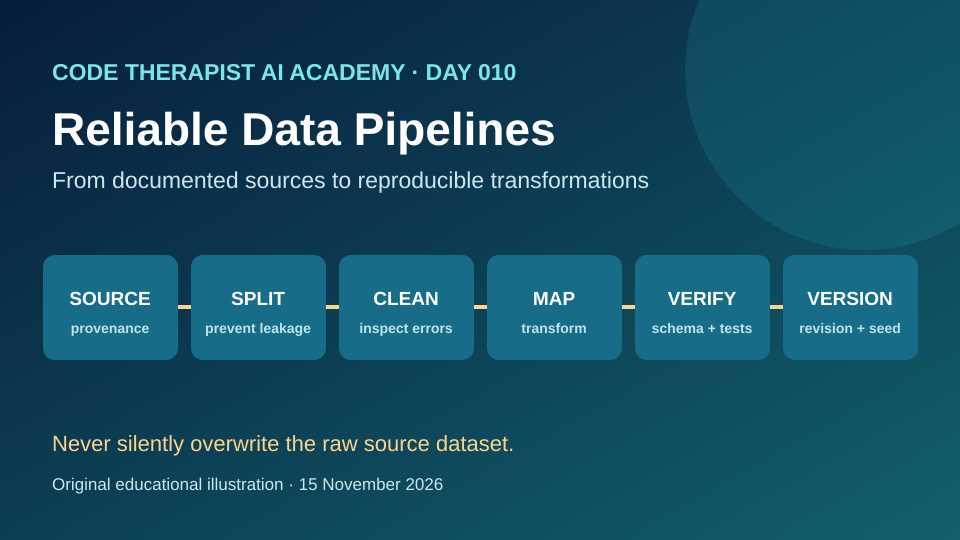
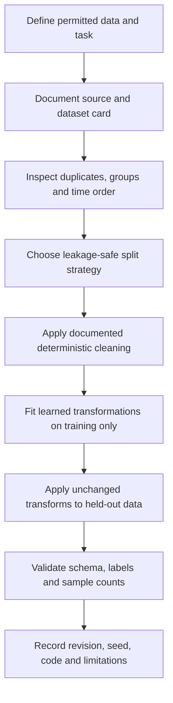

# Day 010 — Build Reliable Dataset Processing Pipelines



**Department:** 03 — AI Platforms · **Platform:** Hugging Face · **Season:** 01 · **Day:** 010  
**Published:** 15 November 2026 · **Status:** Educational lesson published; example code not executed by the academy  
[← Day 009](./DAY-009-DATASETS-EVALUATION-REPRODUCIBILITY.md) · [Season index](./README.md) · [Platform overview](../README.md)

## Objectives

After studying this lesson, you should be able to explain a data pipeline; distinguish filtering, mapping, shuffling, splitting and sharding; preserve dataset provenance; detect data leakage; and write a reproducible processing plan.

## Lecture 1 — What is a dataset processing pipeline?

A **pipeline** is a documented sequence that turns raw, permissioned input records into a structured dataset ready for a defined task. A useful pipeline specifies inputs, operations, outputs, validation checks and the versions of software and data used. The goal is not simply to produce a clean CSV: it is to make every important transformation explainable and repeatable.

**Example:** A fictional Ugandan bookshop receives messages such as “Do you have a Python book?” and “Please reserve two copies.” An ML classifier needs labels, consistent text fields and permission to use the data. For this exercise we use only invented messages; real customers' contact information must not be uploaded to a public dataset.

## Lecture 2 — Understand the operations

| Operation | What it does | Common pitfall |
|---|---|---|
| `filter()` | Keeps rows matching a rule | Removing difficult examples without documenting the decision |
| `map()` | Transforms records or adds columns | Accidentally changing labels or leaking information |
| `select()` | Selects particular row indices | Mistaking a selected sample for a representative sample |
| `shuffle(seed=...)` | Changes row order reproducibly for a given dataset/revision | Shuffling time-series data that needs chronological evaluation |
| `train_test_split()` | Produces train/test partitions | Separating duplicate or related examples across partitions |
| `shard()` | Partitions large datasets for processing | Confusing processing shards with statistically valid test splits |

Hugging Face's Datasets documentation explains that many transformations return **new Dataset objects** instead of modifying the original in place. That helps compose transformations, but you still need to preserve raw data and record what changed.

## Lecture 3 — Split boundaries and leakage

Decide how you will evaluate the model *before* fitting transformations that learn from data. If multiple messages come from one fictional customer conversation, keep the group in the same split. If your task predicts future events, consider a time-based holdout. Any vocabulary, scaler, feature selection or label-informed preprocessing that is **fitted** should learn from training data only, then be applied unchanged to validation/test. Simple deterministic text normalization can be specified consistently across splits, but must not use test labels to tune decisions.

## Lecture 4 — Minimal Python demonstration (illustrative, not run)

The following uses invented records and the documented `datasets` API. For a tiny classroom sample, the split is a demonstration only, **not** a reliable performance estimate.

```python
from datasets import Dataset

rows = {
    "text": [
        "Reserve a Python book", "Do you stock algorithms?",
        "I need two copies", "What time do you close?",
        "Please hold my order", "Is the JavaScript guide available?",
        "I will collect tomorrow", "Where is the shop?",
        "Order one notebook", "Thanks for the update",
    ],
    "label": ["order", "availability", "order", "other", "order",
              "availability", "order", "other", "order", "other"],
}
raw = Dataset.from_dict(rows)
clean = raw.map(lambda row: {"text_clean": row["text"].strip().lower()})
selected = clean.filter(lambda row: bool(row["text_clean"]))
split = selected.train_test_split(test_size=0.2, seed=42)
print(len(split["train"]), len(split["test"]))
```

**Important limitation:** `train_test_split()` above is a row-level split and is **not group-aware**. If your real dataset has repeated customers, documents or near-duplicates, design group-aware splitting instead. Never report a model score based on these ten examples.

## Workflow



## Guided practice — synthetic Kampala bookshop

1. Create 18 fictional bookshop messages: six *order*, six *availability*, six *other*. Do not include real names, phone numbers or private orders.
2. Make a table with `text`, `label`, `conversation_group` and `source=synthetic`.
3. Specify rules to trim whitespace and reject empty records. Explain whether lowercasing is appropriate for your task.
4. Make two messages paraphrases from one fictional conversation and show why they must remain in the same split.
5. Draw the workflow, propose a group-aware train/test split, and list two checks for accidental label changes.
6. Record dataset version, Python/library versions, random seed, transformation logic, sample counts and one limitation.

**Submission:** a one-page pipeline specification, synthetic dataset, Mermaid or hand-drawn workflow, test checklist and a short explanation of leakage risk. **No live training or measured benchmark is claimed.**

## Quiz with answers

1. Does `map()` necessarily mutate the original dataset? **No; the documented Datasets operations commonly return a new Dataset.**
2. Is a random split always suitable? **No; grouped or time-dependent data may need different boundaries.**
3. Why keep raw data? **To audit and reproduce transformations.**
4. Is sharding the same as an evaluation split? **No; sharding is primarily a processing partition.**
5. What should be recorded for reproducibility? **Dataset revision, split method, seed, code, dependencies and limitations.**

## Official references

- [Hugging Face Datasets — Process](https://huggingface.co/docs/datasets/process) — `map`, `filter`, `select`, `shuffle`, `train_test_split` and `shard`.
- [Hugging Face Datasets documentation](https://huggingface.co/docs/datasets/index) — concepts and examples.
- [Hugging Face Dataset Cards](https://huggingface.co/docs/hub/datasets-cards) — provenance and limitations.

**Source review date:** 15 November 2026. This is a platform tutorial, **not a new AI model release**. API behavior and examples are based on provider documentation; the academy has not executed this example or independently benchmarked any model.
