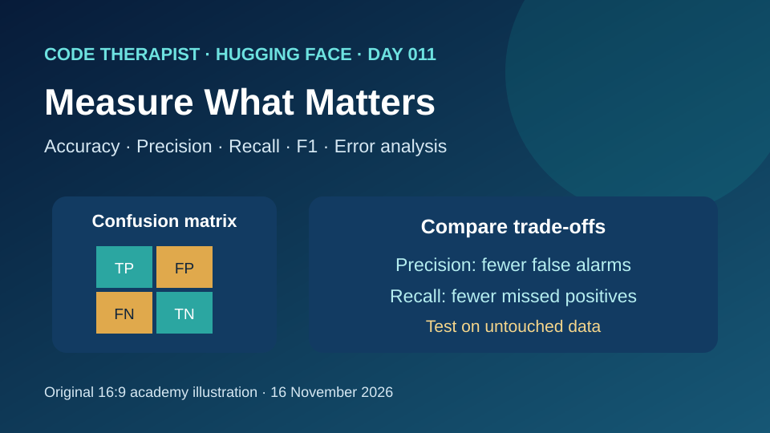
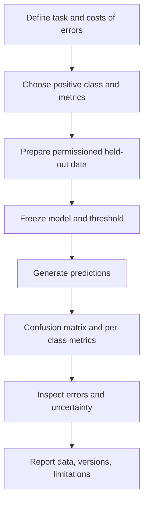

# Day 011 — Evaluation Metrics: Measure What Matters



**Department:** 03 — Platforms · **Platform:** Hugging Face · **Season:** 01 · **Day:** 011  
**Published:** 16 November 2026 · **Status:** Published educational lesson; no live model evaluation claimed  
[← Day 010](./DAY-010-DATA-PROCESSING-PIPELINES.md) · [Season index](./README.md) · [Platform overview](../README.md)

## Learning objectives

Explain why accuracy alone can mislead, calculate precision, recall and F1 from a confusion matrix, choose metrics based on the consequences of errors, and document an honest evaluation using a held-out dataset.

## Lecture 1 — What are we actually measuring?

A classifier predicts categories. An **evaluation metric** summarizes how its predictions compare with trusted reference labels. Different tasks demand different measures: an inventory query classifier, a medical screening tool and a spam filter should not automatically optimize the same number. A model provider's published benchmark is a *claim about a particular setup*, not proof of performance on your own data.

For binary classification, count **TP** (true positive), **FP** (false positive), **FN** (false negative) and **TN** (true negative). Define the positive class *before* calculating results. In a fictional bookshop example, positive might mean *urgent order requiring attention*.

| Metric | Formula | Interpretation | Limitation |
|---|---|---|---|
| Accuracy | (TP + TN) / all examples | Share of correct predictions | Can conceal minority-class failures |
| Precision | TP / (TP + FP) | Among predicted positives, share correct | Ignores missed positives |
| Recall | TP / (TP + FN) | Among actual positives, share found | Ignores false alarms |
| F1 | 2 × precision × recall / (precision + recall) | Balances precision and recall | Does not include true negatives or operational cost |

When a denominator is zero, document how your chosen library handles the undefined value rather than silently inventing a score.

## Lecture 2 — Worked example (illustrative, not a model benchmark)

Imagine **20 synthetic bookshop requests**: TP=6, FP=2, FN=4, TN=8. Then accuracy=(6+8)/20=**70%**; precision=6/(6+2)=**75%**; recall=6/(6+4)=**60%**; F1=2×0.75×0.60/(0.75+0.60)=**66.7%**. These figures are arithmetic on invented counts; **no model was trained or evaluated**.

Why does the choice matter? If missing an urgent order is costly, recall deserves attention. If wrongly escalating messages overwhelms staff, precision matters. Real systems often balance both against latency, fairness, privacy and the costs of human review.

## Lecture 3 — Class imbalance and multiclass reporting

If 98 out of 100 messages are ordinary inquiries, always predicting *ordinary* gives 98% accuracy but finds none of the two urgent orders. Use a confusion matrix, per-class precision and recall, and appropriate macro/weighted averages. For **macro F1**, compute F1 separately for each class and take their unweighted mean; weighted F1 gives more weight to larger classes. Neither replaces inspecting rare but important failure cases.

Never tune prompts or thresholds on the final test set. Compare candidates using training/validation data, freeze the choice, and then report untouched test results with sample sizes and dataset revisions. Small samples yield uncertain estimates; avoid sweeping conclusions.

## Lecture 4 — Reproducible evaluation in Python

The following self-contained example uses only Python's standard library; it is safe to run locally. It calculates metrics from invented reference labels and predictions, **not** a real model result.

```python
truth = [1]*10 + [0]*10
pred  = [1]*6 + [0]*4 + [1]*2 + [0]*8
TP = sum(t == 1 and p == 1 for t, p in zip(truth, pred))
FP = sum(t == 0 and p == 1 for t, p in zip(truth, pred))
FN = sum(t == 1 and p == 0 for t, p in zip(truth, pred))
TN = sum(t == 0 and p == 0 for t, p in zip(truth, pred))
precision = TP / (TP + FP) if TP + FP else 0.0
recall = TP / (TP + FN) if TP + FN else 0.0
f1 = 2 * precision * recall / (precision + recall) if precision + recall else 0.0
print(dict(TP=TP, FP=FP, FN=FN, TN=TN,
           accuracy=(TP+TN)/len(truth), precision=precision,
           recall=recall, f1=f1))
```

For actual ML projects, Hugging Face **Evaluate** can compute multiple metrics together using `evaluate.combine([...])`. Record library versions and metric configuration, including positive-label selection and averaging method. See the official documentation below.

## Evaluation workflow



## Guided practice — fictional Kampala bookshop

1. Create 20 **synthetic** requests and label urgent/non-urgent. Keep any real customer messages out of public repositories.
2. Draft a simple keyword baseline and specify the positive class.
3. Make a 2×2 confusion matrix and compute accuracy, precision, recall and F1. Show calculations.
4. Describe two false positives and two false negatives. Explain which error is more costly for the bookshop.
5. Propose one improvement, but do **not** revise your baseline after looking at the final test set; use a separate validation split.
6. Record dataset version, split method, code version, date, sample size and limitations in a short experiment report.

**Submission:** metric table, confusion matrix, baseline pseudocode, error-analysis paragraph and reproducibility note. **Exercise status:** not executed by the academy.

## Quiz and answers

1. Can 98% accuracy hide poor detection of a rare class? **Yes.**
2. Which metric answers “Of predicted positives, how many were right?” **Precision.**
3. Which metric answers “Of actual positives, how many did we find?” **Recall.**
4. Does F1 measure runtime, fairness or privacy? **No.**
5. Why keep the test set untouched until the end? **To avoid biased model selection and inflated performance claims.**

## Official learning sources

- [Hugging Face Evaluate — choosing a metric](https://huggingface.co/docs/evaluate/choosing_a_metric) — task-appropriate metric selection.
- [Hugging Face Evaluate — quick tour](https://huggingface.co/docs/evaluate/a_quick_tour) — computing and combining metrics.
- [Hugging Face Evaluate — evaluator](https://huggingface.co/docs/evaluate/base_evaluator) — automated evaluation and latency considerations.

**Sources reviewed:** 16 November 2026. This is a platform education article, **not** a model release or an independently benchmarked result.
