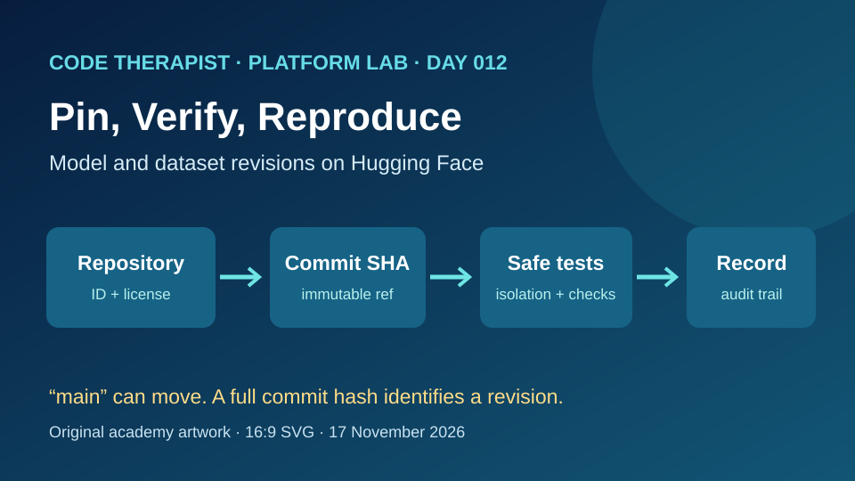
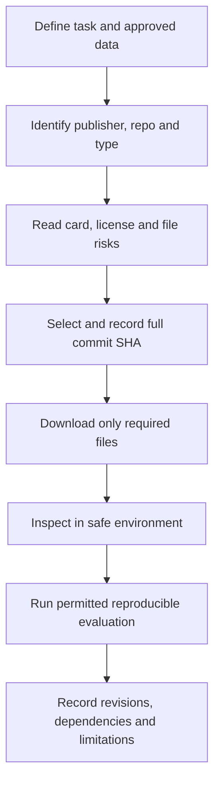

# Day 012 — Pin, Verify and Reproduce Hugging Face Artifacts



**Department:** 03 — Platforms · **Season:** 01 · **Day:** 012 · **Published:** 17 November 2026  
**Status:** Published educational lesson; no model download or execution claimed  
[← Day 011](./DAY-011-EVALUATION-METRICS.md) · [Season index](./README.md) · [Platform overview](../README.md)

## Learning objectives

Identify a Hub repository and its type, distinguish moving branch names from immutable commit revisions, pin files for repeatable experiments, inspect security and licensing limitations, and create an honest provenance record.

## Lecture 1 — What exactly are you downloading?

The Hugging Face Hub hosts **model**, **dataset**, and **Space** repositories. A model repository may include weights, a tokenizer, configuration, a model card and additional code. A dataset repository may contain data files and a dataset card. A Space is an application repository. The repository name is **not** a unique frozen version of every artifact it contains.

A branch such as `main` can change when maintainers commit. A tag is a human-readable reference to a particular revision, but tags may be altered by repository maintainers. A **full commit SHA** is a more precise reference for reproducing a snapshot. Record the publisher and repository type too: `some-org/my-model` is not equivalent to an unrelated repository with a similar name.

## Lecture 2 — Why pin revisions?

Suppose a team evaluates a classifier on Monday using `main`. On Friday the maintainer updates model weights, tokenizer settings or preprocessing files. Running the same code against the moving branch might produce different results. Pinning a full commit hash helps ensure the same repository snapshot is selected. It does **not** guarantee identical results across different GPU kernels, hardware, random seeds or dependencies. Record these separately.

The official `huggingface_hub` download APIs accept a `revision` argument. For a single file, use `hf_hub_download`; for a repository snapshot, use `snapshot_download`. Avoid mixing files from different commits by resolving one revision before downloading related artifacts.

## Lecture 3 — Read before you run

A stable revision is not necessarily **safe** or **permitted**. Read the model/dataset card, publisher, license, intended use, access restrictions, file list and dependencies. Some model-loading options execute remote repository code; do not enable `trust_remote_code=True` casually. Serialized artifacts and dependencies can be risky. Prefer documented safe formats where appropriate, review provenance, and test untrusted material only in an isolated, least-privileged environment. A scanner's clean result is not a security guarantee.

A private or gated repository may require authentication. Never commit access tokens to GitHub, print them in logs or include them in screenshots. Use least-privileged credentials and approved secret management.

## Lecture 4 — Python example: a pinned, non-executing file download

The following is an **illustrative template**. Replace the placeholder with a verified full commit SHA from a repository you have permission to access. It downloads a text/configuration file only; it does not load model weights or execute inference.

```python
from huggingface_hub import hf_hub_download

repo_id = "openai-community/gpt2"  # Example public repository
revision = "REPLACE_WITH_VERIFIED_FULL_COMMIT_SHA"

if revision.startswith("REPLACE_"):
    raise ValueError("Inspect repository history and pin a full commit SHA first")

file_path = hf_hub_download(
    repo_id=repo_id,
    filename="config.json",
    revision=revision,
    repo_type="model",
)
print("Downloaded configuration to local cache:", file_path)
```

**Important:** Do not modify files directly inside the managed Hub cache. For a full repository, use `snapshot_download(repo_id=..., revision=...)` and record the selected revision. This template is not a benchmark or evidence of a successful download.

## Provenance workflow



## Guided practical — fictional Kampala bookshop

1. Select a public, documented model repository appropriate for text classification. Record its exact owner/repo and task; **do not download weights yet**.
2. Read the model card. Note publisher, license, language coverage, documented limitations and whether any field is missing.
3. Locate repository history, identify a full commit SHA, and explain why `main` is not sufficient for an immutable evaluation record.
4. Write a paper-only manifest with `repo_id`, `repo_type`, `revision`, `filename`, `license`, `source_review_date`, `dependencies`, `test_data_version` and `risks`.
5. Explain how you would isolate an untrusted dependency and avoid exposing customer information. Use invented bookshop messages only.
6. Design a rollback procedure if a later version performs worse. Compare snapshots using the **same held-out test data** and clearly label results as *not measured* until you run them.

**Deliverable:** one-page artifact provenance manifest, risk checklist and rollback plan. **Status:** instructional exercise only; no live model or dataset was tested for this article.

## Five-question quiz

1. Does `main` always identify the same files? **No; branches can advance.**
2. What is the purpose of a full commit SHA? **To identify a specific repository revision.**
3. Does pinning alone guarantee deterministic predictions? **No; runtime, dependencies and randomness also matter.**
4. Can a clean scan prove a model is safe? **No; scanning has limitations.**
5. Should access tokens appear in a public notebook? **No; use secure secret handling.**

## Official documentation and source dates

- [Hugging Face: Download files from the Hub](https://huggingface.co/docs/huggingface_hub/main/guides/download) — `revision`, `hf_hub_download`, `snapshot_download`.
- [Hugging Face: Create and manage repositories](https://huggingface.co/docs/huggingface_hub/guides/repository) — branches, tags, repository settings.
- [Hugging Face: Model cards](https://huggingface.co/docs/hub/model-cards) — limitations and documentation.
- [Hugging Face: Hub security](https://huggingface.co/docs/hub/security) — security considerations.

**Documentation checked:** 17 November 2026. These are platform documentation sources, not a newly released model or an independent security audit.
