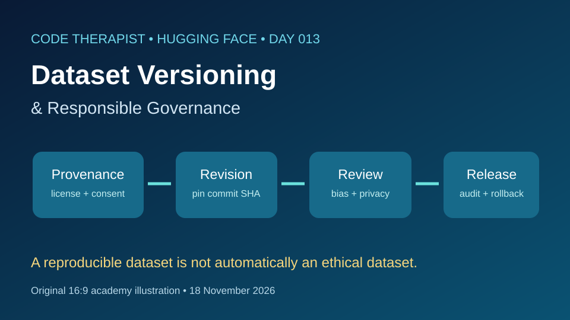
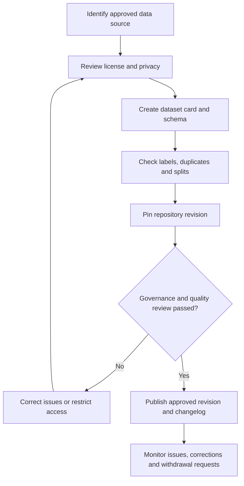

# Day 013 — Dataset Versioning and Responsible Governance



**Department:** 03 — Platforms · **Platform:** Hugging Face · **Season:** 01 · **Day:** 013  
**Published:** 18 November 2026 · **Status:** Educational lesson published; no dataset uploaded or benchmark executed  
[← Day 012](./DAY-012-PIN-VERIFY-REPRODUCE.md) · [Season index](./README.md) · [Platform overview](../README.md)

## Learning outcomes

Explain how dataset repositories change over time; pin a revision; write a useful dataset card; distinguish technical reproducibility from permission to process data; design a privacy-conscious review and rollback process.

## Lecture 1 — Dataset identity is not dataset version

A Hugging Face dataset repository has an identifier, for example `organization/dataset-name`. A repository's `main` branch can move as data, metadata and scripts change. A **commit revision** identifies a particular snapshot. To reproduce a study, record the full revision, configuration, split, preprocessing and dependencies, not merely the dataset name. The `datasets.load_dataset` API accepts a `revision` parameter for supported Hub datasets. Pinning the revision improves traceability but does not prove that labels are correct or that the dataset was collected lawfully.

## Lecture 2 — A dataset card is part of the experiment

Hugging Face dataset cards document provenance and intended use. Include the data source, collection period, language coverage, label definitions, split design, license, known biases, personally identifying fields, update history, limitations and contact or correction process where appropriate. **Missing license information is not an invitation to redistribute.** Model cards describe models; dataset cards describe datasets. Neither replaces an independent audit.

## Lecture 3 — Governance means deciding what may be used

Before publication, check permission, consent where relevant, privacy law and institutional policies, access controls, retention, deletion requests, third-party licenses and whether examples contain identifying information. Pseudonymization is not always anonymization. Never upload real university student records, client documents, credentials or customer conversations into a public dataset merely because they are useful for training.

Versioning does not erase previously published sensitive data: Git history and downstream copies may persist. If a disclosure occurs, restrict access, follow the host's remediation guidance and notify responsible parties through appropriate channels. Do not assume deleting the latest file fixes past exposure.

## Lecture 4 — Quality gates and release discipline

Use a documented review before each dataset release: (1) provenance and licensing, (2) schema/label checks, (3) duplicate and leakage checks, (4) privacy and bias review, (5) version pin and changelog, (6) held-out evaluation, (7) approved release. Track who reviewed each gate and what remains unknown. A revision hash is a technical identifier, **not** an ethical approval certificate.

### Safe illustrative Python template

```python
from datasets import load_dataset

repo_id = "OWNER/VERIFIED_DATASET"  # Replace with a permitted public dataset
revision = "REPLACE_WITH_VERIFIED_FULL_COMMIT_SHA"

if revision.startswith("REPLACE_") or repo_id.startswith("OWNER/"):
    raise ValueError("Verify dataset identity, license and full commit revision first")

# Only run after reviewing dataset documentation and permitted access.
dataset = load_dataset(repo_id, revision=revision, split="train")
print(dataset.column_names)
```

This is an unexecuted template; API behavior can depend on dataset type and installed library version. Do not run unknown repository code or publish outputs containing personal data.

## Dataset release workflow



## Guided practice — fictional Kampala bookshop

1. Invent eight synthetic messages about book orders, delivery questions and stock. Never use real customer chats.
2. Draft a dataset card with intended task, labels, synthetic origin, English-language limitation, license decision and explicit prohibition on treating the sample as a representative benchmark.
3. Propose a `v0.1` release and `v0.2` correction: one mislabeled message is fixed. Record the change, reviewer and two *placeholder* commit IDs; do not invent real Git hashes.
4. Explain how results would differ if the experiment loaded moving `main` rather than the recorded `v0.1` revision.
5. Write a three-column risk register: risk, control, residual uncertainty. Include privacy, licensing, label quality and language bias.
6. Submit a one-page release checklist and identify one situation where publication should be stopped.

**Submission:** synthetic dataset card, changelog, risk register, revision plan and approval checklist. **Status:** classroom exercise only; no dataset upload or model test claimed.

## Quiz and answers

1. Does a dataset name identify immutable contents? **No; pin a commit revision.**
2. What is the difference between a dataset card and a model card? **They document different artifact types.**
3. Does a full commit SHA prove lawful collection? **No.**
4. Can removing a secret from the latest Git commit guarantee removal from history? **No.**
5. Why document label corrections? **They can change evaluation outcomes and reproducibility.**

## Official learning sources

- [Hugging Face — Dataset cards](https://huggingface.co/docs/hub/datasets-cards)
- [Hugging Face — Dataset repository structure](https://huggingface.co/docs/datasets/repository_structure)
- [Hugging Face — Load datasets](https://huggingface.co/docs/datasets/loading)
- [Hugging Face — Hub discussions and pull requests](https://huggingface.co/docs/hub/repositories-pull-requests-discussions)

**Source review:** 18 November 2026. These are educational platform capabilities and recommended governance practices, **not** claims about a newly released AI model.
