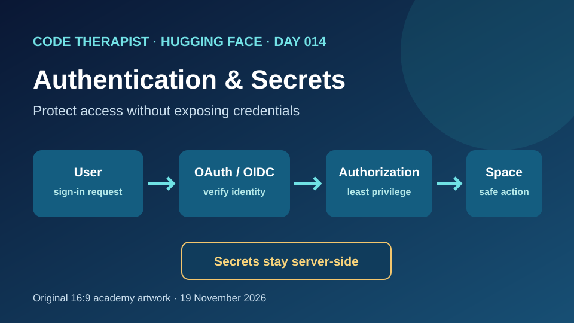
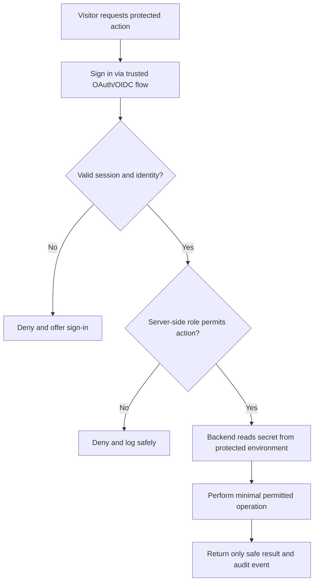

# Day 014 — Space Authentication, Authorization and Secrets



**Department:** 03 — Platforms · **Platform:** Hugging Face · **Season:** 01 · **Day:** 014  
**Published:** 19 November 2026 · **Status:** Published educational lesson; no authentication service deployed or tested  
[← Season index](./README.md) · [← Platform overview](../README.md)

## Learning outcomes

Distinguish authentication, authorization and secrets; explain Hugging Face Space OAuth at a high level; design least-privilege access; recognize dangerous client-side credential exposure; and document an access-control test plan.

## Lecture 1 — Identity is not permission

**Authentication** answers *who is signing in?* **Authorization** answers *what may that identity do?* A signed-in user is not automatically entitled to read private records, manage repositories or call paid inference. A model's quality and a Space's visibility settings do not establish access-control correctness.

**Example:** A fictional Kampala bookshop has a public catalog demo and a private inventory dashboard. Signing in may establish a user's identity, but the application must still check a server-side role before showing inventory. Do not put actual customer, payment or student information into a classroom Space.

## Lecture 2 — Hugging Face OAuth and OIDC

Hugging Face documents a **Sign in with Hugging Face** integration for Spaces. Space metadata can enable OAuth using `hf_oauth: true`; optional scopes request additional capabilities. OIDC provides identity information, while OAuth access tokens grant scoped access. Verify the authorization response, state, token audience/issuer and session handling with a maintained library rather than implementing cryptography yourself. Request only the permissions actually required. Scope availability and configuration may change; consult the official guide before implementation.

**Important distinction:** OAuth sign-in is not the same as making a Space private, nor does it automatically protect every route or data object. Implement and test application authorization separately. Never trust a browser-supplied role without server-side verification.

## Lecture 3 — Secrets, variables and exposure boundaries

Hugging Face Space **Variables** are for non-sensitive configuration; they may be publicly visible and copied when a Space is duplicated. **Secrets** are for tokens and sensitive values. For Python/Docker server-side applications, read secrets from environment variables without logging their values. **Static Spaces execute client-side JavaScript:** do not assume a value accessed in a browser is confidential, even if it was configured through a secret mechanism. Put sensitive provider calls behind a properly authenticated backend or choose a deployment architecture that can keep credentials server-side.

Example of a **server-side-only** configuration check (no real key supplied):

```python
import os

api_token = os.getenv("INFERENCE_API_TOKEN")
if not api_token:
    raise RuntimeError("Missing required server-side token")
# Pass the token only to an approved server-side client.
# Never print it, return it to the browser, or commit it to Git.
```

Rotate a leaked token and investigate logs, commits and access; deleting the visible string from the latest file does not remove it from Git history.

## Lecture 4 — Threat modeling and operating controls

Consider an attacker reading browser source, copying a public Space, replaying a session, manipulating a request, or obtaining excessive OAuth scopes. Mitigate with least privilege, secure session management, server-side checks, safe logs, rate limits, token rotation and clear incident response. Document who owns the app and how access is revoked. Provider documentation describes features; it does not prove that a particular application is secure.

## Architecture diagram



## Guided practice — fictional bookshop access design

1. Define three roles: visitor, staff and administrator. Write a permission matrix for catalog viewing, stock editing and token rotation.
2. Draw the sign-in, callback, session and server-side authorization boundaries. Mark which information is public, sensitive or secret.
3. Write a sample Space README metadata plan enabling OAuth, but **do not** insert actual credentials or request unnecessary write scopes.
4. Compare a Static Space with a Python-backed Space: explain why browser JavaScript cannot keep a long-lived API token confidential.
5. Design six tests: anonymous denial, authorized staff success, visitor privilege escalation denial, expired session denial, missing-secret failure and sanitized error logging.
6. Write an incident checklist for a leaked key: revoke/rotate, inspect history and logs, assess misuse and document remediation.

**Submission:** one-page role matrix, architecture diagram, six test cases and an incident checklist. **Status:** design exercise only; no OAuth deployment, penetration test or security certification claimed.

## Five-question quiz and answers

1. Is sign-in proof of permission? **No. Authentication and authorization are separate.**
2. What does least privilege mean? **Grant only the scopes and actions needed.**
3. Can client-side JavaScript safely hold a private API key? **No. Browser users can inspect it.**
4. Do Space Secrets replace server-side role checks? **No. They address credential storage, not authorization.**
5. What should happen after token exposure? **Revoke/rotate, investigate, remediate and record the incident.**

## Official references and editorial record

- [Hugging Face — Adding a Sign-In button to Spaces](https://huggingface.co/docs/hub/spaces-oauth) — OAuth metadata, scopes and sign-in flow.
- [Hugging Face — Spaces overview](https://huggingface.co/docs/hub/spaces-overview) — Secrets, Variables and visibility.
- [Hugging Face — OAuth and OpenID Connect](https://huggingface.co/docs/hub/oauth) — authorization concepts and app registration.

**Official-source review:** 19 November 2026. Feature descriptions reflect provider documentation; this lesson contains no independently tested security or performance claim. It is **platform education, not a new model release**.
