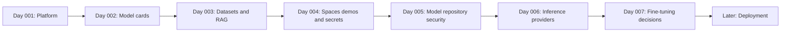

# 🤗 Hugging Face — Season 01: Platform and Model Literacy

**Code Therapist AI Academy · Platform Department · Beginner-to-Practical**

[← Hugging Face platform research](../README.md) · [← AI Academy](../../../README.md) · [ML builder pathway](../../../PATH-03-ML-BUILDER/README.md)

> **Purpose:** This is a dedicated study season about an AI platform and infrastructure, **not a sixteenth LLM model family**. It shows learners how to discover, assess and test AI resources safely.

## Start reading: first seven days

| Day | Class | Outcome |
|---|---|---|
| **001** | **[What Is Hugging Face?](./DAY-001-PLATFORM-INTRODUCTION.md)** | Understand Models, Datasets, Spaces and repositories |
| **002** | **[Read a Model Card](./DAY-002-MODEL-CARDS.md)** | Evaluate a model's intended use, limits and license |
| **003** | **[From Data to a Knowledge Base](./DAY-003-DATASETS-AND-RAG.md)** | Distinguish datasets, retrieval indexes and model applications |
| **004** | **[Spaces: Safe AI Demos](./DAY-004-SPACES-SAFE-DEMOS.md)** | SDK, visibility, secrets, compute costs and safe deployment design |
| **005** | **[Model Repository Security](./DAY-005-MODEL-REPOSITORY-SECURITY.md)** | Provenance, pickle risks, scanner limitations and isolated tests |
| **006** | **[Inference Providers: Choose, Route and Evaluate](./DAY-006-INFERENCE-PROVIDERS.md)** | Routing, pricing, authentication and measured evaluation |
| **007** | **[Should You Fine-Tune a Model?](./DAY-007-FINE-TUNING-DECISION.md)** | Baselines, RAG, PEFT, leakage and held-out evaluation |

## Season flow

**Status:** Days 001–007 contain lessons and exercises. Later topics are planned rather than marked as complete.

**Reliable references:** [Hugging Face Hub](https://huggingface.co/docs/hub/main/index) · [Model cards](https://huggingface.co/docs/hub/model-cards) · [Official learning portal](https://huggingface.co/learn)

[← Platform overview](../README.md)
