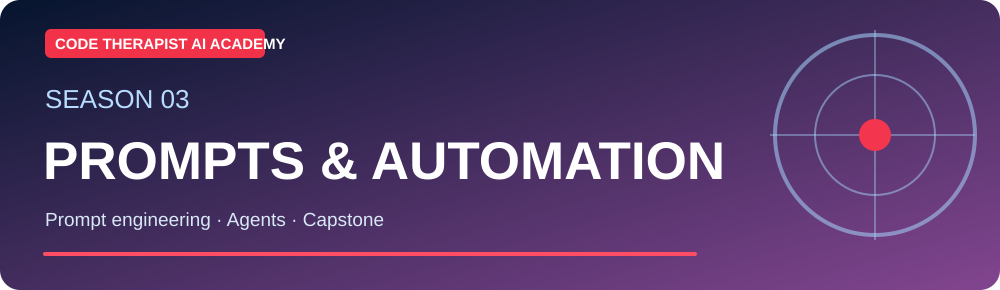
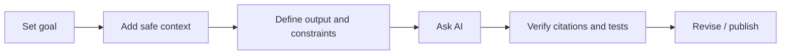

# 📝 Prompt Engineering Handbook — Code Therapist AI Academy

**Audience:** Students, professionals, content creators and software developers · **Reviewed:** 9 November 2026

[← AI Academy](./README.md) · [Class 09](./SEASON-03/CLASS-09-PROMPT-ENGINEERING.md) · [Advanced prompting](./SEASON-03/CLASS-10-ADVANCED-PROMPTING.md)

## The seven-part reliable prompt framework

| Part | What to write | Why it matters |
|---|---|---|
| **1. Objective** | “Explain,” “draft,” “classify,” “test” | Clarifies the action |
| **2. Audience** | “For a first-year student” | Sets level and vocabulary |
| **3. Context** | Allowed source text and project constraints | Reduces unfounded assumptions |
| **4. Scope** | Topic, timeframe, region and exclusions | Prevents an overly broad answer |
| **5. Format** | Markdown table, JSON, steps, code | Produces usable output |
| **6. Evidence** | Require links, calculations, executable tests | Supports verification |
| **7. Revision** | Review errors and request a corrected version | Improves results through feedback |



## Level 1 · Beginner template

```text
Task: Teach me [topic].
Audience: I am a beginner learning [subject].
Context: I already understand [prior knowledge].
Requirements: Use simple English and a Uganda-relevant example.
Output: 5 short sections, 1 example and 3 quiz questions.
Verification: State any assumptions; do not invent sources.
```

## Level 2 · Research template

```text
Question: [specific research question].
Period and place: [date range, country].
Sources: Prefer [official sources, peer-reviewed reports].
Method: Distinguish facts, claims, unknowns and opinions.
Output: Summary, dated timeline, evidence table and limitations.
Citation rule: Give a link for every material externally verifiable claim.
If the information cannot be verified, say so.
```

## Level 3 · Coding template

```text
Build a small Python function that [behavior].
Inputs: [types and examples]. Outputs: [expected types].
Constraints: Python 3, no unnecessary dependencies, no secrets.
Return: Code, 5 tests (normal, edge and invalid), explanation.
Do not claim tests ran unless you actually executed them.
```

## Level 4 · Structured data template

```text
Extract only these fields from the fictional product description:
sku (string), qty (integer), unit_price_ugx (integer).
Output valid JSON with exactly those fields.
Use null for unavailable values. Do not guess.
Description: "Sugar pack SUG001, 12 units, UGX 2600 each."
```

Expected example: `{"sku":"SUG001","qty":12,"unit_price_ugx":2600}`.

## Level 5 · Agent workflow template

```text
Goal: Prepare a public GitHub technology news draft.
Allowed actions: Read official public release notes and draft Markdown.
Not allowed: Send emails, modify repositories or publish without approval.
Before writing: Confirm event date, source date and previous articles.
Output: Proposed headline, facts, official sources, limitations, SVG diagram idea.
Stop and request review before any external state change.
```

## Typical prompt mistakes

- “Make it professional” without specifying audience or criteria.
- Asking for the “latest” without permitting live research or requiring a date.
- Treating a generated link or citation as verified without opening it.
- Asking AI to execute code or change files when it lacks tools.
- Pasting private customer/student information into an unapproved service.
- Optimizing prompts for style while ignoring accuracy, safety and permissions.

## Prompt comparison exercise

Start with **“Explain APIs.”** Then use this improved prompt:

> Explain REST-style APIs to a beginner computer-science student in Uganda. Use a restaurant analogy, then one HTTP GET example with illustrative JSON. Distinguish an API from a database. Provide a five-question quiz and two official documentation links. State any simplifications.

Grade both outputs (0–5) for clarity, factual accuracy, practical relevance and source quality. **Model response quality must be assessed, not assumed.**

## Source materials

- [OpenAI prompt engineering guide](https://platform.openai.com/docs/guides/prompt-engineering)
- [Anthropic prompting documentation](https://docs.anthropic.com/en/docs/build-with-claude/prompt-engineering/overview)
- [Microsoft Generative AI for Beginners](https://microsoft.github.io/generative-ai-for-beginners/)

[← Academy](./README.md)
