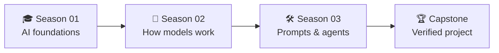

# 🤖 Code Therapist AI & Automation Academy

### Understand AI · Use AI responsibly · Build with AI

**12 practical classes · 3 seasons · 15 AI model family profiles · Prompt engineering · Dated AI news**

[Start Learning](./SEASON-01/README.md) · [Explore 15 Models](./MODEL-CATALOG.md) · [Prompt Engineering](./SEASON-03/CLASS-09-PROMPT-ENGINEERING.md) · [AI Updates](./NEWS/README.md)

> [!IMPORTANT]
> **Independent educational library, not a training certification authority.** Content is based on cited official sources and short original instructional explanations. Model versions, costs, policies and capabilities change. Course completion does not imply a professional credential. Exercises use fictional or consented data, not confidential company documents.

## 👋 Choose your learning pathway

| Learner | Recommended path | Expected outcome |
|---|---|---|
| **Curious beginner** | [Season 1 — Foundations](./SEASON-01/README.md) | Explain AI, history, types, careers and safe use |
| **Student / AI user** | [Season 2 — Models and tools](./SEASON-02/README.md) | Understand tokens, model training, evaluation, AI assistants and RAG |
| **Developer / prompt engineer** | [Season 3 — Build and automate](./SEASON-03/README.md) | Design stronger prompts, evaluate outputs, control tools and document a safe project |
| **Technology researcher** | [15-model catalog](./MODEL-CATALOG.md) | Study provenance and use cases of major AI families |
| **News follower** | [Dated AI updates](./NEWS/README.md) | Read model-card and release-note updates with primary sources |

## 🗂️ The complete three-season course

### Season 01 — Learn what AI is

| Class | Lesson |
|---|---|
| **01** | [What Is Artificial Intelligence?](./SEASON-01/CLASS-01-WHAT-IS-AI.md) |
| **02** | [A Short History of AI](./SEASON-01/CLASS-02-AI-HISTORY.md) |
| **03** | [AI Branches, Industries and Careers](./SEASON-01/CLASS-03-FIELDS-AND-JOBS.md) |
| **04** | [Responsible and Safe AI](./SEASON-01/CLASS-04-RESPONSIBLE-AI.md) |

### Season 02 — Understand and operate AI

| Class | Lesson |
|---|---|
| **05** | [Tokens, Transformers and LLMs](./SEASON-02/CLASS-05-HOW-LLMS-WORK.md) |
| **06** | [Model Training and Evaluation](./SEASON-02/CLASS-06-TRAINING-AND-EVALUATION.md) |
| **07** | [Practical AI Assistants](./SEASON-02/CLASS-07-PRACTICAL-AI-TOOLS.md) |
| **08** | [Multimodal AI, Search and RAG](./SEASON-02/CLASS-08-MULTIMODAL-RAG.md) |

### Season 03 — Prompt engineering and AI development

| Class | Lesson |
|---|---|
| **09** | [Prompt Engineering Fundamentals](./SEASON-03/CLASS-09-PROMPT-ENGINEERING.md) |
| **10** | [Advanced Prompt Patterns and Evaluation](./SEASON-03/CLASS-10-ADVANCED-PROMPTING.md) |
| **11** | [AI Agents, MCP, Tools and Automation](./SEASON-03/CLASS-11-AGENTS-AND-AUTOMATION.md) |
| **12** | [Final Capstone: Responsible AI Workflow](./SEASON-03/CLASS-12-FINAL-CAPSTONE.md) |

**[Explore the dedicated prompt engineering study guide →](./PROMPT-ENGINEERING-HANDBOOK.md)**

## 🔍 15 AI model families

**[Open the full comparison and individual profiles →](./MODEL-CATALOG.md)**

GPT/ChatGPT · Claude · Gemini · Grok · Llama · DeepSeek · Qwen · Mistral · Phi · Gemma · Cohere Command · IBM Granite · Amazon Nova · Kimi · Perplexity Sonar.

Each profile has a historical background, intended use, classroom demonstration, ethical and technical questions and official reference links. **This is not a performance ranking.**

## 📚 Study rules

- Read one lecture and its sources before using a chatbot to complete its exercise.
- Write your *own explanation* in 3–5 sentences and complete the practical lab.
- Keep test results, model versions and source dates in your learning journal.
- Never claim a tutorial is free for every user; plans and regions differ.
- Do not submit real student grades, personal IDs, passwords, bank data or private company materials to third-party models without authorization.
- For code, **run tests**; for facts, open original sources; for financial or security decisions, use qualified review.

## 🆕 Latest sourced AI research

**[Read the 9 November release watch](./NEWS/2026-11-09-MODEL-RELEASE-WATCH.md)** — Gemini 4 Carbon, Claude Haiku 5.5 and OpenAI Images 2.6. Each update distinguishes release dates from rollout and treats manufacturer evaluations as claims.

## 📰 AI news and daily updates

**[AI news digest with source dates](./NEWS/README.md)** is a curated educational log. It is **not** a live automatic news feed; dated entries are added only after verification.

## Further official learning paths

- [Google Machine Learning Crash Course](https://developers.google.com/machine-learning/crash-course)
- [Microsoft: Generative AI for Beginners — 21 lessons](https://microsoft.github.io/generative-ai-for-beginners/)
- [Microsoft Learn: Introduction to Generative AI and Agents](https://learn.microsoft.com/en-us/training/modules/fundamentals-generative-ai/)
- [Google Cloud AI training paths](https://cloud.google.com/learn/training/machinelearning-ai)

---

**Published by Code Therapist / ByteLab Uganda Ltd** · [Knowledge Hub](../../README.md) · [Developer profile](https://github.com/codetherapistpita-oss)

Last editorial review: 9 November 2026. Updated reports will retain historical dates and state clearly what changed.
