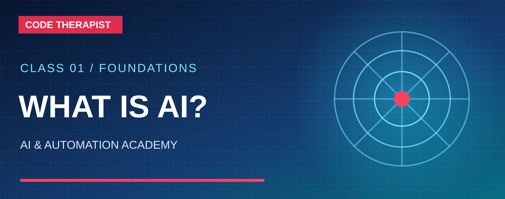
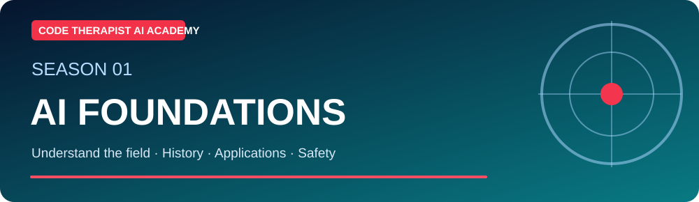
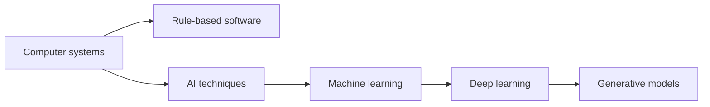

# S1-C01 · What Is Artificial Intelligence?

**Season One — AI Foundations** · **Level:** Absolute beginner · **Published:** 9 November 2026

[← Season One](./README.md) · [AI Academy](../README.md) · [Next season](../SEASON-02/README.md)

> **Learning outcome:** Artificial intelligence (AI) is the broad field of building computer systems that can carry out tasks associated with intelligent behavior, such as interpreting language, recognizing patterns, predicting outcomes and planning actions. Not all AI is generative AI.

## 🎓 Lecture and key definitions

1. **AI vs automation:** A fixed rule that emails a receipt is automation; a trained classifier that recognizes likely spam is machine learning. Systems often combine both.

2. **AI vs machine learning:** Machine learning is a major approach to AI in which systems learn patterns from examples rather than relying entirely on handwritten rules.

3. **Generative AI:** models that produce new text, images, audio, code or other outputs. These outputs can be wrong and are not independent proof.

4. **Everyday examples:** spam filtering, navigation predictions, speech recognition, recommendation systems and assistants.

## 🧭 Concept diagram

## 🧪 Guided class activity

List 10 technologies around you. Classify each as rule-based automation, machine learning, or a combination, and explain the evidence for your classification.

### Instructor walkthrough

1. Read the lesson objective aloud and ask learners to explain each new term in their own words.
2. Demonstrate one familiar computer example or use an entirely **fictional** dataset.
3. Draw the above workflow on a board or in diagrams.net.
4. Have learners explain one limitation or misconception, and record disagreements.
5. Check official sources and revise any incorrect conclusions.

## ✍️ Assignment and quiz

1. Define the main concept in no more than 60 words.
2. Give one application for students and one for a Ugandan small business.
3. Describe two risks or limitations and how to test them.
4. Explain the diagram, moving from left to right or top to bottom.

**Assessment rubric (10 marks):** accurate terminology (3), relevant examples (2), diagram comprehension (2), limitations and evidence (3). Do not claim a certificate without a completed assessment.

## 📚 Official learning resources

- [Primary education/reference 1](https://developers.google.com/machine-learning/intro-to-ml)
- [Primary education/reference 2](https://learn.microsoft.com/en-us/training/modules/fundamentals-generative-ai/)

**Learning note:** This is an original guided lecture summary linking to existing external materials, not a reproduction of those materials. Model availability and policy details change.

[← Academy home](../README.md)
