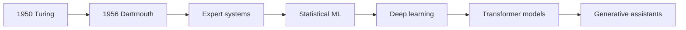

# S1-C02 · A Short History of Artificial Intelligence

**Season One — AI Foundations** · **Level:** Beginner · **Published:** 9 November 2026

[← Season One](./README.md) · [AI Academy](../README.md) · [Next season](../SEASON-02/README.md)

> **Learning outcome:** The history of AI includes early symbolic reasoning, data-driven machine learning, modern deep learning and the recent rise of large generative models. Developments build on decades of mathematics, neuroscience, statistics and computing.

## 🎓 Lecture and key definitions

1. **1950:** Alan Turing discussed machine intelligence and imitation-game tests; these are historical starting points, not a proof modern AI thinks like a person.

2. **1956:** Dartmouth summer research project is frequently cited as a foundational event for the term artificial intelligence.

3. **1980s–2000s:** machine learning, probabilistic methods, computing infrastructure and data resources expanded.

4. **2012 onward:** deep learning grew quickly in speech and vision; transformer architectures (2017) became central to many later language models.

5. **2020s:** conversational and multimodal generative AI products became widely used, with newer capabilities and ongoing safety questions.

## 🧭 Concept diagram

## 🧪 Guided class activity

Create an illustrated five-event history timeline, including exact dates and direct historical sources. Keep 'first' claims precise and explain differing definitions.

### Instructor walkthrough

1. Read the lesson objective aloud and ask learners to explain each new term in their own words.
2. Demonstrate one familiar computer example or use an entirely **fictional** dataset.
3. Draw the above workflow on a board or in diagrams.net.
4. Have learners explain one limitation or misconception, and record disagreements.
5. Check official sources and revise any incorrect conclusions.

## ✍️ Assignment and quiz

1. Define the main concept in no more than 60 words.
2. Give one application for students and one for a Ugandan small business.
3. Describe two risks or limitations and how to test them.
4. Explain the diagram, moving from left to right or top to bottom.

**Assessment rubric (10 marks):** accurate terminology (3), relevant examples (2), diagram comprehension (2), limitations and evidence (3). Do not claim a certificate without a completed assessment.

## 📚 Official learning resources

- [Primary education/reference 1](https://www-formal.stanford.edu/jmc/history/dartmouth/dartmouth.html)
- [Primary education/reference 2](https://arxiv.org/abs/1706.03762)

**Learning note:** This is an original guided lecture summary linking to existing external materials, not a reproduction of those materials. Model availability and policy details change.

[← Academy home](../README.md)
