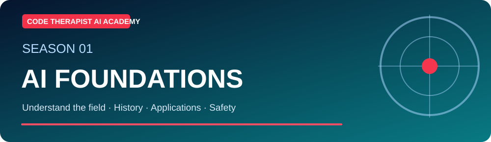
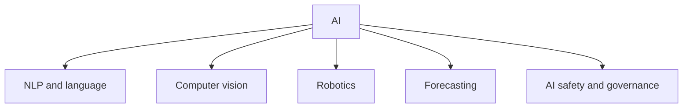

# S1-C03 · Branches of AI, Careers and Real Uses

**Season One — AI Foundations** · **Level:** Beginner · **Published:** 9 November 2026

[← Season One](./README.md) · [AI Academy](../README.md) · [Next season](../SEASON-02/README.md)

> **Learning outcome:** AI is not one job or one chatbot. It spans machine learning, natural-language processing, computer vision, speech, robotics, search, optimization and responsible governance.

## 🎓 Lecture and key definitions

1. **Natural language processing:** classify text, translate and answer questions.

2. **Computer vision:** classify images or detect objects with consent and suitable validation.

3. **Robotics:** perception, planning and control of physical systems.

4. **Data science and ML engineering:** data cleaning, training, evaluating and deploying models.

5. **AI product and security roles:** workflow design, data governance, testing, red-teaming, risk management and user research.

6. **Uganda examples:** farming crop imagery, student helpdesks, retail inventory forecasting and multilingual learning—each requires local data validation.

## 🧭 Concept diagram

## 🧪 Guided class activity

Choose one local problem. Write: target user, input data, expected output, risks, metric, human reviewer, and whether AI is actually necessary.

### Instructor walkthrough

1. Read the lesson objective aloud and ask learners to explain each new term in their own words.
2. Demonstrate one familiar computer example or use an entirely **fictional** dataset.
3. Draw the above workflow on a board or in diagrams.net.
4. Have learners explain one limitation or misconception, and record disagreements.
5. Check official sources and revise any incorrect conclusions.

## ✍️ Assignment and quiz

1. Define the main concept in no more than 60 words.
2. Give one application for students and one for a Ugandan small business.
3. Describe two risks or limitations and how to test them.
4. Explain the diagram, moving from left to right or top to bottom.

**Assessment rubric (10 marks):** accurate terminology (3), relevant examples (2), diagram comprehension (2), limitations and evidence (3). Do not claim a certificate without a completed assessment.

## 📚 Official learning resources

- [Primary education/reference 1](https://developers.google.com/machine-learning)
- [Primary education/reference 2](https://www.nist.gov/itl/ai-risk-management-framework)

**Learning note:** This is an original guided lecture summary linking to existing external materials, not a reproduction of those materials. Model availability and policy details change.

[← Academy home](../README.md)
