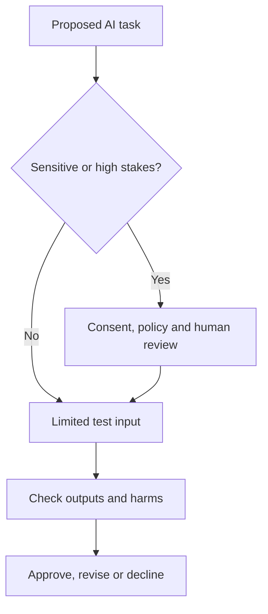

# S1-C04 · Safe and Responsible AI Use

**Season One — AI Foundations** · **Level:** Beginner · **Published:** 9 November 2026

[← Season One](./README.md) · [AI Academy](../README.md) · [Next season](../SEASON-02/README.md)

> **Learning outcome:** AI tools can be useful but may hallucinate facts, mirror bias, reveal private input or automate inappropriate actions. Responsible use starts with consent, transparency, review and accountable people.

## 🎓 Lecture and key definitions

1. **Accuracy:** check citations, arithmetic and code; plausible writing is not verified truth.

2. **Privacy:** avoid submitting private student records, passwords, financial statements or client secrets without authorization.

3. **Fairness:** test outcomes across relevant groups and use cases instead of assuming one prompt works universally.

4. **Security:** treat tool responses and external webpages as untrusted data; never follow surprise commands embedded in retrieved text.

5. **Human oversight:** for medical, legal, financial and academic decisions, consult qualified sources and retain accountable review.

## 🧭 Concept diagram

## 🧪 Guided class activity

Review a hypothetical school chatbot proposal and write five privacy or fairness safeguards before deployment.

### Instructor walkthrough

1. Read the lesson objective aloud and ask learners to explain each new term in their own words.
2. Demonstrate one familiar computer example or use an entirely **fictional** dataset.
3. Draw the above workflow on a board or in diagrams.net.
4. Have learners explain one limitation or misconception, and record disagreements.
5. Check official sources and revise any incorrect conclusions.

## ✍️ Assignment and quiz

1. Define the main concept in no more than 60 words.
2. Give one application for students and one for a Ugandan small business.
3. Describe two risks or limitations and how to test them.
4. Explain the diagram, moving from left to right or top to bottom.

**Assessment rubric (10 marks):** accurate terminology (3), relevant examples (2), diagram comprehension (2), limitations and evidence (3). Do not claim a certificate without a completed assessment.

## 📚 Official learning resources

- [Primary education/reference 1](https://www.nist.gov/itl/ai-risk-management-framework)
- [Primary education/reference 2](https://developers.google.com/machine-learning/responsible-ai)

**Learning note:** This is an original guided lecture summary linking to existing external materials, not a reproduction of those materials. Model availability and policy details change.

[← Academy home](../README.md)
