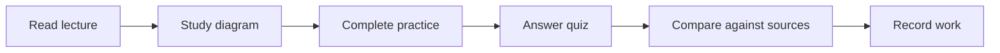

# 🎓 Season 1 — AI Foundations

**Level:** Beginner · **4 guided classes** · **Published:** 9 November 2026

[← AI Academy](../README.md) · [15 AI model families](../MODEL-CATALOG.md)

> What AI is, where it came from, major applications and safe use

## Study plan

| Class | Topic |
|---|---|
| **[Class 01 — What Is AI?](./CLASS-01-WHAT-IS-AI.md)** | Lecture, diagram, lab exercise, quiz and official sources |
| **[Class 02 — AI History](./CLASS-02-AI-HISTORY.md)** | Lecture, diagram, lab exercise, quiz and official sources |
| **[Class 03 — AI Fields and Careers](./CLASS-03-FIELDS-AND-JOBS.md)** | Lecture, diagram, lab exercise, quiz and official sources |
| **[Class 04 — Responsible AI](./CLASS-04-RESPONSIBLE-AI.md)** | Lecture, diagram, lab exercise, quiz and official sources |

## Recommended progression

### Study routine

For each class, read the original Code Therapist lecture, explain the main concept without looking at notes, complete the safe lab and submit a one-page reflection. Learners should **record real results and questions**. A badge or certificate is not automatically awarded by reading a page.

### Next step

Continue to [Season 2](../SEASON-02/README.md) after demonstrating understanding of the current lessons.

**Supplemental references:** [Microsoft Generative AI for Beginners](https://microsoft.github.io/generative-ai-for-beginners/) · [Google Machine Learning Crash Course](https://developers.google.com/machine-learning/crash-course) · [Microsoft Learn Generative AI](https://learn.microsoft.com/en-us/training/modules/fundamentals-generative-ai/)

[← Academy](../README.md)
