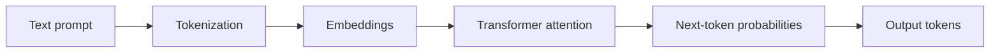

# S2-C05 · How Large Language Models Work

**Season Two — How AI Works and Practical Use** · **Level:** Beginner → Intermediate · **Published:** 9 November 2026

[← Season Two](./README.md) · [AI Academy](../README.md)

> **Lesson objective:** LLMs predict tokens from context based on learned statistical patterns. Tokenization, embeddings, transformer attention, training and inference are distinct parts of the story.

## 01 · Instructor lecture

1. **Tokenization:** text is represented as pieces or tokens; a word may contain multiple tokens.

2. **Embeddings:** numbers represent learned patterns in text or other signals.

3. **Transformers:** neural-network architectures use attention to relate positions in a sequence.

4. **Pretraining:** large datasets and optimization produce model weights; later post-training can tune responses and behavior.

5. **Inference:** a deployed model processes a prompt and generates output progressively. A fluent answer can still be false.

## 02 · Technical diagram

## 03 · Practical demonstration

Write the sentence 'AI helps farmers.' and explain that the exact number of tokens depends on the model tokenizer. Describe why a larger context window does not guarantee correctness.

### Learner workflow

1. Restate the research question or task in a sentence.
2. Prepare non-confidential examples and identify expected outcomes.
3. Run an appropriate software demonstration or draw the conceptual flow.
4. Compare actual output to your expected answer using evidence and tests.
5. Summarize findings and three limitations in a short lab notebook.

## 04 · Self-assessment

- Explain three technical terms from this lecture.
- Identify the boundary between a model and an external tool or data source.
- Describe one possible failure and a test that could catch it.
- State what you would change before using the method with real customer or student records.

**Marking guide (10):** concepts (3), practical method (3), evidence (2), privacy/limitations (2).

## Sources and additional courses

- [Official training material](https://developers.google.com/machine-learning/crash-course)
- [Further reading](https://arxiv.org/abs/1706.03762)
- [Microsoft's public beginner generative AI curriculum](https://microsoft.github.io/generative-ai-for-beginners/)

> **Important:** Generated text is probabilistic and can be wrong. This class includes educational diagrams, not claims of verified systems deployed by ByteLab.

[← Academy](../README.md)
