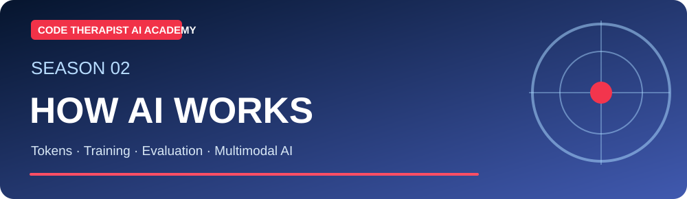
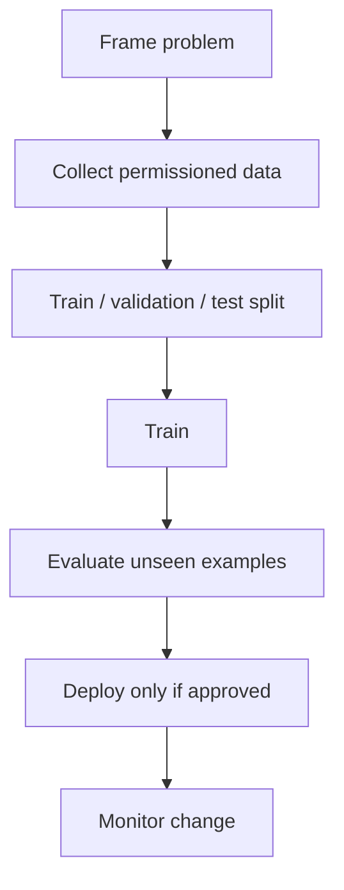

# S2-C06 · Training, Testing and Evaluating AI

**Season Two — How AI Works and Practical Use** · **Level:** Beginner → Intermediate · **Published:** 9 November 2026

[← Season Two](./README.md) · [AI Academy](../README.md)

> **Lesson objective:** Machine-learning development usually moves from problem framing through data preparation, model training, evaluation and monitoring. Test data must be distinct from training examples.

## 01 · Instructor lecture

1. **Define success:** specify an observable outcome, such as classifying spam accurately.

2. **Data split:** train, validation and test sets help detect overfitting and avoid leakage.

3. **Metrics:** accuracy is sometimes inadequate; look at precision, recall, false alarms and errors across groups.

4. **Shift:** real-world inputs may differ from training data after deployment.

5. **Generative evaluations:** verify factual claims, instructions, safety, tool behavior and user outcomes. Do not trust a self-graded model alone.

## 02 · Technical diagram

## 03 · Practical demonstration

Take a fictional dataset of 30 items, reserve six for testing, and identify three ways evaluation could be misleading.

### Learner workflow

1. Restate the research question or task in a sentence.
2. Prepare non-confidential examples and identify expected outcomes.
3. Run an appropriate software demonstration or draw the conceptual flow.
4. Compare actual output to your expected answer using evidence and tests.
5. Summarize findings and three limitations in a short lab notebook.

## 04 · Self-assessment

- Explain three technical terms from this lecture.
- Identify the boundary between a model and an external tool or data source.
- Describe one possible failure and a test that could catch it.
- State what you would change before using the method with real customer or student records.

**Marking guide (10):** concepts (3), practical method (3), evidence (2), privacy/limitations (2).

## Sources and additional courses

- [Official training material](https://developers.google.com/machine-learning/crash-course)
- [Further reading](https://developers.google.com/machine-learning/guides)
- [Microsoft's public beginner generative AI curriculum](https://microsoft.github.io/generative-ai-for-beginners/)

> **Important:** Generated text is probabilistic and can be wrong. This class includes educational diagrams, not claims of verified systems deployed by ByteLab.

[← Academy](../README.md)
