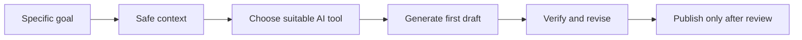

# S2-C07 · Practical Use of AI Assistants

**Season Two — How AI Works and Practical Use** · **Level:** Beginner → Intermediate · **Published:** 9 November 2026

[← Season Two](./README.md) · [AI Academy](../README.md)

> **Lesson objective:** Using ChatGPT, Claude, Gemini and other AI applications starts with a defined task, safe context, clear expected output and verification. Different tools, features and account entitlements vary.

## 01 · Instructor lecture

1. **Research:** request an outline, trace factual claims to original sources and check publication dates.

2. **Learning:** ask for explanations, worked examples, quizzes and progressive hints.

3. **Coding:** request a small function, generate tests, run the function and examine errors.

4. **Writing:** ask for a draft, not unsupported claims; preserve your own voice and confidentiality.

5. **Data analysis:** use anonymized sample data and independently validate formulas and totals.

## 02 · Technical diagram

## 03 · Practical demonstration

Ask two assistants to explain JavaScript conditional operators to a beginner; score clarity, correctness, tested examples and citations. Do not upload private IDs or academic marks.

### Learner workflow

1. Restate the research question or task in a sentence.
2. Prepare non-confidential examples and identify expected outcomes.
3. Run an appropriate software demonstration or draw the conceptual flow.
4. Compare actual output to your expected answer using evidence and tests.
5. Summarize findings and three limitations in a short lab notebook.

## 04 · Self-assessment

- Explain three technical terms from this lecture.
- Identify the boundary between a model and an external tool or data source.
- Describe one possible failure and a test that could catch it.
- State what you would change before using the method with real customer or student records.

**Marking guide (10):** concepts (3), practical method (3), evidence (2), privacy/limitations (2).

## Sources and additional courses

- [Official training material](https://learn.microsoft.com/en-us/training/modules/fundamentals-generative-ai/)
- [Further reading](https://www.grow.google/ai/)
- [Microsoft's public beginner generative AI curriculum](https://microsoft.github.io/generative-ai-for-beginners/)

> **Important:** Generated text is probabilistic and can be wrong. This class includes educational diagrams, not claims of verified systems deployed by ByteLab.

[← Academy](../README.md)
