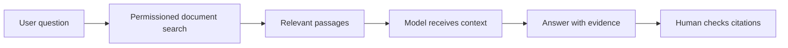

# S2-C08 · Multimodal AI, Search and RAG

**Season Two — How AI Works and Practical Use** · **Level:** Beginner → Intermediate · **Published:** 9 November 2026

[← Season Two](./README.md) · [AI Academy](../README.md)

> **Lesson objective:** Multimodal AI handles different input/output formats (such as text and images). Retrieval-augmented generation (RAG) retrieves relevant external documents to give a model task-specific context.

## 01 · Instructor lecture

1. **Multimodal:** input may include images, audio, video or text depending on the selected service.

2. **RAG:** a search/retrieval component selects document passages before the model drafts an answer.

3. **Citations:** a cited document still needs verification; citations can be irrelevant or insufficient.

4. **Permissions:** retrieval must respect file-level access and organizational policy.

5. **Limitations:** retrieval misses information, models can misread passages, and tool outputs may carry adversarial instructions.

## 02 · Technical diagram

## 03 · Practical demonstration

Write two fictional paragraphs about shop stock policies; answer a question by quoting the exact source paragraph without inventing an extra policy.

### Learner workflow

1. Restate the research question or task in a sentence.
2. Prepare non-confidential examples and identify expected outcomes.
3. Run an appropriate software demonstration or draw the conceptual flow.
4. Compare actual output to your expected answer using evidence and tests.
5. Summarize findings and three limitations in a short lab notebook.

## 04 · Self-assessment

- Explain three technical terms from this lecture.
- Identify the boundary between a model and an external tool or data source.
- Describe one possible failure and a test that could catch it.
- State what you would change before using the method with real customer or student records.

**Marking guide (10):** concepts (3), practical method (3), evidence (2), privacy/limitations (2).

## Sources and additional courses

- [Official training material](https://microsoft.github.io/generative-ai-for-beginners/)
- [Further reading](https://docs.cohere.com/docs/retrieval-augmented-generation-rag)
- [Microsoft's public beginner generative AI curriculum](https://microsoft.github.io/generative-ai-for-beginners/)

> **Important:** Generated text is probabilistic and can be wrong. This class includes educational diagrams, not claims of verified systems deployed by ByteLab.

[← Academy](../README.md)
