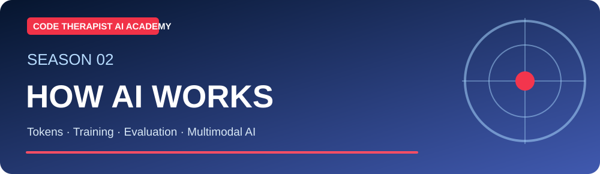
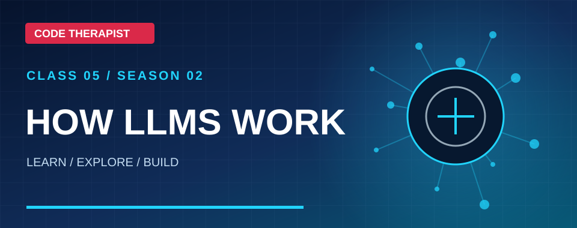
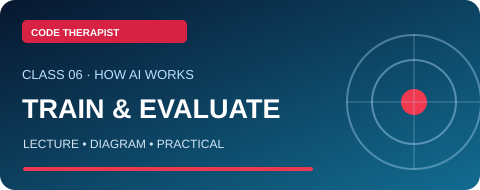
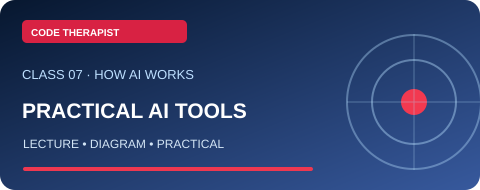
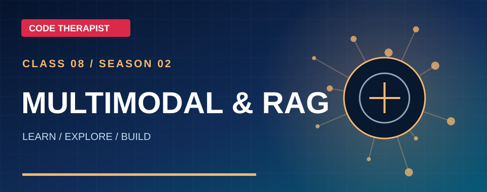
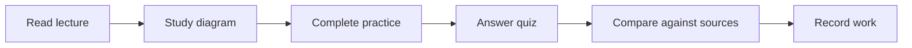

# 🎓 Season 2 — How AI Works and Practical Use

**Level:** Beginner to Intermediate · **4 guided classes** · **Published:** 9 November 2026

[← AI Academy](../README.md) · [15 AI model families](../MODEL-CATALOG.md)

> Tokens, model training, evaluation, assistants, multimodal processing and RAG

## Study plan — visual lesson cards

| Class | Small landscape card | Lesson | Open |
|:---:|:---|---|:---|
| **05** |  | **How LLMs Work** | [Read & Study](./CLASS-05-HOW-LLMS-WORK.md) |
| **06** |  | **Training and Evaluation** | [Read & Study](./CLASS-06-TRAINING-AND-EVALUATION.md) |
| **07** |  | **Practical AI Tools** | [Read & Study](./CLASS-07-PRACTICAL-AI-TOOLS.md) |
| **08** |  | **Multimodal AI and RAG** | [Read & Study](./CLASS-08-MULTIMODAL-RAG.md) |

## Recommended progression

### Study routine

For each class, read the original Code Therapist lecture, explain the main concept without looking at notes, complete the safe lab and submit a one-page reflection. Learners should **record real results and questions**. A badge or certificate is not automatically awarded by reading a page.

### Next step

Continue to [Season 3](../SEASON-03/README.md) after demonstrating understanding of the current lessons.

**Supplemental references:** [Microsoft Generative AI for Beginners](https://microsoft.github.io/generative-ai-for-beginners/) · [Google Machine Learning Crash Course](https://developers.google.com/machine-learning/crash-course) · [Microsoft Learn Generative AI](https://learn.microsoft.com/en-us/training/modules/fundamentals-generative-ai/)

[← Academy](../README.md)
