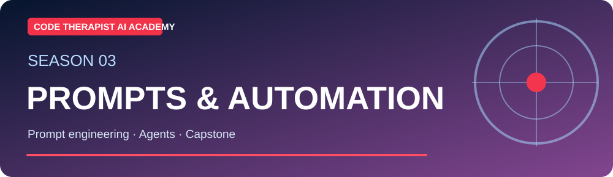
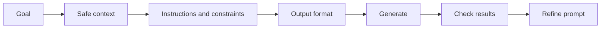

# S3-C09 · Prompt Engineering: From First Prompt to Structured Results

**Season Three — Prompting, AI Applications & Automation** · **Level:** Intermediate / Applied · **Published:** 9 November 2026

[← Season Three](./README.md) · [AI Academy](../README.md) · [15 AI models](../MODEL-CATALOG.md)

> **Learning objective:** Write a better prompt by specifying the goal, relevant context, constraints, a clear output format and acceptance criteria. Iterate based on real evaluation, not ritual 'magic phrases'.

## 01 · Detailed lecture

1. **Goal:** State the task explicitly: summarize, classify, teach, compare, debug or draft.

2. **Context:** Provide relevant, authorized source material and audience details. Do not paste secrets or customer documents without approval.

3. **Constraints:** Set length, language, reading level, excluded content and citation rules.

4. **Format:** Request Markdown table, JSON object, code block or numbered explanation only if that helps.

5. **Verification:** Ask the model to label assumptions, uncertainty, test calculations and support external claims with sources.

6. **Iteration:** Review the answer, give targeted feedback and save successful patterns for reuse.

## 02 · Architecture and method

## 03 · Guided laboratory

Improve 'Explain computers' into: 'Teach a 15-year-old student in Uganda what RAM, SSD and CPU do. Use 3 simple analogies, one comparison table, and a 5-question quiz. Avoid unsupported speed claims.' Compare both answers.

### Practice steps

1. Write your objective and the expected output before selecting a tool.
2. Use publicly shareable or synthetic content; avoid sensitive inputs.
3. Implement one small case and record the product/model version if known.
4. Test success, failure and out-of-scope situations.
5. Revise using observed evidence, then write a reusable reflection.

## 04 · Course questions and assignment

- Explain the objective and three important terms in your own words.
- Show a small working example or a documented proposed workflow.
- Identify at least two risks and two safeguards.
- Describe how you evaluated the output and whether the result was reproducible.

**Assessment rubric (20 marks):** objective and clarity (4), technical accuracy (5), practical evidence (5), safeguards (4), sources and documentation (2).

## 05 · Verified reference materials

- [Primary learning guide](https://platform.openai.com/docs/guides/prompt-engineering)
- [Additional technical reference](https://docs.anthropic.com/en/docs/build-with-claude/prompt-engineering/overview)
- [Microsoft: Generative AI for Beginners](https://microsoft.github.io/generative-ai-for-beginners/)

> **Safety:** AI outputs can be inaccurate, and connected tools can make real changes. Do not interpret model confidence as proof or execute unverified suggested commands against real systems.

[← AI Academy](../README.md)
