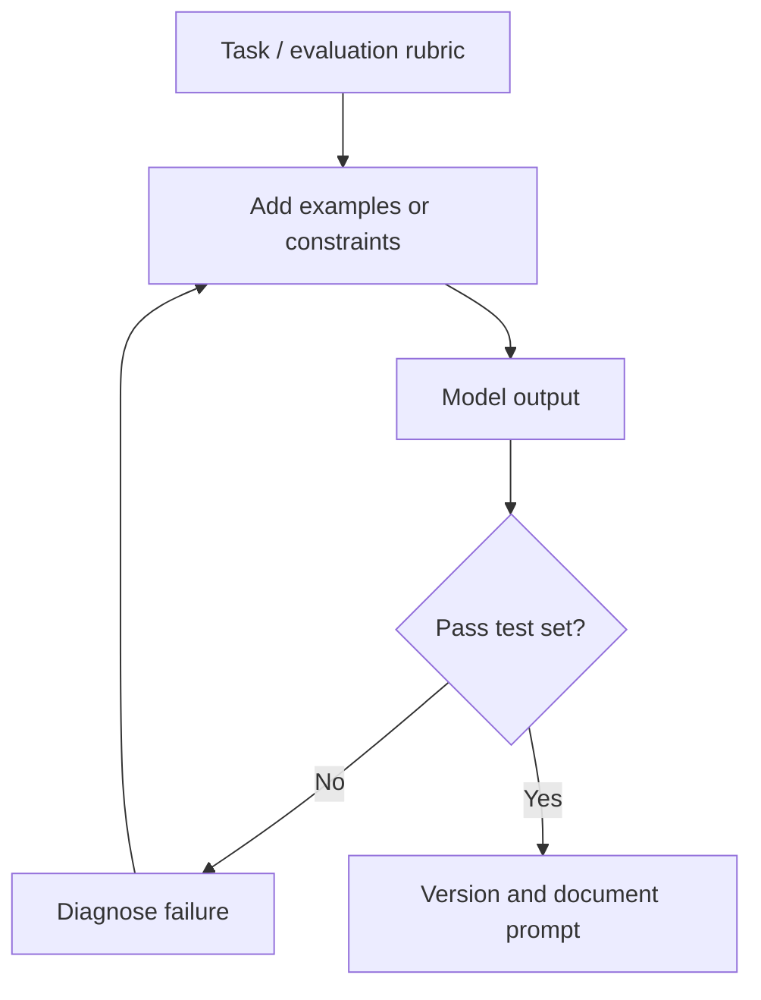

# S3-C10 · Advanced Prompt Patterns, Examples and Evaluation

**Season Three — Prompting, AI Applications & Automation** · **Level:** Intermediate / Applied · **Published:** 9 November 2026

[← Season Three](./README.md) · [AI Academy](../README.md) · [15 AI models](../MODEL-CATALOG.md)

> **Learning objective:** Useful prompting patterns include examples, decomposition, structured output constraints, tool use and self-checks. Their benefits depend on the model and task, and should be validated.

## 01 · Detailed lecture

1. **Few-shot examples:** Show two correctly labeled instances before requesting a classification.

2. **Decomposition:** Split a large job into research, outline, draft and evidence review.

3. **Structured outputs:** Use explicit fields and schema validation where an API supports it.

4. **Tool requests:** Clarify which tools or sources are authorized; do not presume the model actually used a tool.

5. **Evaluation:** Write a rubric, collect test prompts, compare accuracy and failure modes across model versions.

6. **Prompt injection:** Treat external documents as data, not instructions. Never allow a retrieved page to override system permissions.

## 02 · Architecture and method

## 03 · Guided laboratory

Create a three-field JSON extraction prompt for simulated product stock (`sku`, `qty`, `unit_price_ugx`), test on five fictional sentences, and manually verify every field.

### Practice steps

1. Write your objective and the expected output before selecting a tool.
2. Use publicly shareable or synthetic content; avoid sensitive inputs.
3. Implement one small case and record the product/model version if known.
4. Test success, failure and out-of-scope situations.
5. Revise using observed evidence, then write a reusable reflection.

## 04 · Course questions and assignment

- Explain the objective and three important terms in your own words.
- Show a small working example or a documented proposed workflow.
- Identify at least two risks and two safeguards.
- Describe how you evaluated the output and whether the result was reproducible.

**Assessment rubric (20 marks):** objective and clarity (4), technical accuracy (5), practical evidence (5), safeguards (4), sources and documentation (2).

## 05 · Verified reference materials

- [Primary learning guide](https://microsoft.github.io/generative-ai-for-beginners/)
- [Additional technical reference](https://platform.openai.com/docs/guides/structured-outputs)
- [Microsoft: Generative AI for Beginners](https://microsoft.github.io/generative-ai-for-beginners/)

> **Safety:** AI outputs can be inaccurate, and connected tools can make real changes. Do not interpret model confidence as proof or execute unverified suggested commands against real systems.

[← AI Academy](../README.md)
