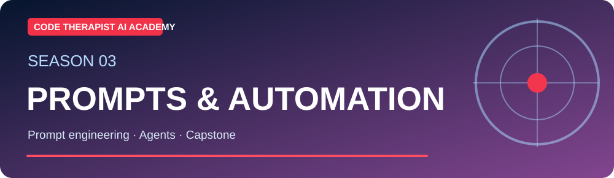
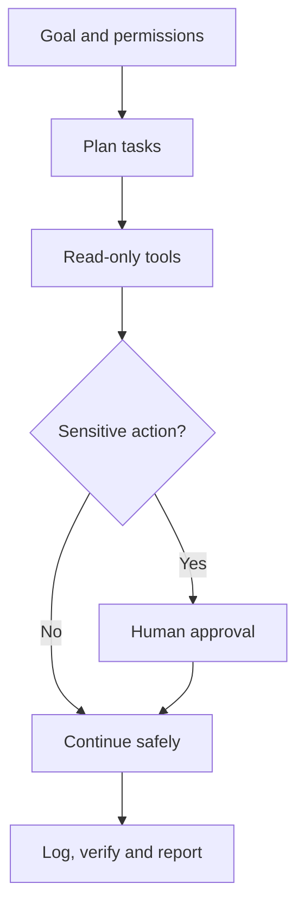

# S3-C11 · AI Agents, Tools and Safe Automation

**Season Three — Prompting, AI Applications & Automation** · **Level:** Intermediate / Applied · **Published:** 9 November 2026

[← Season Three](./README.md) · [AI Academy](../README.md) · [15 AI models](../MODEL-CATALOG.md)

> **Learning objective:** An agentic system may call external tools and pursue multi-step goals under configured permissions. A chatbot responding in text is not the same as software that can write files, send messages or move money.

## 01 · Detailed lecture

1. **Model vs agent:** the model produces reasoning/output; an agent orchestrates decisions, tools and state.

2. **Tool permissions:** read-only actions are different from changes, sends, payments and deletions.

3. **Human approval:** require confirmation for sensitive and irreversible operations.

4. **Logs and rollback:** keep run IDs, change history and recovery paths.

5. **Evaluation:** test wrong targets, duplicate actions, prompt injection, unavailable tools and unexpected network changes.

6. **Business automation:** start with a simulated daily inventory summary, not autonomous payments.

## 02 · Architecture and method

## 03 · Guided laboratory

Plan an AI agent that reads public GitHub releases and drafts a change summary. Identify exactly which action needs approval before updating any repository files.

### Practice steps

1. Write your objective and the expected output before selecting a tool.
2. Use publicly shareable or synthetic content; avoid sensitive inputs.
3. Implement one small case and record the product/model version if known.
4. Test success, failure and out-of-scope situations.
5. Revise using observed evidence, then write a reusable reflection.

## 04 · Course questions and assignment

- Explain the objective and three important terms in your own words.
- Show a small working example or a documented proposed workflow.
- Identify at least two risks and two safeguards.
- Describe how you evaluated the output and whether the result was reproducible.

**Assessment rubric (20 marks):** objective and clarity (4), technical accuracy (5), practical evidence (5), safeguards (4), sources and documentation (2).

## 05 · Verified reference materials

- [Primary learning guide](https://modelcontextprotocol.io/introduction)
- [Additional technical reference](https://learn.microsoft.com/en-us/training/modules/fundamentals-generative-ai/)
- [Microsoft: Generative AI for Beginners](https://microsoft.github.io/generative-ai-for-beginners/)

> **Safety:** AI outputs can be inaccurate, and connected tools can make real changes. Do not interpret model confidence as proof or execute unverified suggested commands against real systems.

[← AI Academy](../README.md)
