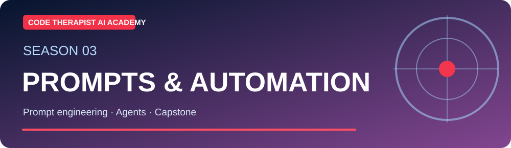
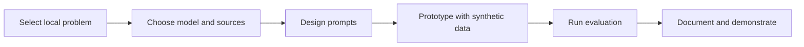

# S3-C12 · Capstone: Build and Present a Responsible AI Workflow

**Season Three — Prompting, AI Applications & Automation** · **Level:** Intermediate / Applied · **Published:** 9 November 2026

[← Season Three](./README.md) · [AI Academy](../README.md) · [15 AI models](../MODEL-CATALOG.md)

> **Learning objective:** Combine core AI knowledge, model selection, prompt engineering, evaluation, safety and documentation in one defensible course project.

## 01 · Detailed lecture

1. **Project brief:** build a *simulated* AI assistant that answers beginner Python questions from an approved document set.

2. **Model choice:** compare at least two families from the catalog against quality, deployment mode and privacy.

3. **Prompt design:** define task, examples, scope, output structure and refusal limits.

4. **Retrieval:** use only public or synthetic source documents; cite the exact paragraphs relevant to answers.

5. **Testing:** create ten questions with known expected answers; include unknown-answer and malicious-instruction cases.

6. **Presentation:** show an architecture diagram, evaluation results, risks, improvements and lessons learned.

## 02 · Architecture and method

## 03 · Guided laboratory

Deliver a GitHub README, architecture diagram, ten test cases, an evaluation table with observed results, a short demonstration script and a limitations section. Use actual test results, not invented success percentages.

### Practice steps

1. Write your objective and the expected output before selecting a tool.
2. Use publicly shareable or synthetic content; avoid sensitive inputs.
3. Implement one small case and record the product/model version if known.
4. Test success, failure and out-of-scope situations.
5. Revise using observed evidence, then write a reusable reflection.

## 04 · Course questions and assignment

- Explain the objective and three important terms in your own words.
- Show a small working example or a documented proposed workflow.
- Identify at least two risks and two safeguards.
- Describe how you evaluated the output and whether the result was reproducible.

**Assessment rubric (20 marks):** objective and clarity (4), technical accuracy (5), practical evidence (5), safeguards (4), sources and documentation (2).

## 05 · Verified reference materials

- [Primary learning guide](https://developers.google.com/machine-learning/crash-course)
- [Additional technical reference](https://www.nist.gov/itl/ai-risk-management-framework)
- [Microsoft: Generative AI for Beginners](https://microsoft.github.io/generative-ai-for-beginners/)

> **Safety:** AI outputs can be inaccurate, and connected tools can make real changes. Do not interpret model confidence as proof or execute unverified suggested commands against real systems.

[← AI Academy](../README.md)
