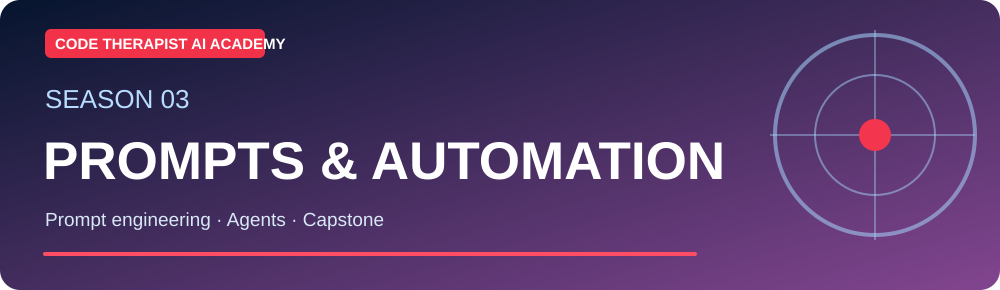
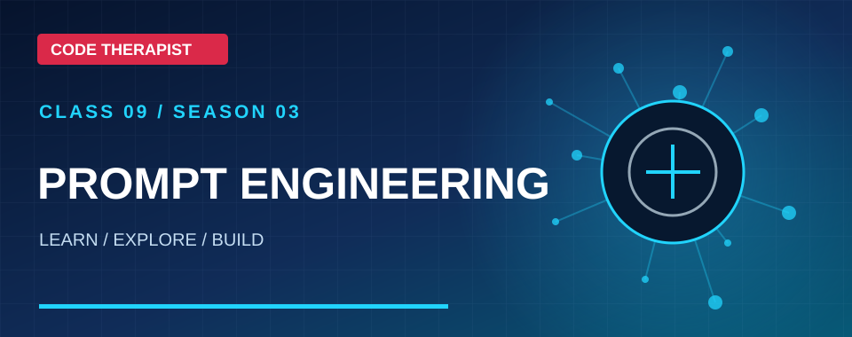
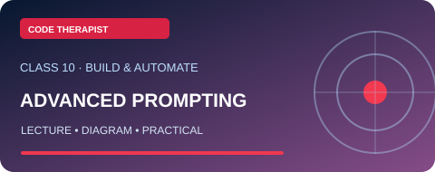
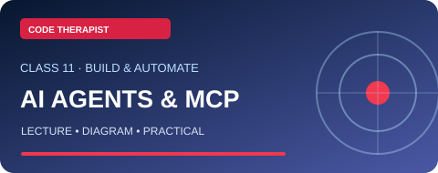
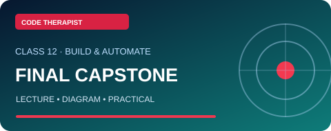
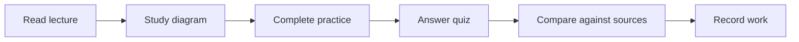

# 🎓 Season 3 — Prompt Engineering, Agents and Projects

**Level:** Intermediate / Applied · **4 guided classes** · **Published:** 9 November 2026

[← AI Academy](../README.md) · [15 AI model families](../MODEL-CATALOG.md)

> Prompt design, structured results, AI tools, automation and a final project

## Study plan — visual lesson cards

| Class | Small landscape card | Lesson | Open |
|:---:|:---|---|:---|
| **09** |  | **Prompt Engineering** | [Read & Study](./CLASS-09-PROMPT-ENGINEERING.md) |
| **10** |  | **Advanced Prompting** | [Read & Study](./CLASS-10-ADVANCED-PROMPTING.md) |
| **11** |  | **AI Agents and Automation** | [Read & Study](./CLASS-11-AGENTS-AND-AUTOMATION.md) |
| **12** |  | **Final Capstone** | [Read & Study](./CLASS-12-FINAL-CAPSTONE.md) |

## Recommended progression

### Study routine

For each class, read the original Code Therapist lecture, explain the main concept without looking at notes, complete the safe lab and submit a one-page reflection. Learners should **record real results and questions**. A badge or certificate is not automatically awarded by reading a page.

### Next step

Complete the final capstone and present real evidence of testing and safeguards.

**Supplemental references:** [Microsoft Generative AI for Beginners](https://microsoft.github.io/generative-ai-for-beginners/) · [Google Machine Learning Crash Course](https://developers.google.com/machine-learning/crash-course) · [Microsoft Learn Generative AI](https://learn.microsoft.com/en-us/training/modules/fundamentals-generative-ai/)

[← Academy](../README.md)
