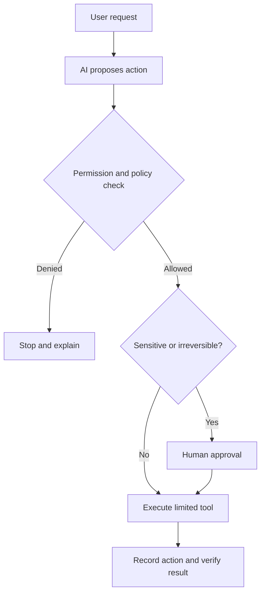

# 🤖 AI Agents — Safety Checklist Before Connecting Real Tools

> **Code Therapist AI Engineering** · **7 November 2026** · Intermediate  
> A practical framework inspired by NIST's AI Risk Management Framework; not a certification.

## What changes when AI can take actions?

An assistant that answers questions has different risks from one that can **read private files, send emails, edit databases or run commands**. Tool permissions and human oversight become part of the product's security design.

## Six controls to plan

| Control | Example implementation |
|---|---|
| Least privilege | Read-only until edits are genuinely needed |
| Explicit approval | Confirm recipients before sending sensitive messages |
| Data boundaries | Restrict access to named folders and accounts |
| Input distrust | Treat web pages and retrieved documents as untrusted |
| Audit trail | Log request, proposed action and actual outcome |
| Recovery | Use version history and reversible steps |

## Practical scenario

Imagine an agent that prepares a daily technology roundup. It should collect source links, draft a summary, flag uncertain claims and request publishing approval. It should **not** invent a news story, leak private source material or automatically execute downloaded scripts.

## Review questions

Before connecting a new tool, ask: What can the agent see? What can it modify? Who approves irreversible changes? How do we detect mistakes? How do we disable access?

## References

- [NIST — AI Risk Management Framework](https://www.nist.gov/itl/ai-risk-management-framework)
- [OWASP — Top 10 for LLM Applications](https://genai.owasp.org/llm-top-10/)

---

[← AI Agents](./README.md) · [← Knowledge Hub](../../README.md)
