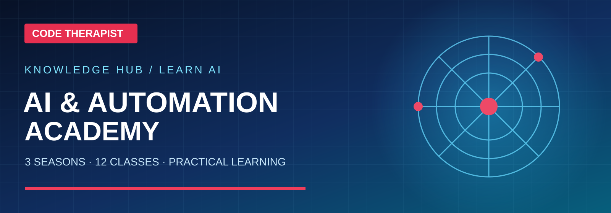
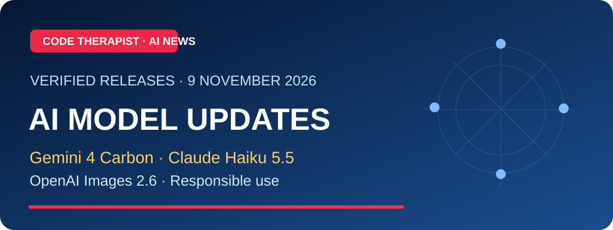
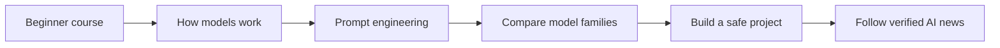

# 🤖 AI & Automation — Code Therapist

### Structured AI learning, research and responsible automation

**[START THE AI ACADEMY →](./AI-ACADEMY/README.md)**

> Updated 9 November 2026. Course materials are educational; cited news must retain source publication dates and model names. AI model availability and free tiers may change.

## 🧭 Start Here — Three Separate Departments

| Department | Purpose | Open |
|---|---|---|
| **General AI Learning** | Three levels (Awareness, Practical User, ML Builder); each has Season 01–03 and numbered Day lessons | **[Choose learning track](./AI-ACADEMY/LEARNING-PATHWAYS.md)** |
| **Specific AI Model Research** | Separate company histories, model explanations and dated update logs for 15 LLM/model families | **[Browse 15 research folders](./AI-ACADEMY/MODEL-RESEARCH/README.md)** |
| **AI Platforms & Infrastructure** | Hugging Face, Models, Datasets, Spaces, learning resources, knowledge bases and RAG | **[Explore Hugging Face](./AI-ACADEMY/PLATFORMS/HUGGING-FACE/README.md)** |

**[Model research Season 01 — Day 001 to 003](./AI-ACADEMY/MODEL-RESEARCH/RELEASE-SEASON-01/README.md)** teaches learners to interpret new model releases, while company-specific logs store the ongoing news itself.

## Featured structured learning

| Study path | What it includes |
|---|---|
| **[Season 01 — AI Foundations](./AI-ACADEMY/SEASON-01/README.md)** | What AI is, history, fields and responsible use (Classes 01–04) |
| **[Season 02 — How AI Works](./AI-ACADEMY/SEASON-02/README.md)** | LLMs, model training and evaluation, using assistants and RAG (Classes 05–08) |
| **[Season 03 — Prompts & Agents](./AI-ACADEMY/SEASON-03/README.md)** | Prompt engineering, practical automation and final project (Classes 09–12) |
| **[15 AI model families](./AI-ACADEMY/MODEL-CATALOG.md)** | GPT, Claude, Gemini, Grok, Llama, DeepSeek, Qwen, Mistral and seven more, each with a lecture profile |
| **[Prompt Engineering Handbook](./AI-ACADEMY/PROMPT-ENGINEERING-HANDBOOK.md)** | Seven-part prompting framework, templates, evaluations and examples |
| **[AI News Digest](./AI-ACADEMY/NEWS/README.md)** | Dated updates, model-card links and editorial verification |

## 📰 Latest AI Academy research

**[9 November 2026 release watch](./AI-ACADEMY/NEWS/2026-11-09-MODEL-RELEASE-WATCH.md)** · [Beginner lessons](./AI-ACADEMY/SEASON-01/README.md) · [15 AI model families](./AI-ACADEMY/MODEL-CATALOG.md)

## Existing research and topic areas

| Topic | Existing research |
|---|---|
| [AI NEWS](./AI-NEWS/README.md) | Verified new releases and AI industry developments |
| [PROMPT ENGINEERING](./PROMPT-ENGINEERING/README.md) | Prompt design and template references |
| [AI AGENTS](./AI-AGENTS/README.md) | Agent safety, tool boundaries and MCP |
| [AUTOMATION](./AUTOMATION/README.md) | Safe automated workflows and operations |

## Recommended learning workflow

### Official independent educational sources

- [Google Machine Learning Crash Course](https://developers.google.com/machine-learning/crash-course)
- [Microsoft Generative AI for Beginners](https://microsoft.github.io/generative-ai-for-beginners/)
- [Microsoft Learn: Generative AI and Agents](https://learn.microsoft.com/en-us/training/modules/fundamentals-generative-ai/)

[← Knowledge Hub](../README.md) · [Code Therapist](https://github.com/codetherapistpita-oss)
