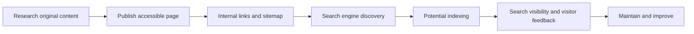

# 🌐 How Developers Can Make a Website Easier to Find on Google

> **Code Therapist · Published 7 November 2026 · Web development and publishing guide**  
> Based on Google Search Central documentation. Not a claim that a site will rank first.

## The goal

A website is more useful when readers can discover its pages. Search optimization helps search engines understand what pages contain and helps readers decide whether to visit them. It cannot guarantee indexing or a particular ranking position.

## Beginner action plan

1. **Write original, useful content** with a descriptive title and headings.
2. **Use clear URLs** and link related articles together logically.
3. **Make pages mobile-friendly**, readable and reasonably fast.
4. **Provide text alternatives for meaningful images**, and avoid hiding key content inside pictures.
5. **Expose important public pages** to normal crawlers and consider a sitemap.
6. **Use Search Console** to examine indexing and search performance for a website you control.
7. **Keep old articles current** and transparently record significant corrections.

## Visual: publication to discovery



## A small HTML example

```html
<!doctype html>
<html lang="en">
<head>
  <meta charset="utf-8">
  <meta name="viewport" content="width=device-width,initial-scale=1">
  <title>Beginner Guide to Responsive Web Design</title>
  <meta name="description" content="Learn to build responsive web pages using accessible HTML and modern CSS.">
</head>
<body>
  <main>
    <h1>Responsive Web Design</h1>
    <p>A practical introduction with tested examples.</p>
  </main>
</body>
</html>
```

The title and description help describe the page, but search engines still make their own decisions about display and rankings.

## Official sources

- [Google Search Central — SEO Starter Guide](https://developers.google.com/search/docs/fundamentals/seo-starter-guide)
- [Google Search Central — Developer Guide](https://developers.google.com/search/docs/fundamentals/get-started-developers)

---

[← Technology Innovations](./README.md) · [← Knowledge Hub](../../../README.md) · [Portfolio](https://codetherapist.netlify.app/)
