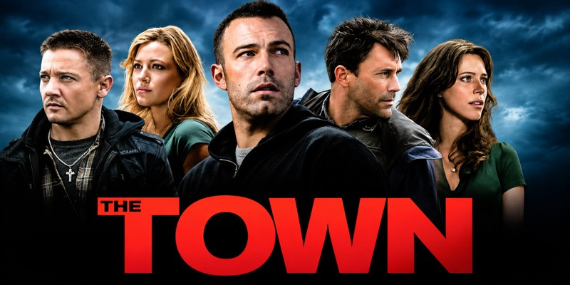
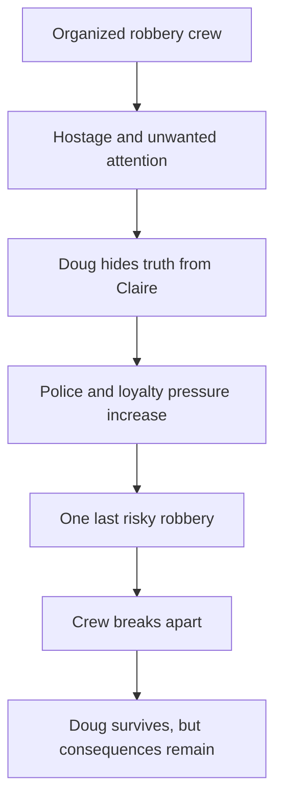

# 🎬 Feature 001 — The Town (2010)
### Crime, loyalty, consequences and the price of escaping one's past

**Code Therapist Cinema Research · 10 November 2026 · Crime/Thriller · Mature audiences · Major spoilers below**

[← Today's four films](./README.md) · [Studio film overview](https://www.legendary.com/film/the-town/) · [AFI production record](https://catalog.afi.com/Film/66415-THE-TOWN)

> **Selected artwork:** Curator-provided five-character compact landscape.

## 🎞️ Film identification

| Item | Details |
|---|---|
| Original release | **17 September 2010** |
| Director and star | **Ben Affleck**, playing **Doug MacRay** |
| Main cast | Jeremy Renner (Jem), Rebecca Hall (Claire), Jon Hamm (FBI agent Frawley), Blake Lively (Krista) |
| Source | Adapted from **Chuck Hogan's novel *Prince of Thieves*** |
| Genre | Crime, heist drama, thriller |
| Reality check | Fictional characters and plot set against recognizable Charlestown/Boston social history; **not a reconstruction of one actual bank robbery** |
| Viewer guidance | R-rated violence and strong language; best for mature viewers |

## 01 · How the film came into existence

*The Town* began with Chuck Hogan's novel *Prince of Thieves*. Its premise—someone trying to escape a criminal community whose loyalties still hold him—gave the producers more than a sequence of robberies. Affleck helped rewrite the adaptation and used Boston locations and local voices to give the film an unusually grounded atmosphere. According to the American Film Institute's production history, the studio pushed the screenplay toward a more filmable scale; Affleck and Aaron Stockard spent time researching the city and its culture. The 2010 film does not say that everyone from Charlestown is a robber; the production explicitly acknowledged the many law-abiding residents whose lives do not resemble the story.

The decision to set much of the movie around familiar Boston streets matters artistically. A robbery is never isolated from the neighborhood where its perpetrators grew up. Streets, friendships, families, local expectations and criminal reputation all create pressure. Instead of a fantasy crime world, the film depicts Doug's effort to move away from an identity he has lived with for years. The film is **based on a novel, not a single true-story case**, although the community setting and themes drew on real history.

## 02 · The story — an original narrative summary

Doug MacRay is a professional robber who leads a close-knit Charlestown crew. His closest companion, Jem, combines devotion to the crew with a volatility that can undo even a careful plan. Their opening bank job demonstrates both sides of the group: discipline in the preparation, recklessness when fear takes control. Claire, a bank employee, is briefly taken hostage. She survives, but the trauma follows her home. That decision—using an innocent person to escape—becomes the crack through which the crew's confidence begins to fall apart.

Jem fears that Claire might identify them. Doug offers to investigate her himself and approaches her as if they were strangers meeting naturally. Claire has no idea who he is. Their conversations turn into a relationship, creating the film's central moral contradiction: Doug begins to feel something genuine while concealing the fact that he helped cause her deepest recent fear. The viewer sees a man who wants to be better, but his first attempt to build a different life is founded on a lie.

At the same time, FBI agent Adam Frawley begins connecting evidence about the crew. Surveillance, witness accounts and mistakes place increasing pressure on the robbers. The film alternates between Doug's growing emotional conflict and the procedural investigation that makes the criminal world's supposed control seem fragile. The crew's actions affect people outside its circle, but it is often too late for them to acknowledge the damage.

Doug tells himself that one last job will provide enough money to leave. This familiar promise becomes a trap: every profitable operation reinforces the people who control him, especially Jem and the criminal organizer known as the Florist. The closer Doug moves toward Claire and the idea of ordinary life, the more dangerous the demands around him become. His father and his history also remind him how deeply the habits of the neighborhood have shaped his decisions.

The final Fenway Park robbery turns their professional confidence into disaster. Law-enforcement pressure and the crew's own desperation make the operation unravel. The confrontation is not simply about who can shoot or drive faster; it is the collapse of a plan built on coercion and a fantasy of invincibility. Lives are lost. Doug survives and eventually leaves Boston, but departure cannot erase his crimes or make all the people he hurt whole. The closing relationship with Claire is intentionally unsettled: a chance to change is not the same as a clean moral pardon.

## 03 · Five memorable story situations

**The first bank robbery** establishes the team's efficiency and their dangerous disregard for victims. **Claire's return to everyday life** shows how violence continues affecting a person long after the robbers disappear. **Doug's conversations with Claire** show how intimacy built on deceit produces emotional and ethical conflict. **Frawley's investigation** counters the fantasy that a disciplined crew can control every witness, trace and risk. **The Fenway operation** makes the cumulative consequences unavoidable; the gang fails not because it lacked ambition but because its choices created enemies, evidence and mutual distrust.

## 04 · Why did Doug's plan fail?

His operational problem was a criminal organization that could not keep risk under control: Jem's impulsiveness, witness exposure, increasing police attention and dependence on others' illegal demands. His personal problem was deeper. He wanted freedom without fully confronting the harm already done. He could not build a trustworthy new relationship while keeping Claire in the dark. The film presents escape as costly and partial, not magical.

## 05 · What makes it worth watching?

The photography and Boston locations give weight to decisions that could otherwise feel like generic heist-movie action. Affleck contrasts Doug's quiet self-examination with Jem's unpredictable intensity. Renner's performance makes Jem frightening without reducing him to a simple villain. Claire's position ensures that the story cannot be celebrated solely as a clever criminal escape. The film's tension is strongest when everyone has a different understanding of loyalty, survival and truth.

## 06 · Lessons and moral questions

1. **Loyalty is not permission to do harm.** A friendship can become destructive when it demands wrongdoing.
2. **Your environment influences you but does not eliminate your choices.** Doug's past helps explain him; it does not excuse him.
3. **Crime creates victims beyond the immediate transaction.** Claire's fear matters as much as the crew's plans.
4. **Every shortcut creates hidden dependencies.** “One last job” can become another reason to stay trapped.
5. **Change requires truth and accountability.** A desire for a better life is only a starting point.

**Discussion prompt:** Can an individual meaningfully change while still benefiting from past wrongdoing? What would responsible change require?

## 07 · Should you watch it?

**Recommended for adult viewers** who enjoy tense crime drama, character psychology, urban filmmaking and stories about moral decisions. Watch it for the human cost and direction—not to learn how to commit robberies. The movie includes disturbing violent crime.

**Watch or trailer information:** [Legendary / official film page](https://www.legendary.com/film/the-town/) (official trailer and viewing link). Availability varies by country and streaming provider.

## 08 · Sources and credits

- [Legendary Entertainment — film overview and official trailer](https://www.legendary.com/film/the-town/)
- [American Film Institute — production, adaptation and film details](https://catalog.afi.com/Film/66415-THE-TOWN)
- Film imagery and characters are associated with Warner Bros. and the credited filmmakers. The essay is original editorial commentary, **not a screenplay transcription or a replacement for viewing the movie**.

## 📱 Share a preview

**🎬 THE TOWN (2010) — Code Therapist Film Stories**  
A robbery, a hostage, an unexpected relationship—and a man discovering that leaving crime is harder than planning it. Read the full researched story, unforgettable scenes and lessons.

**Full article:** https://github.com/codetherapistpita-oss/codetherapistpita-oss/blob/main/knowledge-hub/07-SOCIAL-MEDIA/CINEMA-AND-TECH-FILMS/2026-11-10-FOUR-FILMS/01-THE-TOWN.md

[← Four-film collection](./README.md)
