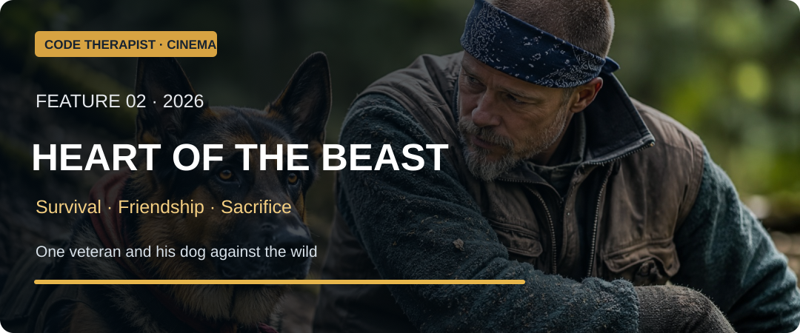
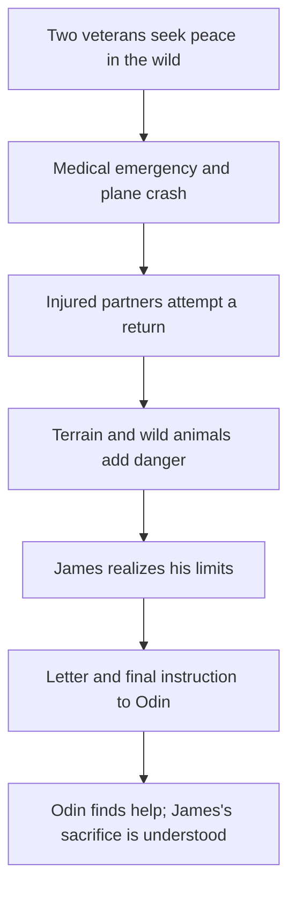

# 🐕 Feature 002 — Heart of the Beast (2026)
### A soldier, his dog and the painful meaning of loyalty

**Code Therapist Cinema Research · 10 November 2026 · Survival/Adventure · PG-13 · Major spoilers below**

[← Today's four films](./README.md) · [Film information and critics](https://www.rottentomatoes.com/m/heart_of_the_beast) · [BFI film review](https://www.bfi.org.uk/sight-and-sound/reviews/heart-beast-bracingly-executed-man-dog-survival-story)

> **Selected artwork:** Curator-provided man-and-dog compact landscape.

## 🎞️ Essential film facts

| Fact | Verified information |
|---|---|
| Release | **25 September 2026** (US theatrical release) |
| Director | **David Ayer** |
| Writer | **Cameron Alexander** |
| Stars | **Brad Pitt** as James Belmont; the dog **Uber** plays Odin |
| Location in story | Remote Alaskan wilderness |
| Genre and duration | Adventure / survival thriller · about 101 minutes |
| True story? | **Fictional dramatic screenplay**; not documented as a biographical account of an actual soldier and dog |
| Production | Filmed in New Zealand's South Island standing in for Alaska, according to production interviews |

## 01 · Why the filmmakers made this story

Many survival films ask whether someone can defeat nature. *Heart of the Beast* gives that familiar question an emotional twist: what happens when a human survivor is also responsible for an animal who trusts him absolutely? James Belmont is not simply a tough veteran displaying outdoor skills. He and Odin carry the psychological burden of military service, and their relationship has become their refuge.

Director David Ayer, known for forceful action stories, works here with a spare, emotionally direct script. In interviews, Brad Pitt described James as a deeply troubled person trying to find peace away from the world. The production's wild landscapes and difficult weather help make the environment feel indifferent to human hopes. The result is less a movie about defeating an animal enemy than a story about responsibility, grief and the fragile ability to continue living.

Odin is not decorative. The dog's reactions, physical movement and persistence help tell the story. Film critics at the British Film Institute singled out how the photography, editing and animal-handling work make the dog's presence emotionally convincing. The animal actor's real name is Uber. The film's military and wilderness events are **fiction**, even though trauma, human–animal bonds and survival risks are real experiences.

## 02 · The story — an original narrative summary

James, a retired Special Forces officer, has withdrawn from ordinary society. His loyal combat dog Odin carries injuries of his own; the two have shared experiences that nobody else can fully understand. James flies a small aircraft deep into Alaska with the intention of finding a quiet escape by a remote lake. Their early moments in the wilderness suggest that the landscape might offer the peaceful life war did not.

Their isolation is interrupted only briefly by another traveller. Even the quiet encounter matters, because it reveals something of James's guarded personality and the cost of the memories he carries. The calm is temporary. During the flight away from the remote campsite, James suffers a serious heart attack. The aircraft crashes, leaving both companions injured and far from organized help. James escapes the wreck, locates Odin and salvages what he can. Their chance of survival now depends on keeping moving through unfamiliar, unforgiving country.

The trek is not a simple march. Each challenge removes another layer of confidence. The pair must respond to cold, injury, uncertain directions and the intimidating presence of wild animals. A bear encounter reminds James that physical force is not the answer to every danger: restraint and reading a situation can be more important. During a precarious crossing, James and Odin are separated by dangerous water, and the dog helps him survive after a fall. Their relationship repeatedly reverses the expected roles—sometimes James is the rescuer; sometimes the animal keeps the human alive.

As they move onward, James's health continues to deteriorate. The film places physical injuries beside psychological strain. Odin, though a trained combat dog, is no invincible machine: the animal also tires and suffers. When wolves threaten them, their instinct to defend one another creates a hard-fought escape but leaves James gravely weakened. The scenes grow increasingly painful because every small success comes at a cost.

Near the end of their journey, James can glimpse the possibility of returning to civilization. Yet he also knows that his own body may not carry him the remaining distance. The dilemma is no longer just whether the pair can survive together. It is whether James can choose Odin's survival when that means giving up their shared path.

James writes a letter explaining Odin's history, how to care for him and his request that a stranger offer the dog a gentler future. He places it with Odin's equipment and directs the dog toward safety. Their final night together is quiet rather than triumphant, beneath the northern lights. James dies of the accumulated injuries and exhaustion. Odin eventually reaches a road, where a young woman named Amber finds the dog and reads the letter. She accepts responsibility for him. The road scene at the end echoes the film's opening, changing its meaning: we began by seeing a dog alive; we finish understanding the sacrifice that made it possible.

## 03 · The scenes that carry the film

**The retreat into wilderness** establishes emotional isolation as much as physical distance. **The plane crash** breaks the fantasy that James can control life merely by leaving society. **The grizzly encounter** shows judgment and restraint. **The river rescue** turns the dog into an active partner instead of a passive pet. **The wolf confrontation** makes survival inseparable from sacrifice. **The farewell and handwritten letter** give the film its deepest emotional weight: love becomes a deliberate action for another being's welfare.

## 04 · Why did the survival plan fail?

James's initial plan was to seek peace by travelling into a remote area, but physical illness, isolation, insufficient access to rescue and injuries turned the journey into a crisis. Military training helped him improvise, but it could not reverse every consequence of a heart condition or severe wounds. The final decision acknowledges limits: James cannot bring himself safely home, but he can still make a choice that increases Odin's chance of reaching help.

## 05 · Lessons viewers can take away

1. **Love is active responsibility.** A loyal relationship requires protecting the other person—or animal—even at personal cost.
2. **Resilience is not invulnerability.** Strength includes knowing when a situation is beyond one's control.
3. **Preparedness matters.** Outdoor travel, communications, rescue planning and medical readiness can be life-saving.
4. **Trauma deserves care.** Isolation and stoicism may not replace appropriate emotional or professional support.
5. **Small acts carry large meaning.** A letter and clear instructions can connect someone vulnerable to future help.
6. **Companionship can give purpose.** Their relationship is the heart of the story, but the film also asks what happens when one companion can no longer remain.

## 06 · Is the movie worth watching?

**Yes, especially for viewers who enjoy survival, animal companionship and emotional storytelling.** The scenery and the dog's expressiveness make it visually memorable. The film contains intense danger and upsetting moments involving injuries and animals; those seeking light entertainment should know the tone is serious. Its central idea is not simply that the strongest person wins—it is that the best act of courage may be to protect someone else's future.

**Viewing information:** [Film synopsis, ratings and official trailer links via Rotten Tomatoes](https://www.rottentomatoes.com/m/heart_of_the_beast). Availability depends on country and service.

## 07 · Sources and attribution

- [Rotten Tomatoes — film facts, release and review index](https://www.rottentomatoes.com/m/heart_of_the_beast)
- [BFI Sight and Sound — review and film craftsmanship](https://www.bfi.org.uk/sight-and-sound/reviews/heart-beast-bracingly-executed-man-dog-survival-story)
- [Entertainment Weekly — production interview with cast and director](https://ew.com/heart-of-the-beast-brad-pitt-haunted-soul-canine-costar-12076327)
- [Los Angeles Times — contemporary critical review](https://www.latimes.com/entertainment-arts/movies/story/2026-09-24/heart-of-beast-review-brad-pitt-uber-david-ayer-j-k-simmons)
- [Film plot overview](https://en.wikipedia.org/wiki/Heart_of_the_Beast) — supplementary chronology; checked against review/interview coverage.

**Copyright:** The film and production stills belong to their respective rights holders. This is an original educational review and analysis, not a reproduced screenplay.

## 📱 WhatsApp preview

**🐕 HEART OF THE BEAST (2026) — A powerful story of courage and loyalty.**  
A veteran and his dog survive a plane crash—but surviving together becomes more complicated than either imagined. Read the story, strongest scenes and deeper life lessons.

**Read:** https://github.com/codetherapistpita-oss/codetherapistpita-oss/blob/main/knowledge-hub/07-SOCIAL-MEDIA/CINEMA-AND-TECH-FILMS/2026-11-10-FOUR-FILMS/02-HEART-OF-THE-BEAST.md

[← Four-film collection](./README.md)
