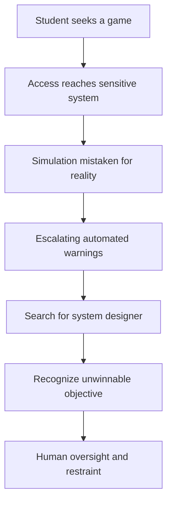

# 💻 Feature 003 — WarGames (1983)
### The teenager, the computer and a catastrophe that almost happened

**Code Therapist Cinema Research · 10 November 2026 · Technology / Cold War Thriller · PG · Spoilers below**

[← Today's four films](./README.md) · [American Film Institute archival entry](https://catalog.afi.com/Film/67139-WARGAMES-?cxt=filmography)

## 🎞️ Production and history

| Item | Details |
|---|---|
| Film | *WarGames* |
| Release | **3 June 1983** |
| Director | **John Badham** |
| Writers | **Lawrence Lasker and Walter F. Parkes** |
| Cast | **Matthew Broderick** as David Lightman, **Ally Sheedy** as Jennifer, John Wood as Dr. Falken, Dabney Coleman as McKittrick |
| Genre | Fictional technology / suspense / Cold War drama |
| True story? | **No.** The plot is fiction informed by real-era fears of nuclear escalation and computer reliability. Official AFI notes that its depiction of NORAD authority and military command is significantly simplified and inaccurate. |

### How the idea developed

*WarGames* belongs to a period when personal computers were becoming more accessible while nuclear threats remained part of public imagination. The screenwriters considered how a curious student with a modem might encounter something vastly more important than a game. The early screenplay, once known as *The Genius*, developed into a thriller involving a defense computer that cannot distinguish harmless simulation from catastrophic real-world events. John Badham replaced an earlier director during production, as documented by the American Film Institute. The result was both an entertaining computer story and a warning about excessive confidence in automation.

It is important to separate cinema from history: there was no documented actual incident in which a teenager named David Lightman nearly launched nuclear war through this fictional game. Nonetheless, the movie invites meaningful questions about real military warning systems, human oversight, software assumptions and unintended consequences.

## 01 · The story

David Lightman is a clever but impulsive high-school student who knows how to communicate with computers beyond his immediate surroundings. He approaches computers like a puzzle; if an interface can be reached, he wants to discover what it can do. That attitude brings him excitement but very little respect for consent or consequences. Searching for new software, David discovers a system that appears to offer an unusually compelling set of games.

He chooses a simulation resembling global thermonuclear conflict, imagining that he has entered a remarkable computer game. What he does not understand is that the system is associated with military command and warning infrastructure. The program interprets some of his actions as part of a serious scenario. Operators begin to see information that resembles an approaching attack, and decision-makers face intense pressure to react.

The tension grows from a terrible mismatch. David thinks he is exploring entertainment software; military personnel fear a genuine threat; and the computer keeps processing its simulation according to rules that do not adequately account for human misunderstanding. Neither access nor apparent technical competence proves that David understands the system. When the real significance of the game becomes clear, his curiosity turns into fear.

David, aided by Jennifer, must find the creator associated with the machine's logic. Their search leads them toward Dr. Stephen Falken, a computer scientist who has become disillusioned by the implications of his work. Falken's withdrawal from the world gives the film a personal dimension: technical brilliance cannot guarantee moral comfort with the technology someone has built. The young characters need him not merely because he knows code, but because he understands why the system's objectives are flawed.

As the defense computer escalates its dangerous simulation, the humans seek a way to interrupt it without producing an even greater misunderstanding. The central turning point is a lesson about games that have no meaningful winner. Through repeated demonstrations of outcomes in which every side loses, the system moves toward recognizing the futility of nuclear conflict. It is a dramatic narrative solution, not a factual claim that real-world nuclear systems can safely learn ethics from simple games.

The ending is memorable because what appears to be a computer victory is actually a refusal to pursue a destructive objective. In the world of the movie, the safest action is to refrain from playing the unwinnable contest. That leaves a wider question for the viewer: when should humans design machines to say “no,” and when must people remain responsible for making the decision themselves?

## 02 · Memorable sequences

**David's search for games** introduces unauthorized discovery as temptation. **The first simulation** reveals the gulf between what a user believes and what a system actually does. **The military command scenes** show panic amplified by uncertain information. **The search for Falken** introduces the responsibility of the designer. **The concluding game logic** offers a powerful visual metaphor for decisions where optimization itself is a mistake.

## 03 · Where did the system fail?

Its most serious fictional weaknesses are blurred boundaries between test and live environments, excessive trust in automatically generated indications, and interfaces that fail to constrain unauthorized users. The film exaggerates real military architecture, but its *engineering questions* remain important: how do you authenticate users, isolate simulations, distinguish evidence from false alerts and require appropriate human oversight?

## 04 · Lessons for modern developers

1. **Separate development, testing and production.** A simulation should never directly cause high-stakes real-world action.
2. **Authentication is a safety control.** Technical curiosity is not authorization to enter a system.
3. **Automation requires transparent limits.** Software can optimize toward a harmful goal when the goal itself is wrong.
4. **Human oversight is vital for high-impact decisions.** Alerts should be corroborated, not blindly accepted.
5. **Assumptions are part of security architecture.** A system needs to know what it cannot infer from incomplete data.
6. **Refusal can be an intelligent outcome.** Some actions should remain unavailable or require hard approval boundaries.

## 05 · Is it still worth watching?

**Yes.** For a technology learner, the old-fashioned terminals and 1980s setting are part of its charm rather than a weakness. The film turns abstract questions about software design into understandable drama. Watch it as imaginative fiction and a conversation starter about AI and safety—not as a technical blueprint of real NORAD systems.

**Original archival source:** [American Film Institute — *WarGames* 1983](https://catalog.afi.com/Film/67139-WARGAMES-?cxt=filmography). The AFI record describes production history and explicitly cautions about inaccurate command-and-control depictions.

## 06 · Classroom extension

Imagine a computer system receives an uncertain warning about a serious event. Design a responsible workflow: **sensor input → corroboration → confidence evaluation → human review → authorized action → audit**. Write which actions a model may recommend and which it may never trigger automatically.

**Related Code Therapist course:** [AI agents and safe automation](../../../05-AI-AND-LLMS/AI-ACADEMY/SEASON-03/CLASS-11-AGENTS-AND-AUTOMATION.md).

## 📱 WhatsApp preview

**💻 WARGAMES (1983) — When a computer game almost starts a world war.**  
A young programmer learns that a powerful system can mistake curiosity for catastrophe. Read the movie's background, story and cybersecurity lessons.

🔗 https://github.com/codetherapistpita-oss/codetherapistpita-oss/blob/main/knowledge-hub/07-SOCIAL-MEDIA/CINEMA-AND-TECH-FILMS/2026-11-10-FOUR-FILMS/03-WARGAMES.md

[← Four-film collection](./README.md)
