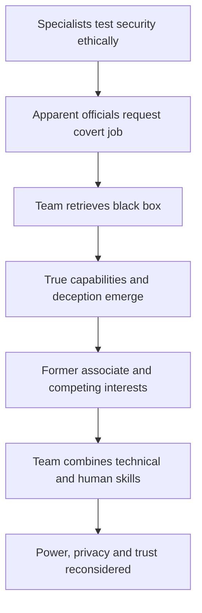

# 🕵️ Feature 004 — Sneakers (1992)
### The security testers who discovered a tool nobody should control

**Code Therapist Cinema Research · 10 November 2026 · Hacking / Espionage / Technology Thriller · PG-13 · Spoilers below**

[← Today's four films](./README.md) · [Universal Studios official description](https://www.universalpicturesathome.com/movies/sneakers) · [AFI historical production file](https://catalog.afi.com/Catalog/moviedetails/59395)

## 🎬 Key details

| Fact | Information |
|---|---|
| Movie | *Sneakers* (1992) |
| Director | **Phil Alden Robinson** |
| Screenwriters | **Phil Alden Robinson, Lawrence Lasker, Walter F. Parkes** |
| Lead | **Robert Redford** as Martin Bishop |
| Supporting actors | **Ben Kingsley**, Sidney Poitier, Dan Aykroyd, River Phoenix, David Strathairn, Mary McDonnell |
| Reality check | A **fictional spy/technology caper**, partly inspired by actual security-testing communities, **not a documentary** |
| Why chosen | Early mainstream cinematic treatment of authorized penetration testing, social engineering, encryption and dual-use technology |

## 01 · How this movie was developed

*Sneakers* has a particularly interesting relationship to computer history. According to the American Film Institute, writers Lawrence Lasker and Walter Parkes encountered the term “sneakers” while researching their earlier film *WarGames*. They learned it could refer to specialists paid to test the security of organizations by trying to find weaknesses. That distinction—breaking into a system to help improve security versus stealing from it—became the film's central professional idea.

The team developed the screenplay over many years. Its concept changed as computers, national-security concerns and public understanding of digital threats evolved. The film includes fictional characters and a highly dramatized technology, but it also draws from real communities of security testers and phone-system experimenters. AFI notes that people such as John Draper and security consultant John Strauchs influenced some characterization. These influences do not make the movie a true-event reconstruction.

The production became especially effective by assembling actors with different personalities and by allowing technology to be understood through teamwork rather than endless close-ups of mysterious screen text. *Sneakers* is funny at times, tense at others, and surprisingly reflective about whether the power to read secrets should belong to anyone.

## 02 · The story

Martin Bishop runs a skilled group of security specialists who test companies' defenses. The group's expertise is deliberately varied. Some members understand computers, others observe physical spaces or people, and others bring knowledge of operations and sound. Their business depends on the principle that an organization can be protected better when its weaknesses are discovered in an authorized test.

Martin has a complicated past involving his earlier life as a hacker. This history makes him vulnerable when men claiming government authority approach him with a task he cannot easily refuse. They tell him to acquire a mysterious black box from a mathematician. What begins as an apparently secret but controlled operation soon becomes something far more unsettling.

The team's initial objective is concrete: find the device and bring it back. But success at that narrow job reveals the danger of the broader situation. The black box appears capable of defeating conventional computer encryption at extraordinary scale. Such a capability would threaten the privacy of people, businesses and institutions everywhere. The story therefore changes from “How do we acquire this object?” to “Who should be allowed to possess it—and can anyone be trusted with it?”

Martin realizes that the people who commissioned the job have concealed their real identities and intentions. The inventing mathematician's death makes the danger personal, and the group discovers that it has become involved in a contest between powerful actors. The conflict reaches into Martin's past when his former associate Cosmo reappears. Once friends in a world of technological experimentation, they now represent opposing attitudes toward power and society.

Cosmo believes extraordinary control over information can be used to overturn established systems. Martin is skeptical of anyone who claims that a sweeping, unaccountable power will ultimately be exercised for the public good. Neither man's technical knowledge settles the ethical argument. The same tool capable of exposing corruption can also expose innocents and enable coercion.

To recover from their deception, the team must rely on every kind of skill it possesses. They plan, improvise, communicate and use observations that have nothing to do with typing a password on a monitor. Human voices, physical environments, social trust and careful timing become as important as code. This makes *Sneakers* unusually rich for people learning cybersecurity: attackers and defenders both operate in the same world of people, buildings, devices and incentives.

By the climax, the security specialists must prevent the device from remaining in dangerous hands while avoiding further manipulation by people who may have impressive badges but dubious motives. The resolution depends on working together and questioning apparent authority. The black box's incredible capability is a story device, but the moral issue it illustrates remains current: encryption, private communications and control over secrets are not merely technical topics. They concern human rights, institutional power and the possibility of abuse.

## 03 · The most memorable narrative moments

**The team's legitimate security-testing work** introduces ethical penetration testing before the term became everyday vocabulary. **The offer from supposed government representatives** illustrates pressure and identity deception. **The discovery about the black box** turns a gadget into a question about privacy. **Cosmo's return** connects personal betrayal with ideological conflict. **The group planning and improvising** demonstrates why successful security work involves multiple disciplines rather than one genius operating alone.

## 04 · Why did the team initially fail?

They accepted the claimed legitimacy of the people who assigned the job and underestimated the possible consequences of obtaining the device. Their technical competence did not protect them from deception about *who had authority* and *why the target mattered*. The lesson is that an authorized-looking request needs scope verification, due diligence and independent confirmation before sensitive work begins.

## 05 · Lessons for cybersecurity students

1. **Penetration testing must be authorized.** Skills alone do not make an intrusion legal or ethical.
2. **Verify authority independently.** Titles, uniforms, urgent requests and confident claims can be misleading.
3. **Social engineering is part of security.** People and physical access can bypass expensive technical barriers.
4. **Cryptography serves trust and privacy.** Its disruption can expose entire systems, not just one account.
5. **Security is multidisciplinary.** Strong teams combine diverse technical, operational and interpersonal abilities.
6. **Dual-use tools require governance.** A capability can help legitimate investigations and still be dangerous in uncontrolled hands.

## 06 · What makes it a classic?

For viewers who enjoy clever, character-driven action, *Sneakers* balances humor and stakes. Each member of the team has a useful role. Redford gives Martin restraint, while Kingsley's Cosmo challenges the audience with an apparently principled but dangerous vision of technological power. The movie's technology may look dated, yet much of its core discussion—trust, encryption, oversight, the politics of data—feels remarkably contemporary.

**Recommended** for software developers, computer science students, cybersecurity learners and anyone who likes intelligent heist thrillers. Watch it with an eye on the difference between a paid security audit and unlawful intrusion.

## 07 · Sources and where to watch

- [Universal Pictures — film synopsis, cast and digital viewing options](https://www.universalpicturesathome.com/movies/sneakers)
- [American Film Institute — production history and real-world influences](https://catalog.afi.com/Catalog/moviedetails/59395)
- [Science on Screen — discussion and film details](https://scienceonscreen.org/films/sneakers)

This original review paraphrases factual sources, not the film's copyrighted screenplay or spoken dialogue. Film rights remain with their respective owners; streaming availability varies.

## 📱 WhatsApp preview

**🕵️ SNEAKERS (1992) — Before modern hacking thrillers became popular.**  
A team hired to test computer security is tricked into obtaining a device that could expose the world's secrets. Read the story, production history and cybersecurity lessons.

🔗 https://github.com/codetherapistpita-oss/codetherapistpita-oss/blob/main/knowledge-hub/07-SOCIAL-MEDIA/CINEMA-AND-TECH-FILMS/2026-11-10-FOUR-FILMS/04-SNEAKERS.md

[← Four-film collection](./README.md)
