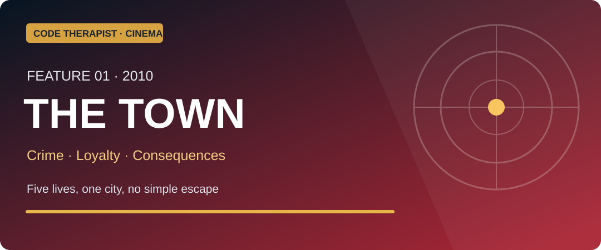
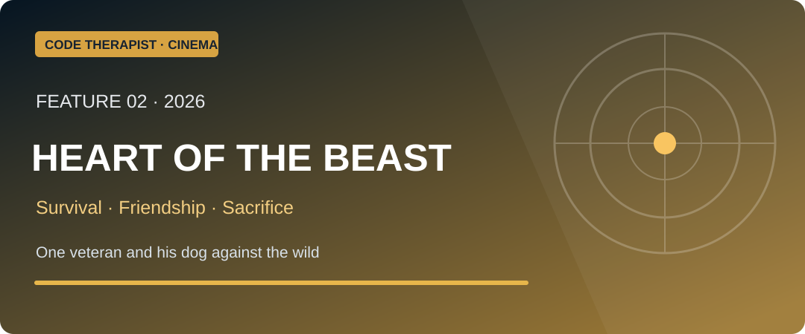
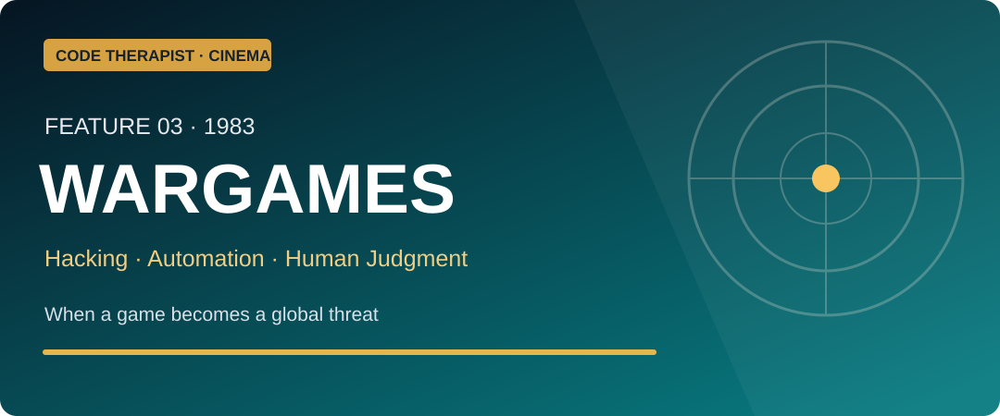
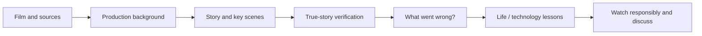

# 🎬 Code Therapist — Cinema, Technology & Life Lessons
### Four movie features · Tuesday, 10 November 2026

**2 curator-selected main movies · 2 classic computer-security movies · 4 original cinema essays**

[Cinema category](../README.md) · [Knowledge Hub](../../../README.md) · [Main Code Therapist profile](https://github.com/codetherapistpita-oss)

> [!IMPORTANT]
> **Publication status:** The essays, original compact SVG editorial banners and reading links are live on GitHub. The curator's **enhanced five-character The Town image, Heart of the Beast man-and-dog image and nun-mask scene** are prepared separately as resized JPG assets; those specific JPG files are **not yet uploaded to GitHub**, so they are not shown here as though already hosted. See the [image-upload guide](./IMAGE-UPLOAD-GUIDE.md). This collection features written analysis, **not full movies or unauthorized streaming downloads**.

## 🍿 Today's featured movie stories

### 01 · The Town (2010) — Crime / loyalty / second chances

A professional robber falls for a woman who does not know he helped traumatize her. His attempt to leave a violent crew becomes more dangerous as loyalty, deception and law enforcement close in. Based on the novel *Prince of Thieves*; inspired by a real community's complicated history, but **fictional**.

**[📖 Read the full The Town story and life lessons](./01-THE-TOWN.md)** · [Official studio synopsis](https://www.legendary.com/film/the-town/)

### 02 · Heart of the Beast (2026) — Survival / companionship / sacrifice

A Special Forces veteran and his dog survive a remote plane crash, but every obstacle leaves them weaker. The ending transforms survival into a story about love, letting go and caring for another life. **Fictional**, released in 2026.

**[📖 Read the full Heart of the Beast story and morals](./02-HEART-OF-THE-BEAST.md)** · [Film synopsis and reviews](https://www.rottentomatoes.com/m/heart_of_the_beast)

### 03 · WarGames (1983) — Hacking / technology / human judgment

A teenage computer enthusiast mistakes sensitive computer simulations for a game. What follows is a memorable warning about unchecked automation and decisions whose consequences cannot be reversed.

**[📖 Read the WarGames story and AI safety lessons](./03-WARGAMES.md)** · [American Film Institute history](https://catalog.afi.com/Film/67139-WARGAMES-?cxt=filmography)

### 04 · Sneakers (1992) — Cybersecurity / trust / encryption

Professional security testers are deceived into acquiring a mysterious device that could compromise the world's secrets. The movie explores permission, deception, teamwork and the ethics of powerful technology.

**[📖 Read the Sneakers story and cybersecurity lessons](./04-SNEAKERS.md)** · [Universal official film page](https://www.universalpicturesathome.com/movies/sneakers)

## 🎓 How to study this cinema series

| Path | Season / lesson | Featured title | Learning theme |
|---|---|---|---|
| **Adventure & Human Stories** | Season 01 · Day 001 | [Heart of the Beast](./02-HEART-OF-THE-BEAST.md) | Resilience, loyalty, trauma and sacrifice |
| **Crime & Ethical Decisions** | Season 01 · Day 001 | [The Town](./01-THE-TOWN.md) | Consequences, honesty, loyalty and accountability |
| **Hacking & Tech Cinema** | Season 01 · Day 001 | [WarGames](./03-WARGAMES.md) | Authorized access, false alarms and human review |
| **Hacking & Tech Cinema** | Season 01 · Day 002 | [Sneakers](./04-SNEAKERS.md) | Security testing, cryptography and social engineering |

### Editorial learning workflow

## ✅ What every movie report must contain

Original film title and release, writer/director/actors, verified adaptation and real-event status, original story analysis (clearly marked for spoilers), important turning points, consequences of characters' choices, moral/technical lessons, viewing recommendation, appropriate content notes, **small landscape cover**, and links to studios/archives or reliable criticism.

Each story is **editorial analysis**, not a film transcript, copied book or illegal streaming page. Film promotional images remain the property of the respective rights holders, and public redistribution may require permission.

## 📱 Share the movie collection

**🎬 CODE THERAPIST MOVIE STORIES**  
Four fascinating movies, four different lessons. Read *The Town* and *Heart of the Beast*, then discover hacker classics *WarGames* and *Sneakers*. Full researched stories, important scenes, lessons, and original sources:

https://github.com/codetherapistpita-oss/codetherapistpita-oss/tree/main/knowledge-hub/07-SOCIAL-MEDIA/CINEMA-AND-TECH-FILMS/2026-11-10-FOUR-FILMS

[← Cinema library](../README.md) · [Original image status](./IMAGE-UPLOAD-GUIDE.md)
