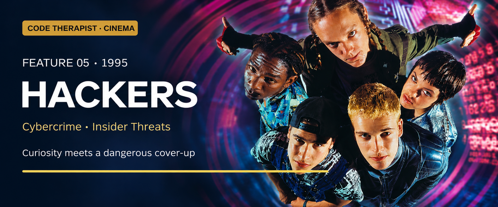

# Feature 005 · Hackers (1995)
### Curiosity, belonging and the danger of trusting the insider

**Code Therapist Cinema · 10 November 2026 · Spoilers below**  
[← Six new films](./README.md) · [Cinema library](../README.md)

## Film identity and origin

| Item | Information |
|---|---|
| Director / writer | Iain Softley / Rafael Moreu |
| Main cast | Jonny Lee Miller, Angelina Jolie, Fisher Stevens, Matthew Lillard |
| Origin | Fictional original screenplay; not a reconstruction of a documented heist |
| Production / release | United Artists; 1995 |
| Genre | Cyberpunk crime thriller and youth adventure |
| Content | PG-13; threat, language and sexual material |

AFI records the creative credits; Rotten Tomatoes supplies the release information and introductory synopsis. The film arrived when public interest in the internet was expanding. Its colourful design treats the online world as a place of identity, rivalry and discovery. This makes it valuable as a cultural portrait, even where its technology is extravagantly theatrical. [1][2]

## The story

Dade Murphy returns to computers after a childhood offence led to a lengthy ban. In New York he meets a competitive group of young hackers, including Kate, whose skill challenges his confidence. Their enthusiasm becomes dangerous when Joey enters a corporate system and takes a fragment of a file.

The file threatens to expose a financial scheme run by security officer Eugene Belford. He reframes the intrusion as a destructive attack by the teenagers, turning his position of authority into a shield. Dade and his friends must move beyond personal rivalry to protect one another and establish what the file actually proves. With help from the wider hacker community, they expose Belford; the apparent defender is revealed as the criminal. [2][3]

This is a story about control of the explanation as much as control of a computer. The teenagers are easy to suspect because they have crossed boundaries. Belford is initially harder to question because his job title gives his account institutional credibility. The tension comes from the gap between who looks trustworthy and whose claims deserve verification.

## The moments that matter

**Dade meeting Kate** makes technical ability part of friendship and status. The rivalry gives the film its youthful energy, but also reveals how proving oneself can overwhelm judgment.

**Joey's discovery** changes the meaning of the adventure. An act intended to earn respect places everyone in a conflict they do not understand. Finding wrongdoing does not make the original unauthorized access harmless.

**Belford controlling the narrative** is the most useful security discussion. The person responsible for protecting an organisation may also have the knowledge and influence to conceal abuse. The film invites viewers to ask whether evidence has been checked independently of its presenter.

## Where it belongs

| Field | Fit and limitation |
|---|---|
| Cybersecurity | Central: unauthorized access, insider abuse and evidence |
| Financial theft | Central: embezzlement concealed inside corporate systems |
| Social engineering | Relevant: manipulation of people and institutional trust |
| Cryptography | Not the main subject; this is not a codebreaking lesson |
| Realism | Highly stylized interfaces and compressed events |

**Editorial security interpretation:** the useful question is not how quickly someone types. It is who can act without an independent check. A company in a similar trust situation would benefit from separating approval from execution, preserving records outside one person's control, and making reports reviewable. These are discussion lessons drawn from the story, not claims that the movie demonstrates a complete security design.

## Why the wrongdoing unravels

Belford relies on two assumptions: outsiders will accept his account, and the young people will remain isolated. Their cooperation challenges both. His trusted role helps him hide the scheme, but it does not erase the evidence. The film's moral weakness is that its energetic ending can make unlawful access look consequence-free. A careful viewer should separate the pleasure of the rescue from the legitimacy of the methods.

## What viewers can learn

- **Ability needs boundaries.** Curiosity is valuable; permission still matters.
- **Evidence deserves more weight than reputation.** Confidence and job titles are not proof.
- **Belonging can encourage both courage and recklessness.** Good friends should challenge unsafe choices.
- **Accountability must include powerful insiders.** Oversight loses meaning if it only examines outsiders.

## Is it worth watching?

**For its style, energy and picture of early internet culture, yes.** Its characters make technology feel exciting and social. Watch it as a colourful thriller, then discuss where the fantasy simplifies responsibility. For Peter's technology learners, it is a strong starting point for a conversation about the difference between being technically capable and being trusted to use that capability.

**Discussion:** If the person investigating a breach also controls its records, who should verify the conclusion?

## Sources and image credit

1. [AFI — Hackers credits](https://catalog.afi.com/Film/59910-HACKERS).
2. [Rotten Tomatoes — synopsis, cast and content information](https://www.rottentomatoes.com/m/hackers).
3. [Plot and production chronology — supplementary reference](https://en.wikipedia.org/wiki/Hackers_(film)).
4. [Microsoft — hacker films and their relationship to reality](https://news.microsoft.com/on-the-issues/2019/09/04/hollywood-hacking-movies/).

**Artwork:** AI-assisted editorial adaptation of the film poster [catalogued by TMDB](https://www.themoviedb.org/movie/10428-hackers/watch), using [this source image](https://image.tmdb.org/t/p/original/w8H2KpRtpzwlxz5KrvINCVihok1.jpg). Film imagery belongs to its rights holders. This banner is an adapted composition, not an unmodified production still.

[← Collection](./README.md) · [Next: Blackhat →](./06-BLACKHAT.md)
