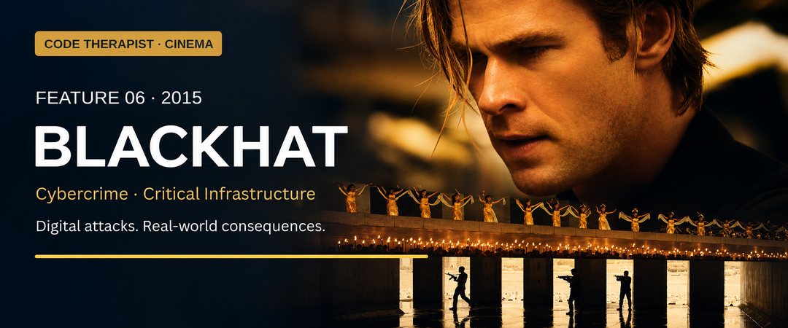

# Feature 006 · Blackhat (2015)
### Digital intrusion reaches the physical world

**Code Therapist Cinema · 10 November 2026 · Spoilers · Theatrical-version story**  
[← Six new films](./README.md) · [Cinema library](../README.md)

## Film identity and origin

| Item | Information |
|---|---|
| Director / writer | Michael Mann / Morgan Davis Foehl |
| Main cast | Chris Hemsworth, Tang Wei, Viola Davis, Wang Leehom |
| Production / release | Legendary Pictures and Forward Pass; Universal distribution; 2015 |
| Origin | Fictional screenplay about international cybercrime |
| Genre | Cybercrime action thriller |
| Content | R; violence and language |

Universal describes an investigation crossing several countries. Mann brings the urgency of a crime pursuit to systems that might otherwise seem invisible. The title uses the familiar label for a malicious hacker. A later director's cut rearranges material, so this guide identifies the theatrical version rather than mixing versions together. [1][2]

## The story

An attack on a Hong Kong nuclear plant is followed by manipulation of a Chicago commodities exchange. Investigators connect the malicious code to earlier work by Chen Dawai and imprisoned programmer Nicholas Hathaway. Hathaway receives conditional freedom to help an American–Chinese team pursue the attacker.

The investigation moves from code to money, people and physical locations. Hathaway and networking engineer Chen Lien grow close while the team faces lethal resistance. The attacks ultimately point to a profit scheme involving sabotage of a dam and disruption of tin production. After devastating losses, Hathaway confronts the criminal behind it. The case exposes a financial motive beneath events that first appear unrelated. [1][2]

The film's strongest idea is that a digital event does not remain inside a screen. An invisible change can lead to damaged equipment, dangerous environments and frightened people. Its story asks viewers to connect an incident's technical appearance with the interests it serves. The most spectacular failure may be a distraction from a quieter business objective.

## Key situations and their meaning

**The infrastructure attack** makes the opening unusually unsettling. The target is not merely a stolen document; the story places human safety in the same chain of consequences as software.

**Hathaway joining the investigators** creates an uneasy relationship between expertise and accountability. A person's usefulness does not automatically resolve questions about supervision, authority or past conduct.

**Following financial clues** changes the direction of the investigation. The question becomes why someone would want these outcomes, rather than which technical label best describes the intrusion.

**The team's losses** puncture the fantasy of a bloodless computer duel. Even when the action becomes exaggerated, the emotional point is clear: those responding to an incident carry real risks.

## Where it belongs

| Field | Fit and limitation |
|---|---|
| Cybersecurity | Central: malicious software, compromised access and investigation |
| Critical infrastructure | Central: industrial processes and public consequences |
| Financial crime | Central: market manipulation and profit motive |
| Cryptography | Secondary; encryption is not the film's principal puzzle |
| Physical security | Important: people and locations remain exposed |
| Realism | Some credible vocabulary, but extensive action-film compression |

**Editorial security interpretation:** use the movie to discuss the connection between business risk and technical risk. A system should be assessed by what a failure could cause, not only by the sensitivity of its files. The story also raises questions about coordination: who is allowed to approve an action, which agency holds evidence, and how a team continues when a key person is unavailable? These are analytical prompts, not a claim that the film supplies an operational response plan.

## Why the attacks are difficult to understand

The investigators initially see separate incidents across institutional and national boundaries. That fragmentation benefits the attacker. The breakthrough is conceptual as much as technical: connect the losses, incentives and intended profit. The criminal's confidence also becomes a weakness when an opponent understands those incentives and challenges his control.

The protagonist's escalating improvisation makes for a forceful thriller, but it should not be mistaken for a model of professional authority. A compelling result on screen does not establish that every action along the way was lawful, safe or reproducible.

## Lessons and viewing recommendation

- **Ask what an incident enables.** Visible damage may not be its final purpose.
- **Consider physical consequences.** Data, equipment and people are connected.
- **Expertise needs accountable authority.** Urgency should not erase responsibility.
- **Work across disciplines.** Financial, technical and human evidence can illuminate one another.

**Worth watching for the atmosphere and systems-wide stakes.** The international locations give the chase scale; the intimate relationships keep it personal. Its action-heavy resolution will suit viewers who enjoy crime thrillers more than those seeking a quiet forensic procedural. Treat the film as a discussion about consequences, not a demonstration of everyday cybersecurity work.

**Discussion:** What additional questions arise when an affected computer controls machinery rather than a document library?

## Sources and image credit

1. [Universal — official synopsis, credits and rating](https://www.universalpicturesathome.com/movies/blackhat).
2. [Plot, writer and version history — supplementary chronology](https://en.wikipedia.org/wiki/Blackhat_(film)).
3. [Universal home-entertainment release announcement](https://www.prnewswire.com/news-releases/from-universal-pictures-home-entertainment-blackhat-300051150.html).

**Artwork:** AI-assisted editorial adaptation of the official poster on Universal's linked film page. © Universal Studios; an adapted banner rather than an unmodified still.

[← Hackers](./05-HACKERS.md) · [Next: Inside Man →](./07-INSIDE-MAN.md)
