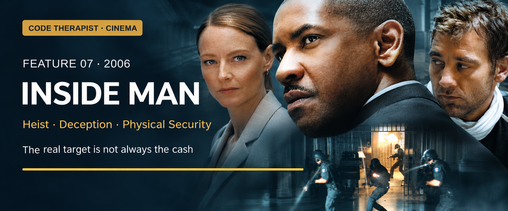

# Feature 007 · Inside Man (2006)
### A bank robbery where the visible crime hides the real objective

**Code Therapist Cinema · 10 November 2026 · Major spoilers below**  
[← Six new films](./README.md) · [Cinema library](../README.md)

## Film identity and origin

| Item | Information |
|---|---|
| Director / writer | Spike Lee / Russell Gewirtz |
| Main cast | Denzel Washington, Clive Owen, Jodie Foster, Christopher Plummer |
| Production / release | Imagine Entertainment; Universal; 2006 |
| Origin | Fictional original screenplay, not a documented bank robbery |
| Genre | Bank-heist thriller, hostage drama and crime mystery |
| Content | R; language and violent images |

Universal frames the story as a contest between a robber, detective and influential intermediary. Gewirtz's original script provides the puzzle; Lee's direction places that puzzle inside a city shaped by unequal power. The result combines a clever caper with questions about whose wrongdoing becomes visible and whose remains protected. [1][2]

## The story

Dalton Russell takes over a Manhattan bank and creates a hostage crisis. Detective Keith Frazier negotiates, but the robber's behaviour does not fit a straightforward demand for cash. The bank's founder, Arthur Case, brings in fixer Madeleine White to protect something hidden in a safe-deposit box.

The robbery disguises a narrower target: diamonds and records connected to Case's collaboration with the Nazis. Confusion among identically dressed captives and robbers frustrates identification. The apparent ending is not Russell's departure: he remains concealed inside the bank, emerging after the immediate investigation has passed. Frazier continues following evidence that powerful people would prefer him to ignore. The final revelation changes the meaning of both the robbery and the institution's respectable appearance. [1][2]

The film makes uncertainty its central dramatic resource. A negotiator has to judge intentions without knowing the whole plan. An institution wants to preserve its reputation without revealing why it is afraid. The audience is encouraged to keep asking whether the most obvious explanation accounts for what it has actually seen.

## The important situations

**The opening claim of a perfect robbery** invites scrutiny. The film establishes that Russell can influence how events are narrated, not merely what happens inside the building.

**Frazier's negotiations** work because confidence is paired with doubt. He tries to read behaviour while remaining responsible for people he cannot fully see. The tension comes from interpretation, rather than from assuming that force is always the answer.

**Madeleine's intervention** introduces another form of access: influence. She can enter conversations that others cannot, illustrating how an organisation's decision process may bend around powerful people.

**The hidden history** gives the crime an ethical complication. Exposing a wrong does not automatically excuse another wrong. The film leaves viewers to consider how justice, profit and revenge can overlap without becoming identical.

## Where it belongs

| Field | Fit and limitation |
|---|---|
| Heist / theft | Central: a targeted bank robbery |
| Physical security | Central: occupancy, identification and protected spaces |
| Deception / social engineering | Central: controlling appearances and expectations |
| Governance / insider influence | Strong: concealed records and institutional pressure |
| Cybersecurity | Indirect discussion value; not primarily a hacking film |
| Cryptography | Not a principal subject |

**Editorial security interpretation:** this is a useful film for discussing assumptions. A building being searched is not the same as every space being accounted for. A witness statement is not the same as verified identity. A senior stakeholder's urgency is not necessarily aligned with the investigation's purpose. These distinctions apply to many reviews without turning the film into a practical guide to bypassing security.

## What fails, and why?

The response is initially organised around the robbery people expect. Russell benefits from that expectation. Meanwhile, Case's interest in concealment conflicts with the detective's interest in finding the truth. That conflict makes the institution less transparent at exactly the moment transparency matters.

Frazier's persistence is the counterweight. He asks why the facts do not fit neatly and resists pressure to accept a convenient conclusion. The lesson is not that every unusual event hides a grand conspiracy. It is that a conclusion should explain the evidence, including the awkward details.

## Lessons and viewing recommendation

- **Define the real asset at risk.** The most visible object may be a distraction.
- **Keep independent judgment.** Influence should not substitute for evidence.
- **Check assumptions about identity.** Appearance and certainty are different things.
- **Do not confuse exposure with innocence.** A criminal can reveal another person's crime.

**Highly worthwhile for viewers who like intelligent dialogue and layered mysteries.** Washington, Owen and Foster give the contest different rhythms: patient inquiry, controlled ambiguity and institutional confidence. The film rewards a second viewing because earlier scenes acquire new meanings. Its strongest lesson for a student of security is to question the frame of the problem before rushing to solve it.

**Discussion:** How should an investigator handle a powerful stakeholder whose personal interests conflict with full disclosure?

## Sources and image credit

1. [Universal — official film page, synopsis, cast and rating](https://www.universalpicturesathome.com/movies/inside-man).
2. [Plot and production chronology — supplementary reference](https://en.wikipedia.org/wiki/Inside_Man).
3. [Rotten Tomatoes — film information and criticism index](https://www.rottentomatoes.com/m/inside_man).

**Artwork:** AI-assisted editorial adaptation of the official poster on Universal's film page. © Universal Studios. The banner rearranges source artwork and is not an unmodified film still.

[← Blackhat](./06-BLACKHAT.md) · [Next: Ocean's Eleven →](./08-OCEANS-ELEVEN.md)
