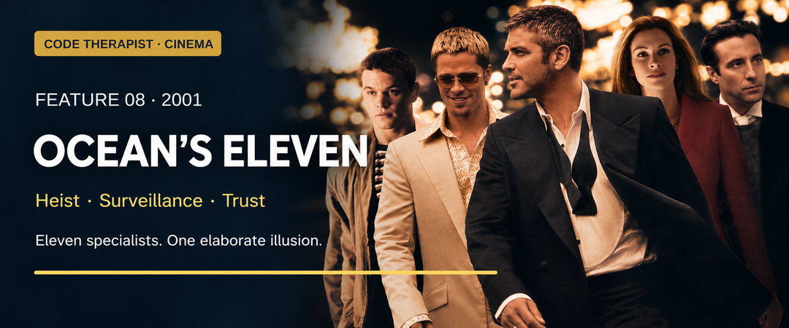

# Feature 008 · Ocean's Eleven (2001)
### Specialist teamwork meets the illusion of complete control

**Code Therapist Cinema · 10 November 2026 · Spoilers below**  
[← Six new films](./README.md) · [Cinema library](../README.md)

## Film identity and origin

| Item | Information |
|---|---|
| Director / writer | Steven Soderbergh / Ted Griffin |
| Main cast | George Clooney, Brad Pitt, Matt Damon, Andy García, Julia Roberts |
| Production / release | Warner Bros. / Village Roadshow; 2001 |
| Origin | Fictional remake of the 1960 film; not an actual casino-heist account |
| Genre | Ensemble heist comedy and crime caper |
| Content | PG-13; crime, language and sexual references |

The 2001 production reworks an earlier star-driven caper for a new ensemble. Warner's official Japanese release page confirms the principal cast, director and screenwriter. The appeal is not simply the amount of money at stake: it is watching sharply different personalities become parts of a shared performance. [1][2]

## The story

Fresh from prison, Danny Ocean reunites with Rusty Ryan and proposes a robbery against casinos controlled by Terry Benedict. Danny's former wife Tess is now with Benedict, making the enterprise personally complicated. The team recruits specialists, rehearses and studies the target.

The apparent robbery is partly theatre. What Benedict believes he sees does not reliably describe what is happening, and the people presented as a response team are part of the deception. The crew obtains the money, while Danny still faces consequences for violating parole. His relationship with Tess changes, but Benedict's continuing interest prevents the ending from feeling entirely free of danger. [1][2][3]

The film makes coordination look effortless because the audience usually sees the successful version. That is part of its charm. The real dramatic achievement is distributing attention: one character supplies nerve, another timing, another an apparently minor intervention that becomes important later. Viewers enjoy recognising how the pieces belong together.

## Scenes and situations worth discussing

**Recruiting the specialists** gives the film its rhythm. Expertise is varied rather than concentrated in one all-powerful hero. The scene is a reminder that a team's strength may lie in complementary abilities.

**Rehearsal** is an important part of the story's promise. The film establishes preparation, then uses apparent surprises to make the audience wonder whether that preparation was sufficient.

**Danny's personal motive** threatens trust inside the team. A leader who conceals a conflict of interest makes everyone else's risk harder to judge.

**The misleading view of the vault** turns surveillance into an interpretive problem. A picture seems authoritative, but the viewer still needs to know what it represents and when it was made.

## Where it belongs

| Field | Fit and limitation |
|---|---|
| Heist / theft | Central: casino robbery |
| Physical and personnel security | Strong: access, identity and response roles |
| Surveillance integrity | Strong discussion theme: believing an image |
| Social engineering | Strong: impersonation, distraction and confidence |
| Cybersecurity | Supporting electronic elements; not mainly a cybercrime procedural |
| Cryptography | Not the central mechanism |
| Realism | Deliberately polished fantasy, including exaggerated technical devices |

**Editorial security interpretation:** the useful question is whether several apparently independent checks actually rely on the same unverified assumption. If everyone trusts the same view or claimed identity, having more people look at it does not necessarily create independent confirmation. The film illustrates that problem dramatically; it does not establish how a real casino's systems operate.

## Why the defenders lose control

Benedict's authority and sophisticated environment create an appearance of certainty. The crew attacks that certainty by influencing what he thinks he knows. His personal rivalry also encourages him to focus on Danny as an individual, while the larger group distributes the work.

From a storytelling perspective, the plan works because the final explanation makes earlier scenes click into place. From an ethical perspective, success does not transform theft into a legitimate business method. The team offers enjoyable examples of planning and communication, but those virtues should be separated from the criminal objective.

## Lessons and viewing recommendation

- **Use complementary skills.** No single specialist sees the whole problem.
- **Disclose conflicts of interest.** Team members deserve to understand shared risks.
- **Verify the source of confidence.** A reassuring display may still require context.
- **Prepare, then communicate.** A plan is only useful if people understand their roles.

**Excellent entertainment for fans of stylish ensemble films.** Its warmth comes from the crew's exchanges, while its pleasure comes from delayed understanding. For a security discussion, the film is strongest on deception and trust. For a leadership discussion, it raises a sharper question: how much can a group trust a capable person whose private objective has not been disclosed?

**Discussion:** When do multiple checks stop being independent because they all trust the same source?

## Sources and image credit

1. [Warner Bros. Japan — official cast, credits, synopsis and artwork](https://www.warnerbros.co.jp/home_entertainment/eul0k3fic/).
2. [Film origin and plot chronology — supplementary reference](https://en.wikipedia.org/wiki/Ocean%27s_Eleven).
3. [Rotten Tomatoes — synopsis, genre and rating](https://www.rottentomatoes.com/m/oceans_eleven).

**Artwork:** AI-assisted editorial adaptation of Warner's official home-entertainment artwork. © Warner Bros. / Village Roadshow; rearranged for this banner, not an unmodified still.

[← Inside Man](./07-INSIDE-MAN.md) · [Next: The Italian Job →](./09-THE-ITALIAN-JOB.md)
