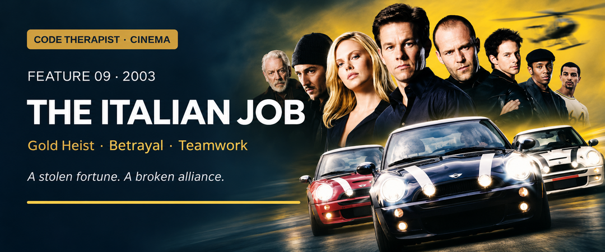

# Feature 009 · The Italian Job (2003)
### When betrayal defeats a technically successful plan

**Code Therapist Cinema · 10 November 2026 · Spoilers below**  
[← Six new films](./README.md) · [Cinema library](../README.md)

## Film identity and origin

| Item | Information |
|---|---|
| Director | F. Gary Gray |
| Screenplay | Donna Powers and Wayne Powers |
| Main cast | Mark Wahlberg, Charlize Theron, Edward Norton, Jason Statham, Seth Green, Mos Def, Donald Sutherland |
| Distributor / year | Paramount Pictures / 2003 |
| Origin | Inspired by the 1969 film, with a different story; fictional |
| Genre | Gold-heist action adventure and revenge caper |
| Content | PG-13; violence, language and criminal activity |

Paramount's synopsis emphasises a successful job undone by a double-cross. The production revisits the earlier film's combination of specialist thieves and small cars, while creating a new revenge story. Calling it a remake does not mean its events reproduce the 1969 plot, and neither version should be presented as documentary evidence of an actual theft. [1][2]

## The story

Charlie Croker and John Bridger lead a team that steals gold in Venice. Their technical success is destroyed by Steve's betrayal: John is killed, the others are left for dead, and Steve takes the fortune.

The survivors later locate Steve in Los Angeles. They recruit John's daughter Stella, whose safecracking skill makes her an essential participant rather than merely a grieving relative. Their first plan must change after circumstances and recognition expose them. When Steve tries to move the gold, the team adapts, using its different specialists to recover it. His violence has also created enemies beyond the original crew, leaving him isolated when the confrontation arrives. [1][2]

The story's emotional engine is broken trust. Gold gives the characters a visible objective, but the audience's investment comes from a shared loss. That makes the second job feel like a test of whether cooperation can survive betrayal. It also gives Stella an important position: she carries the personal cost of the first failure while contributing the expertise needed for the next attempt.

## The scenes that give the film its character

**The Venice operation** establishes a confident team with sharply divided roles. The betrayal that follows is more effective because success initially seems to prove that the group works.

**Stella joining the crew** shifts the balance between emotion and preparation. Grief is part of her motive, but the film lets competence define her contribution.

**The abandoned first plan** prevents the operation from feeling automatic. A plan is not valuable simply because people have invested time in it; conditions can invalidate its assumptions.

**The final chase** turns each specialist's contribution into visible motion. The compact cars give the action a distinctive identity, while the editing allows the audience to follow a complicated group effort.

## Where it belongs

| Field | Fit and limitation |
|---|---|
| Heist / theft | Central: gold, transport and recovery |
| Insider threat | Central story theme: trusted associate betrays the group |
| Physical security | Strong: safes, controlled spaces and movement of assets |
| Cybersecurity | Supporting: electronic surveillance and traffic-system interference |
| Cryptography | Not the main subject; opening a safe is not automatically cryptanalysis |
| Realism | Exaggerated access, timing and pursuit sequences |

**Editorial security interpretation:** the most instructive failure happens after the first objective has been achieved. The team treats possession of the gold as success, but its internal trust has not been secured. In legitimate organisations, the parallel discussion is about custody, independent approval and what happens after a valuable asset changes hands. Technical completion is only one part of a trustworthy process.

The electronic elements should also be kept in proportion. Lyle's abilities support the caper; the movie does not explain how an actual city's traffic systems are secured. Watching a fictional character influence a system is not evidence that comparable real-world access would be simple.

## Why Steve's advantage collapses

Steve has the money but loses the relationships that made the original team effective. His choices create more distrust and more enemies. He repeatedly tries to purchase loyalty after undermining the reasons someone would offer it. The crew, by contrast, can distribute responsibility among people who understand one another's strengths.

This does not make their revenge legally or ethically uncomplicated. The movie invites emotional satisfaction at a recovery, but a viewer can recognise that satisfaction without treating theft or violent retaliation as acceptable ways of settling a dispute.

## Lessons and viewing recommendation

- **Do not stop evaluating risk at technical success.** Handover and custody still matter.
- **Adapt when assumptions change.** Continuing blindly is not commitment.
- **Respect complementary expertise.** Stella's skill cannot be replaced by enthusiasm.
- **Trust is costly to rebuild.** Money cannot automatically repair betrayal.

**A lively choice for viewers who enjoy teamwork and practical-looking action.** The locations, cars and ensemble provide a memorable visual identity. Its best discussion topic is the gap between a clever plan and a trustworthy team: one can exist without the other.

**Discussion:** What can go wrong after a task is declared successful but before its result reaches the intended owner?

## Sources and image credit

1. [Paramount — official synopsis, cast, credits and rating](https://www.paramount.com/movies/the-italian-job-2003).
2. [Origin, screenplay and plot chronology — supplementary reference](https://en.wikipedia.org/wiki/The_Italian_Job_(2003_film)).
3. [AFI — film synopsis and release information](https://watch.afi.com/movie/the-italian-job).

**Artwork:** AI-assisted editorial adaptation of Paramount's official poster, rearranged into a landscape banner. Film imagery belongs to Paramount and the respective rights holders; this is not an unmodified production still.

[← Ocean's Eleven](./08-OCEANS-ELEVEN.md) · [Next: The Imitation Game →](./10-THE-IMITATION-GAME.md)
