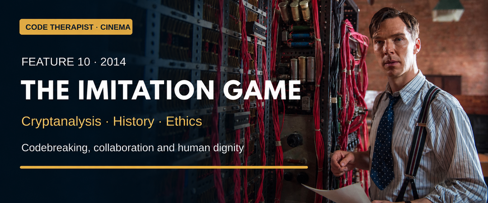

# Feature 010 · The Imitation Game (2014)
### Codebreaking, collaboration and the cost of prejudice

**Code Therapist Cinema · 10 November 2026 · Spoilers · Historical drama with substantial fictionalisation**  
[← Six new films](./README.md) · [Cinema library](../README.md)

## Film identity and origin

| Item | Information |
|---|---|
| Director / writer | Morten Tyldum / Graham Moore |
| Main cast | Benedict Cumberbatch, Keira Knightley, Matthew Goode, Rory Kinnear |
| Producer source | Black Bear Pictures |
| Year | 2014 |
| Adaptation | Andrew Hodges's biography Alan Turing: The Enigma |
| Genre | Biographical historical drama and wartime codebreaking thriller |
| Content | PG-13; war themes, discrimination and distressing persecution |

Black Bear identifies the source biography and creative team. The film builds a suspense story around Turing and wartime codebreaking, while linking that achievement to his earlier life and later persecution. Its dramatic purpose is to make difficult intellectual work emotionally accessible. That purpose does not make every scene historically reliable. [1][2]

## The story

During the Second World War, Alan Turing joins Britain's effort to read encrypted German communications at Bletchley Park. The film presents the pressure to make progress against Enigma alongside tensions within the team. Joan Clarke becomes an important colleague and personal ally.

The drama follows the construction of a codebreaking machine, a breakthrough and the difficult question of how intelligence should be used without exposing its source. Scenes from Turing's schooldays and postwar life frame the wartime story. The later investigation into his private life leads to punishment for homosexuality, turning the account of achievement into a tragedy of institutional prejudice. These are the film's narrative contours, not a claim that its specific conversations and incidents are documented fact. [1][2][3]

The film's emotional force comes from a bitter contrast: an institution can depend on someone's contribution and still deny that person's dignity. The codebreaking problem supplies urgency, but the lasting question concerns how people are treated when they no longer fit the role society wants them to occupy.

## History check: what must be separated from drama

| Film impression | Historical qualification |
|---|---|
| A single isolated genius solves the problem | Turing's contribution was part of a larger collaborative effort, with important prewar Polish breakthroughs |
| One dramatic insight transforms everything | Actual cryptanalytic progress involved sustained work, changing methods and many contributors |
| Personalities and confrontations are exact records | Researchers identify substantial changes and invented details in the portrayals |
| The machine is a universal answer to encryption | The Bombe addressed particular Enigma problems; it was not a general decoder for every cipher |

Professor Graham Farr's Monash analysis explains both the prior Polish work and the film's distortions. Science News also challenges the invented spy-related storyline. Those criticisms matter because a sympathetic film can still teach a misleading history. Do not repeat its dramatic accusations as facts about real people. [2][3]

## Where it belongs

| Field | Fit and limitation |
|---|---|
| Cryptanalysis | Central: trying to recover information protected by a cipher |
| Cryptography | Central context: the design and use of encrypted communications |
| Computing history | Important, but this film is not a complete history of computing |
| Intelligence ethics | Strong: secrecy, decisions and consequences |
| Modern cybersecurity | Historical background, not a guide to contemporary network intrusion |
| Heist / theft | Not the principal genre |

**Editorial interpretation:** this is the collection's clearest distinction between encryption and codebreaking. Cryptography concerns protecting communication; cryptanalysis studies how that protection might be overcome. The film gives those ideas human stakes, but modern systems should not be judged by a fictionalised account of a wartime machine.

## The most meaningful situations

**The struggle to work as a team** makes communication part of intellectual progress. As drama, it asks whether brilliant thinking can become useful without being shared. As history, its portrayals require caution.

**The apparent breakthrough** gives abstract work a physical presence. Moving machinery makes an otherwise invisible search feel tangible, which is an effective cinematic choice even when it compresses the underlying process.

**The intelligence dilemma** raises a serious ethical question: knowing something does not make the consequences of acting on it simple. The particular incident is a dramatic construction, not a documented decision that should be attributed to Turing.

**The postwar persecution** changes the scale of the story. The achievement cannot compensate for the injustice, and the injustice should not become merely a device for celebrating achievement.

## Lessons and viewing recommendation

- **Credit the wider team and earlier work.** Good history does not need a solitary hero.
- **Check dramatic claims against evidence.** Emotional plausibility is not documentation.
- **Protect human dignity.** A person's rights should not depend on their usefulness.
- **Make difficult work understandable without erasing complexity.** Clear explanation and accuracy should support one another.

**Worth watching as an affecting historical drama, followed by a fact check.** The performances and wartime urgency can encourage further study. The strongest learning outcome is not memorising the movie's version of events, but becoming curious about Turing, Clarke, Polish cryptanalysis and the many people behind Bletchley Park's work.

**Discussion:** How can a film honour a real person while still misleading viewers about their life?

## Sources and image credit

1. [Black Bear — official credits, adaptation and synopsis](https://blackbearpictures.com/film-and-tv/the-imitation-game).
2. [Monash University — history, science and myth](https://www.monash.edu/news/articles/the-imitation-game-is-it-history-drama-or-myth).
3. [Science News — historical inaccuracies](https://www.sciencenews.org/article/-imitation-game-entertains-expense-accuracy).
4. [Rotten Tomatoes — film classification and content information](https://www.rottentomatoes.com/m/the_imitation_game).

**Artwork:** AI-assisted editorial adaptation of the featured photograph on Black Bear's official film page. Film imagery belongs to the respective rights holders; this is an adapted banner, not an unmodified production still.

[← The Italian Job](./09-THE-ITALIAN-JOB.md) · [Back to the collection →](./README.md)
