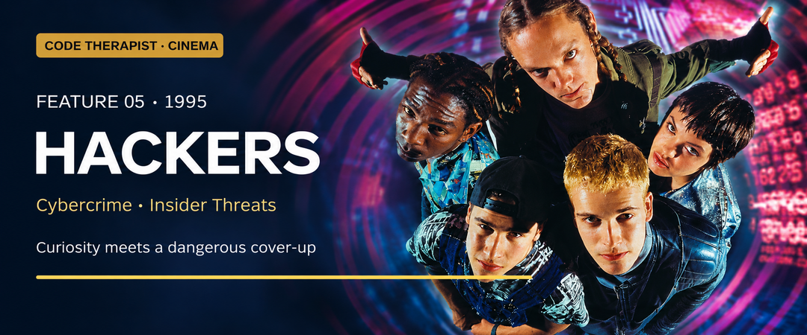
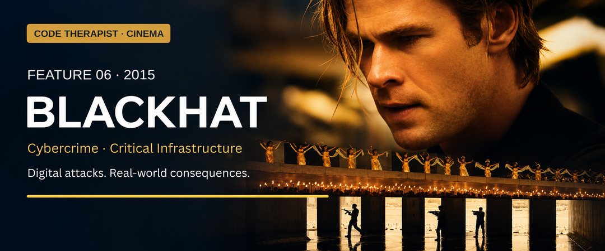
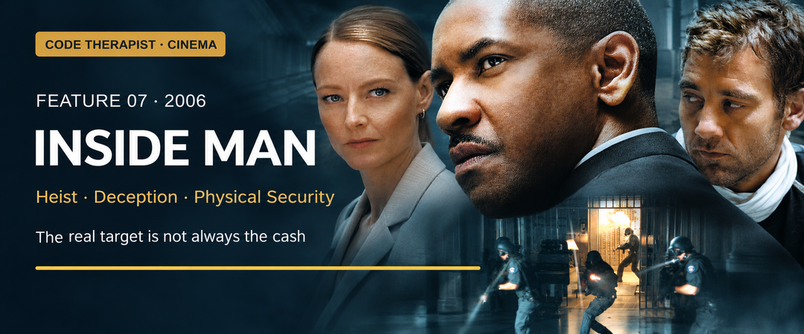
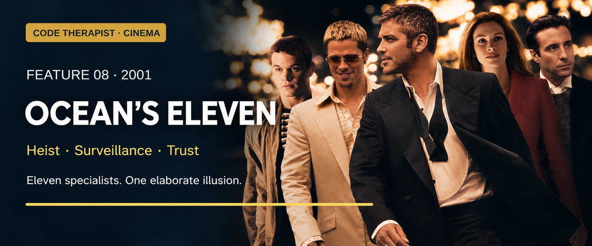
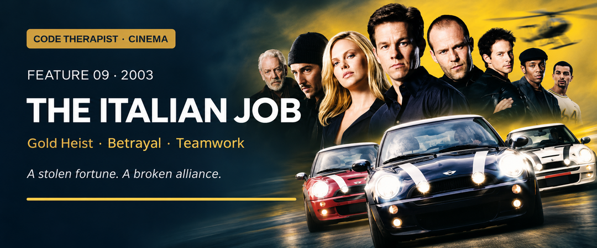
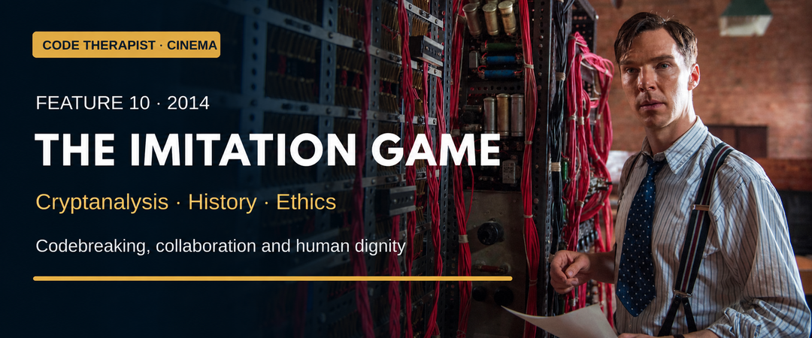

# Six More Movie Stories — Hacking, Heists & Security
### Code Therapist Cinema · Tuesday, 10 November 2026 · Features 005–010

**Six new researched film guides and six matching photographic landscape covers.** Together with [the earlier four films](../2026-11-10-FOUR-FILMS/README.md), today's library now contains **ten distinct movies**.

[← Cinema library](../README.md) · [Earlier four films](../2026-11-10-FOUR-FILMS/README.md) · [Code Therapist profile](https://github.com/codetherapistpita-oss)

Each guide contains its origin, creative credits, an original story overview, meaningful situations, category mapping, security interpretations, lessons, viewing assessment and sources. **Individual stories contain spoilers.** Classification and security lessons are editorial interpretations; film events are not technical demonstrations.

## Choose by field

| Film | Main field | Cybersecurity fit | Cryptography / cryptanalysis fit | Reality status |
|---|---|---|---|---|
| [Hackers (1995)](./05-HACKERS.md) | Cybercrime and insider threats | Central | Not central | Fictional original screenplay |
| [Blackhat (2015)](./06-BLACKHAT.md) | Cybercrime and critical infrastructure | Central | Secondary | Fictional original screenplay |
| [Inside Man (2006)](./07-INSIDE-MAN.md) | Bank heist and deception | Indirect | Not central | Fictional original screenplay |
| [Ocean's Eleven (2001)](./08-OCEANS-ELEVEN.md) | Casino heist, surveillance and trust | Supporting | Not central | Fictional remake of the 1960 film |
| [The Italian Job (2003)](./09-THE-ITALIAN-JOB.md) | Gold theft, betrayal and electronic systems | Supporting | Not central | Fiction, inspired by the 1969 film |
| [The Imitation Game (2014)](./10-THE-IMITATION-GAME.md) | Historical cryptanalysis and ethics | Historical context | Central | Historical drama with substantial fictionalisation |

## The six features

### 05 · Hackers (1995)

**Cybercrime and insider threats.** A teenage hacker community confronts a corporate cover-up.

[Read the story, background and lessons →](./05-HACKERS.md)

### 06 · Blackhat (2015)

**Cybercrime and critical infrastructure.** An international pursuit connects digital disruption with a financial motive.

[Read the story, background and lessons →](./06-BLACKHAT.md)

### 07 · Inside Man (2006)

**Bank heist and deception.** A hostage crisis conceals a target more specific than the bank's cash.

[Read the story, background and lessons →](./07-INSIDE-MAN.md)

### 08 · Ocean's Eleven (2001)

**Casino heist, surveillance and trust.** A specialist crew turns its target's confidence into a weakness.

[Read the story, background and lessons →](./08-OCEANS-ELEVEN.md)

### 09 · The Italian Job (2003)

**Gold theft, betrayal and electronic systems.** A successful robbery is undone by betrayal; the survivors regroup.

[Read the story, background and lessons →](./09-THE-ITALIAN-JOB.md)

### 10 · The Imitation Game (2014)

**Historical cryptanalysis and ethics.** Wartime codebreaking meets collaboration and institutional prejudice.

[Read the story, background and lessons →](./10-THE-IMITATION-GAME.md)

## A useful viewing order

Start with **Hackers** for youth cyberculture, then **Blackhat** for the physical consequences of cybercrime. Move to **Inside Man**, **Ocean's Eleven** and **The Italian Job** for different relationships between deception, trust and theft. Finish with **The Imitation Game** for historical codebreaking and a careful fact check.

These are critical guides, not screenplays or streaming uploads. Watch through legitimate services; this collection does not claim current viewing availability in Uganda.

## Study and discuss

| Question | Films to compare |
|---|---|
| Does a trusted position make an account reliable? | Hackers / Inside Man |
| How can electronic events affect physical assets? | Blackhat / The Italian Job |
| What makes a group more effective than one expert? | Ocean's Eleven / The Imitation Game |
| Can a satisfying ending hide an ethical problem? | Inside Man / The Italian Job |
| When does dramatic clarity distort history? | The Imitation Game |

**Image format:** all six covers are 1080 × 450 PNGs, shown at 720px width with their aspect ratio preserved. Each is an AI-assisted adaptation of sourced film artwork, with credit on its report page. See the [image provenance record](./IMAGE-SOURCES.md).

[← Browse all ten movies](../README.md)
