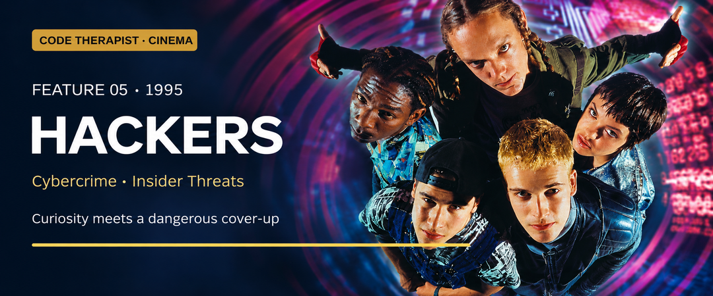
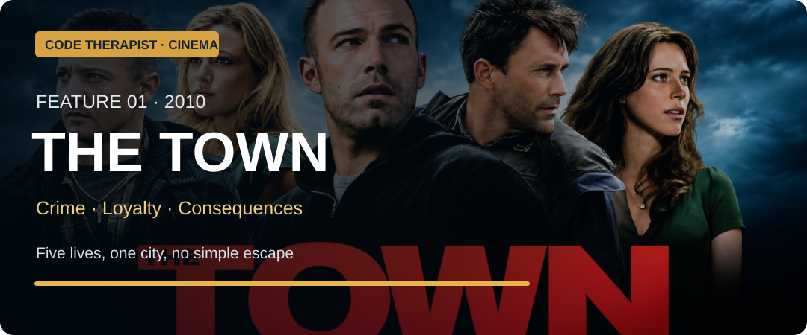
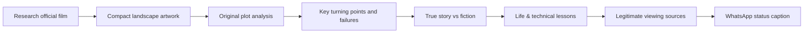

# 🎬 Cinema & Technology Film Research — Code Therapist

**Researched collections spanning hacking, heists, theft, security, cryptanalysis and human stories** · Curated film stories, real source links and lessons.

[← Creator & Social Media](../README.md) · [Knowledge Hub](../../README.md)

> Each case study is a **written critical film guide**, not a copy of the movie, its screenplay or an illegal watch link. Daily suggestions should not repeat previous movies; a publication counts only after it is actually committed and verified. Movie posters and screenshots need appropriate attribution and reuse permissions.

## New: six more films — 10 November 2026

**[Explore six new movie stories, backgrounds and lessons →](./2026-11-10-SIX-SECURITY-FILMS/README.md)**

| Feature | Movie | Field |
|---|---|---|
| 05 | [Hackers (1995)](./2026-11-10-SIX-SECURITY-FILMS/05-HACKERS.md) | Cybercrime and insider threats |
| 06 | [Blackhat (2015)](./2026-11-10-SIX-SECURITY-FILMS/06-BLACKHAT.md) | Cybercrime and critical infrastructure |
| 07 | [Inside Man (2006)](./2026-11-10-SIX-SECURITY-FILMS/07-INSIDE-MAN.md) | Bank heist and deception |
| 08 | [Ocean's Eleven (2001)](./2026-11-10-SIX-SECURITY-FILMS/08-OCEANS-ELEVEN.md) | Casino heist, surveillance and trust |
| 09 | [The Italian Job (2003)](./2026-11-10-SIX-SECURITY-FILMS/09-THE-ITALIAN-JOB.md) | Gold theft, betrayal and electronic systems |
| 10 | [The Imitation Game (2014)](./2026-11-10-SIX-SECURITY-FILMS/10-THE-IMITATION-GAME.md) | Historical cryptanalysis and ethics |

**Today's total: ten movies.** The six above are additions to the four below; no title is repeated.

## Earlier collection: four films — 10 November 2026

**[Read all four researched movies](./2026-11-10-FOUR-FILMS/README.md)**

| Collection | Film | Story & what viewers learn |
|---|---|---|
| Main film · Crime | [**The Town (2010)**](./2026-11-10-FOUR-FILMS/01-THE-TOWN.md) | Loyalty, stolen trust, failed plans, crime and consequences |
| Main film · Adventure | [**Heart of the Beast (2026)**](./2026-11-10-FOUR-FILMS/02-HEART-OF-THE-BEAST.md) | Veteran, dog, wilderness survival and sacrifice |
| Tech classic | [**WarGames (1983)**](./2026-11-10-FOUR-FILMS/03-WARGAMES.md) | Unintended automation, high-stakes errors and human judgment |
| Hacker classic | [**Sneakers (1992)**](./2026-11-10-FOUR-FILMS/04-SNEAKERS.md) | Ethical security testing, cryptography and dangerous trust |

## 📚 Learning seasons

| Season | Level | Main content |
|---|---|---|
| **Season 01 · Cinema awareness** | General audience | Genre, production, storyline, characters, moral decisions |
| **Season 02 · Technology and security in film** | Technology students | Cyber threats, surveillance, programming, technology myths |
| **Season 03 · Film criticism and research** | Advanced | Real vs fictional history, cinematography, storytelling, ethical interpretation |

The film collection is organized by **date, category and individual feature number**; the Season labels are learning tracks, not claims that every season already has its complete material.

## Movie image standard

Every movie must have a clean photographic landscape banner: **1080 × 450 pixels**, displayed at **720px width** with its aspect ratio preserved. Use a sourced featured movie image as the background, readable foreground title and short thematic text, and the established Code Therapist cinema styling. Record the image source and label AI-assisted adaptations. Decode the complete image and verify the live page before publishing.

## 📝 Standard publishing format

## 🛡️ Editorial policies

1. Provide correct year, director, credited cast and original source / adaptation status.
2. Use studio, AFI, BFI and reputable film criticism; date reviews when appropriate.
3. Write original paraphrased commentary; **avoid full screenplays or excessively detailed scene-by-scene substitutes**.
4. Label spoilers so people can decide when to read the ending.
5. Keep all film image assets compact and properly attributed; ask permission where needed.
6. Suggest legitimate viewing providers and do not claim movie availability in Uganda without verifying.
7. Separate **fictional hacking scenes** from real and authorized cybersecurity practice.

[← Knowledge Hub](../../README.md)
