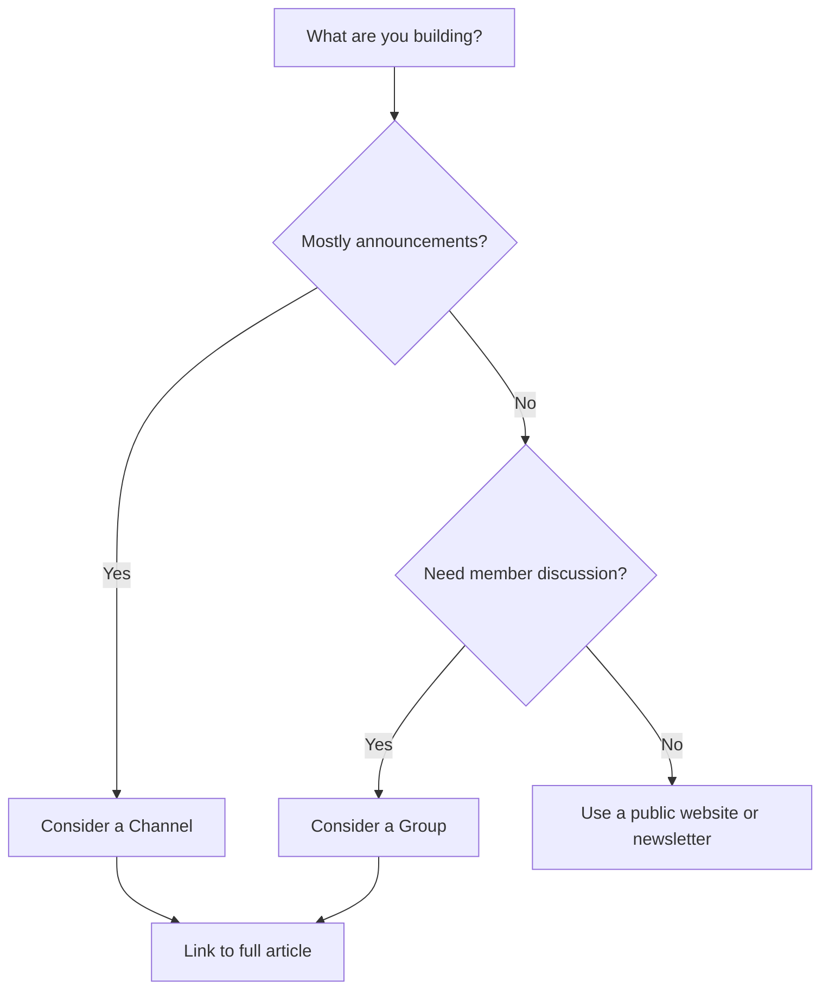

# 📣 WhatsApp Channels vs Groups — Pick the Right Community Format

> **Code Therapist Creator Hub** · **7 November 2026** · Creator guide  
> Product features and availability can change; verify inside the current official app.

## They solve different problems

A **Channel** is oriented toward one-to-many updates from admins to followers. A **Group** supports participant conversations and coordination. Privacy settings and exact tools vary by product version.

## Practical comparison

| Question | Channel | Group |
|---|---|---|
| Main purpose | Broadcast updates | Discussion and coordination |
| Typical content | Announcements and links | Questions, replies, collaboration |
| Good for | Technology news highlights | Programming study groups |
| Long-form articles | Link to full page | Link to full page |

## Code Therapist publishing workflow

1. Publish the complete, source-checked technical article in the Knowledge Hub.
2. Write a short, accurate headline for your chosen messaging platform.
3. Include the date and one clear takeaway.
4. Link directly to the original article, not to a shortened or misleading URL.
5. Correct the public post if new evidence changes the story.

Avoid reuploading someone else's copyrighted article as your own, and avoid posting users' phone numbers or identifying details.

## Source

- [WhatsApp — Official blog](https://blog.whatsapp.com/)
- [WhatsApp — Official help](https://faq.whatsapp.com/)

---

[← WhatsApp](./README.md) · [← Creator Hub](../README.md) · [← Knowledge Hub](../../README.md)
