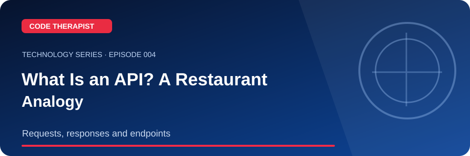
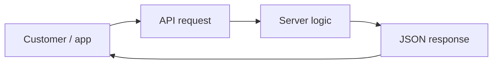

# Episode 004 · What Is an API? A Restaurant Analogy

**Code Therapist · 2026-11-08 · Requests, responses and endpoints**

[Full Technology Series](./README.md) · [Knowledge Hub](../../../README.md) · [Portfolio](https://codetherapist.netlify.app/)

> **Learning summary:** An API is an agreed interface for software to interact. Web APIs commonly use HTTP requests and machine-readable responses such as JSON. A restaurant waiter is a useful analogy, but an actual API is software rather than a human messenger.

## 01 · What viewers will learn

1. Introduce client, endpoint, server and response.
2. Use the restaurant order analogy to show a request/response cycle.
3. Open a public demo API response at https://jsonplaceholder.typicode.com/todos/1 and inspect the JSON.
4. Explain GET versus POST and why APIs must validate permissions.

## 02 · How it works — workflow

## 03 · Practical example / discussion

Open the example JSON and identify its `id`, `title` and `completed` fields. Write one sentence about how an application might display them.

## 04 · Ready-to-record YouTube Short (60–90 seconds)

| Scene | Narration / what to show |
|---|---|
| **00:00–00:08 · Hook** | “undefined” Show the landscape episode thumbnail. |
| **00:08–00:25 · Explain** | An API is an agreed interface for software to interact. Web APIs commonly use HTTP requests and machine-readable responses such as JSON. A restaurant waiter is a useful analogy, but an actual API is software rather than a human messenger. |
| **00:25–00:55 · Demonstrate** | Introduce client, endpoint, server and response. Use the restaurant order analogy to show a request/response cycle. Open a public demo API response at https://jsonplaceholder.typicode.com/todos/1 and inspect the JSON. |
| **00:55–01:12 · Key takeaway** | Show the workflow diagram and summarize the most useful action or lesson. |
| **01:12–01:30 · Close** | “For the full guide and official references, open the Code Therapist Knowledge Hub link below. Follow for the next technology episode.” |

**Recording guidance:** Use your own screen capture and source-authorized visuals. Do not imply that a concept mockup, hypothetical result or corporate announcement is an independently verified production demonstration.

## 05 · Verified source links

- [MDN HTTP overview](https://developer.mozilla.org/en-US/docs/Web/HTTP/Guides/Overview)
- [MDN Fetch API](https://developer.mozilla.org/en-US/docs/Web/API/Fetch_API)

## 06 · Accuracy, privacy and safety

An API may expose private information if poorly secured. Use approved testing endpoints, not private credentials.

## 07 · Share to WhatsApp / video description

**📚 CODE THERAPIST · EPISODE 004**  
**What Is an API? A Restaurant Analogy**

Requests, responses and endpoints. Read the step-by-step article, diagram, practical example and original references:

[Open this article on GitHub](https://github.com/codetherapistpita-oss/codetherapistpita-oss/blob/main/knowledge-hub/07-SOCIAL-MEDIA/YOUTUBE/2026-11-08-TECHNOLOGY-EDUCATION/EP-004-what-is-an-api.md)

**Editorial note:** This is a published article and recording script. A YouTube video has not been recorded or uploaded by this publication.

---

[← All 12 episodes](./README.md) · [Code Therapist GitHub](https://github.com/codetherapistpita-oss)
