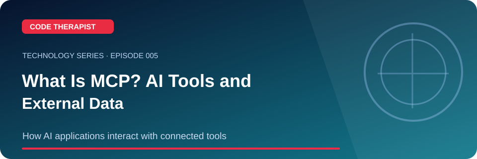
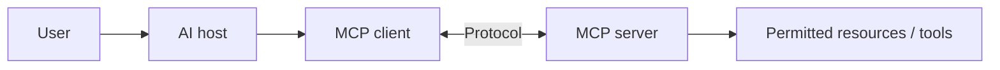

# Episode 005 · What Is MCP? AI Tools and External Data

**Code Therapist · 2026-11-08 · How AI applications interact with connected tools**

[Full Technology Series](./README.md) · [Knowledge Hub](../../../README.md) · [Portfolio](https://codetherapist.netlify.app/)

> **Learning summary:** Model Context Protocol (MCP) is an open protocol that helps AI applications communicate with external tools and data sources. A host uses clients to communicate with MCP servers; permissions and trust still have to be managed.

## 01 · What viewers will learn

1. Identify the host, client, server, tool and resource roles.
2. Show a read-only search of approved documentation as the example.
3. Compare a read action with a sensitive write or send action.
4. Explain why external tool output may contain untrusted instructions.

## 02 · How it works — workflow

## 03 · Practical example / discussion

Draw a read-only MCP integration for a company handbook. Mark the boundary where approval is required before editing content.

## 04 · Ready-to-record YouTube Short (60–90 seconds)

| Scene | Narration / what to show |
|---|---|
| **00:00–00:08 · Hook** | “undefined” Show the landscape episode thumbnail. |
| **00:08–00:25 · Explain** | Model Context Protocol (MCP) is an open protocol that helps AI applications communicate with external tools and data sources. A host uses clients to communicate with MCP servers; permissions and trust still have to be managed. |
| **00:25–00:55 · Demonstrate** | Identify the host, client, server, tool and resource roles. Show a read-only search of approved documentation as the example. Compare a read action with a sensitive write or send action. |
| **00:55–01:12 · Key takeaway** | Show the workflow diagram and summarize the most useful action or lesson. |
| **01:12–01:30 · Close** | “For the full guide and official references, open the Code Therapist Knowledge Hub link below. Follow for the next technology episode.” |

**Recording guidance:** Use your own screen capture and source-authorized visuals. Do not imply that a concept mockup, hypothetical result or corporate announcement is an independently verified production demonstration.

## 05 · Verified source links

- [MCP introduction](https://modelcontextprotocol.io/introduction)
- [MCP architecture](https://modelcontextprotocol.io/docs/learn/architecture)

## 06 · Accuracy, privacy and safety

MCP connections do not automatically make a tool trustworthy. Use least privilege, auditing and confirmation for sensitive actions.

## 07 · Share to WhatsApp / video description

**📚 CODE THERAPIST · EPISODE 005**  
**What Is MCP? AI Tools and External Data**

How AI applications interact with connected tools. Read the step-by-step article, diagram, practical example and original references:

[Open this article on GitHub](https://github.com/codetherapistpita-oss/codetherapistpita-oss/blob/main/knowledge-hub/07-SOCIAL-MEDIA/YOUTUBE/2026-11-08-TECHNOLOGY-EDUCATION/EP-005-what-is-mcp.md)

**Editorial note:** This is a published article and recording script. A YouTube video has not been recorded or uploaded by this publication.

---

[← All 12 episodes](./README.md) · [Code Therapist GitHub](https://github.com/codetherapistpita-oss)
