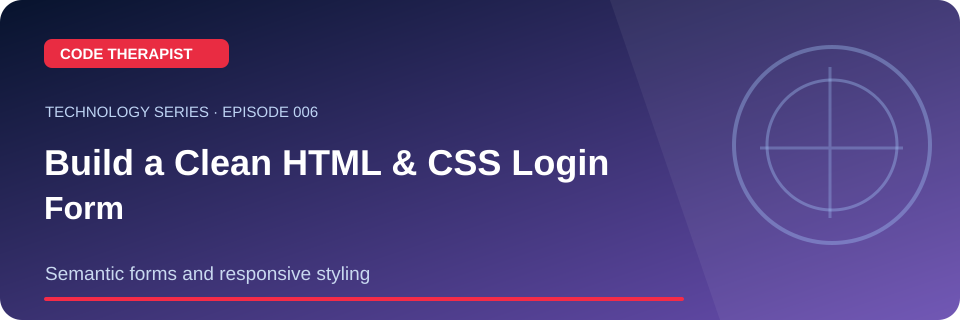
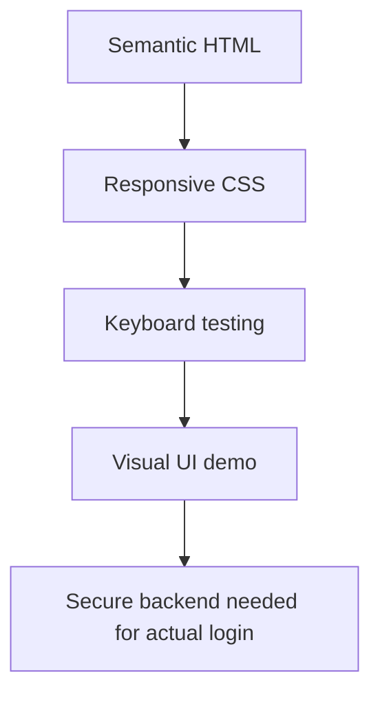

# Episode 006 · Build a Clean HTML & CSS Login Form

**Code Therapist · 2026-11-08 · Semantic forms and responsive styling**

[Full Technology Series](./README.md) · [Knowledge Hub](../../../README.md) · [Portfolio](https://codetherapist.netlify.app/)

> **Learning summary:** A login form is an excellent beginner UI exercise: labels, input types, spacing, contrast and keyboard focus. Code Therapist already has a complete original HTML/CSS project, so this video lesson references that code rather than creating a duplicate.

## 01 · What viewers will learn

1. Open the original login form project linked below.
2. Inspect the HTML labels and email/password inputs.
3. Change the heading, button label and card spacing in CSS.
4. Test keyboard navigation, small screens and the reduced-motion setting where appropriate.

## 02 · How it works — workflow

## 03 · Practical example / discussion

Download the existing sample's `index.html` and `styles.css`. Make a phone-width version and document three accessibility checks.

## 04 · Ready-to-record YouTube Short (60–90 seconds)

| Scene | Narration / what to show |
|---|---|
| **00:00–00:08 · Hook** | “undefined” Show the landscape episode thumbnail. |
| **00:08–00:25 · Explain** | A login form is an excellent beginner UI exercise: labels, input types, spacing, contrast and keyboard focus. Code Therapist already has a complete original HTML/CSS project, so this video lesson references that code rather than creating a duplicate. |
| **00:25–00:55 · Demonstrate** | Open the original login form project linked below. Inspect the HTML labels and email/password inputs. Change the heading, button label and card spacing in CSS. |
| **00:55–01:12 · Key takeaway** | Show the workflow diagram and summarize the most useful action or lesson. |
| **01:12–01:30 · Close** | “For the full guide and official references, open the Code Therapist Knowledge Hub link below. Follow for the next technology episode.” |

**Recording guidance:** Use your own screen capture and source-authorized visuals. Do not imply that a concept mockup, hypothetical result or corporate announcement is an independently verified production demonstration.

## 05 · Verified source links

- [Code Therapist original login form](https://github.com/codetherapistpita-oss/codetherapistpita-oss/tree/main/knowledge-hub/01-DEVELOPER-ACADEMY/HTML-CSS/login-form)
- [MDN HTML forms](https://developer.mozilla.org/en-US/docs/Learn_web_development/Extensions/Forms)

## 06 · Accuracy, privacy and safety

This is only a visual UI, not an authentication service. Never submit real passwords to a demonstration page.

## 07 · Share to WhatsApp / video description

**📚 CODE THERAPIST · EPISODE 006**  
**Build a Clean HTML & CSS Login Form**

Semantic forms and responsive styling. Read the step-by-step article, diagram, practical example and original references:

[Open this article on GitHub](https://github.com/codetherapistpita-oss/codetherapistpita-oss/blob/main/knowledge-hub/07-SOCIAL-MEDIA/YOUTUBE/2026-11-08-TECHNOLOGY-EDUCATION/EP-006-responsive-login-form.md)

**Editorial note:** This is a published article and recording script. A YouTube video has not been recorded or uploaded by this publication.

---

[← All 12 episodes](./README.md) · [Code Therapist GitHub](https://github.com/codetherapistpita-oss)
