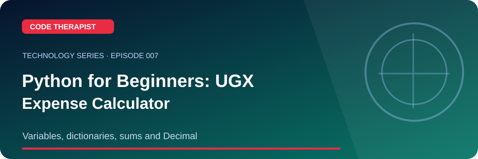

<div align="center">



# Episode 007 · Python for Beginners: UGX Expense Calculator

**Code Therapist · 2026-11-08 · Variables, dictionaries, sums and Decimal**

[Full Technology Series](./README.md) · [Knowledge Hub](../../../README.md) · [Portfolio](https://codetherapist.netlify.app/)

</div>

> **Learning summary:** Create an itemized expense calculator in Python. The practice inputs below are fictional amounts in Ugandan shillings, not real financial records.

## 01 · What viewers will learn

1. Create a file named `expenses.py`.
2. Import `Decimal` and record three fictional expense categories.
3. Print the items and total using a loop and `sum`.
4. Change one value and check that the total updates correctly.

## 02 · How it works — workflow


## 03 · Practical example / discussion

```python
from decimal import Decimal
costs = {'Transport': Decimal('4000'), 'Lunch': Decimal('6000'), 'Data': Decimal('2000')}
for name, ugx in costs.items():
    print(f'{name}: UGX {ugx:,.0f}')
print(f'Total: UGX {sum(costs.values(), Decimal(0)):,.0f}')
```
Expected total: **UGX 12,000**. Add one more fictional item.

## 04 · Ready-to-record YouTube Short (60–90 seconds)

| Scene | Narration / what to show |
|---|---|
| **00:00–00:08 · Hook** | “undefined” Show the landscape episode thumbnail. |
| **00:08–00:25 · Explain** | Create an itemized expense calculator in Python. The practice inputs below are fictional amounts in Ugandan shillings, not real financial records. |
| **00:25–00:55 · Demonstrate** | Create a file named `expenses.py`. Import `Decimal` and record three fictional expense categories. Print the items and total using a loop and `sum`. |
| **00:55–01:12 · Key takeaway** | Show the workflow diagram and summarize the most useful action or lesson. |
| **01:12–01:30 · Close** | “For the full guide and official references, open the Code Therapist Knowledge Hub link below. Follow for the next technology episode.” |

**Recording guidance:** Use your own screen capture and source-authorized visuals. Do not imply that a concept mockup, hypothetical result or corporate announcement is an independently verified production demonstration.

## 05 · Verified source links

- [Python decimal documentation](https://docs.python.org/3/library/decimal.html)
- [Python tutorial](https://docs.python.org/3/tutorial/)

## 06 · Accuracy, privacy and safety

For real financial tracking, add input validation, durable storage and privacy controls. This is a basic learning exercise.

## 07 · Share to WhatsApp / video description

**📚 CODE THERAPIST · EPISODE 007**  
**Python for Beginners: UGX Expense Calculator**

Variables, dictionaries, sums and Decimal. Read the step-by-step article, diagram, practical example and original references:

[Open this article on GitHub](https://github.com/codetherapistpita-oss/codetherapistpita-oss/blob/main/knowledge-hub/07-SOCIAL-MEDIA/YOUTUBE/2026-11-08-TECHNOLOGY-EDUCATION/EP-007-python-expense-calculator.md)

**Editorial note:** This is a published article and recording script. A YouTube video has not been recorded or uploaded by this publication.

---

[← All 12 episodes](./README.md) · [Code Therapist GitHub](https://github.com/codetherapistpita-oss)
