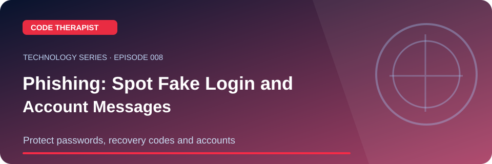
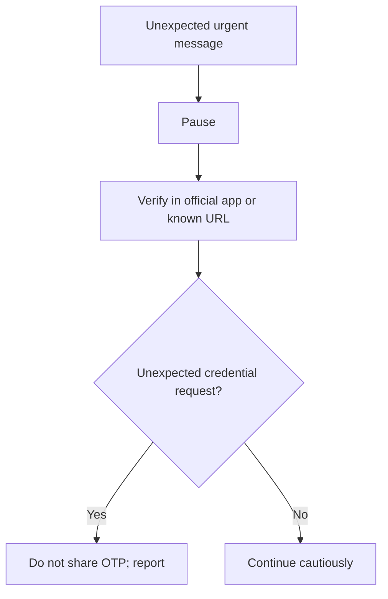

# Episode 008 · Phishing: Spot Fake Login and Account Messages

**Code Therapist · 2026-11-08 · Protect passwords, recovery codes and accounts**

[Full Technology Series](./README.md) · [Knowledge Hub](../../../README.md) · [Portfolio](https://codetherapist.netlify.app/)

> **Learning summary:** Phishing messages impersonate trusted organizations or people and pressure recipients into clicking deceptive links, revealing credentials or approving suspicious requests. Preventive checks help lower risk.

## 01 · What viewers will learn

1. Show a fictional urgent message: 'Your account is locked—send your OTP now.'
2. Explain why sender display names and shortened links are not proof of legitimacy.
3. Navigate to an official app directly instead of using message links.
4. Explain MFA and reporting options, and what to do if credentials were entered.

## 02 · How it works — workflow

## 03 · Practical example / discussion

Write three red flags of a fictional scam text. Do not open live malicious links or collect real passwords.

## 04 · Ready-to-record YouTube Short (60–90 seconds)

| Scene | Narration / what to show |
|---|---|
| **00:00–00:08 · Hook** | “undefined” Show the landscape episode thumbnail. |
| **00:08–00:25 · Explain** | Phishing messages impersonate trusted organizations or people and pressure recipients into clicking deceptive links, revealing credentials or approving suspicious requests. Preventive checks help lower risk. |
| **00:25–00:55 · Demonstrate** | Show a fictional urgent message: 'Your account is locked—send your OTP now.' Explain why sender display names and shortened links are not proof of legitimacy. Navigate to an official app directly instead of using message links. |
| **00:55–01:12 · Key takeaway** | Show the workflow diagram and summarize the most useful action or lesson. |
| **01:12–01:30 · Close** | “For the full guide and official references, open the Code Therapist Knowledge Hub link below. Follow for the next technology episode.” |

**Recording guidance:** Use your own screen capture and source-authorized visuals. Do not imply that a concept mockup, hypothetical result or corporate announcement is an independently verified production demonstration.

## 05 · Verified source links

- [CISA Secure Our World](https://www.cisa.gov/secure-our-world)
- [FTC phishing prevention](https://consumer.ftc.gov/articles/how-recognize-and-avoid-phishing-scams)

## 06 · Accuracy, privacy and safety

Demonstrate defensively. Do not create phishing pages, harvest passwords or show victims' private information.

## 07 · Share to WhatsApp / video description

**📚 CODE THERAPIST · EPISODE 008**  
**Phishing: Spot Fake Login and Account Messages**

Protect passwords, recovery codes and accounts. Read the step-by-step article, diagram, practical example and original references:

[Open this article on GitHub](https://github.com/codetherapistpita-oss/codetherapistpita-oss/blob/main/knowledge-hub/07-SOCIAL-MEDIA/YOUTUBE/2026-11-08-TECHNOLOGY-EDUCATION/EP-008-phishing-explained.md)

**Editorial note:** This is a published article and recording script. A YouTube video has not been recorded or uploaded by this publication.

---

[← All 12 episodes](./README.md) · [Code Therapist GitHub](https://github.com/codetherapistpita-oss)
