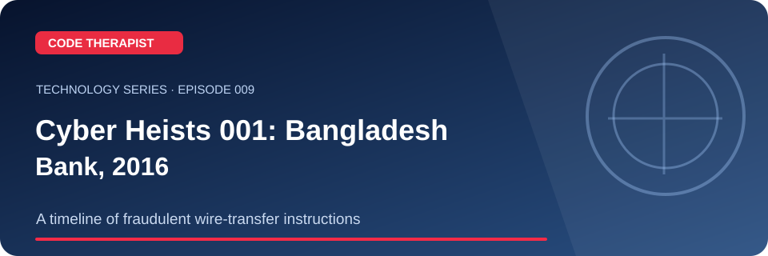
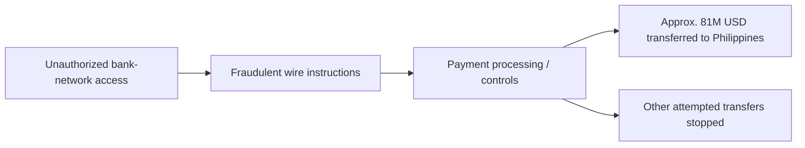

# Episode 009 · Cyber Heists 001: Bangladesh Bank, 2016

**Code Therapist · 2026-11-08 · A timeline of fraudulent wire-transfer instructions**

[Full Technology Series](./README.md) · [Knowledge Hub](../../../README.md) · [Portfolio](https://codetherapist.netlify.app/)

> **Learning summary:** On 4 February 2016 attackers tried to initiate fraudulent transfers approaching **US$951 million** from Bangladesh Bank accounts at the Federal Reserve Bank of New York. Approximately **US$81 million** reached accounts in the Philippines; do not confuse attempted and transferred amounts. US Department of Justice filings and Bangladesh Bank-related reporting discuss the case.

## 01 · What viewers will learn

1. Establish the event date: 4 February 2016.
2. Distinguish the approximately US$951 million attempted from roughly US$81 million transferred to the Philippines.
3. Explain how unauthorized system access and fraudulent payment instructions create cross-border financial risk.
4. Show lessons: transaction anomaly review, access controls, segregation of duties and response coordination.

## 02 · How it works — workflow

## 03 · Practical example / discussion

Create a three-column timeline: incident date, amount classification (attempted/processed/recovered), and primary evidence. Research any legal outcome separately by jurisdiction.

## 04 · Ready-to-record YouTube Short (60–90 seconds)

| Scene | Narration / what to show |
|---|---|
| **00:00–00:08 · Hook** | “undefined” Show the landscape episode thumbnail. |
| **00:08–00:25 · Explain** | On 4 February 2016 attackers tried to initiate fraudulent transfers approaching **US$951 million** from Bangladesh Bank accounts at the Federal Reserve Bank of New York. Approximately **US$81 million** reached accounts in the Philippines; do not confuse attempted and transferred amounts. US Department of Justice filings and Bangladesh Bank-related reporting discuss the case. |
| **00:25–00:55 · Demonstrate** | Establish the event date: 4 February 2016. Distinguish the approximately US$951 million attempted from roughly US$81 million transferred to the Philippines. Explain how unauthorized system access and fraudulent payment instructions create cross-border financial risk. |
| **00:55–01:12 · Key takeaway** | Show the workflow diagram and summarize the most useful action or lesson. |
| **01:12–01:30 · Close** | “For the full guide and official references, open the Code Therapist Knowledge Hub link below. Follow for the next technology episode.” |

**Recording guidance:** Use your own screen capture and source-authorized visuals. Do not imply that a concept mockup, hypothetical result or corporate announcement is an independently verified production demonstration.

## 05 · Verified source links

- [US Department of Justice case filing (PDF)](https://www.justice.gov/usao-cdca/press-release/file/1367721/dl)
- [Bangladesh Bank financial intelligence report (PDF)](https://www.bb.org.bd/pub/annual/bfiu/2015-2016.pdf)

## 06 · Accuracy, privacy and safety

Court allegations and proven findings are not interchangeable. Specific criminal statutes, prosecutions and recovery figures must be attributed to their time and jurisdiction.

## 07 · Share to WhatsApp / video description

**📚 CODE THERAPIST · EPISODE 009**  
**Cyber Heists 001: Bangladesh Bank, 2016**

A timeline of fraudulent wire-transfer instructions. Read the step-by-step article, diagram, practical example and original references:

[Open this article on GitHub](https://github.com/codetherapistpita-oss/codetherapistpita-oss/blob/main/knowledge-hub/07-SOCIAL-MEDIA/YOUTUBE/2026-11-08-TECHNOLOGY-EDUCATION/EP-009-bangladesh-bank-heist-2016.md)

**Editorial note:** This is a published article and recording script. A YouTube video has not been recorded or uploaded by this publication.

---

[← All 12 episodes](./README.md) · [Code Therapist GitHub](https://github.com/codetherapistpita-oss)
