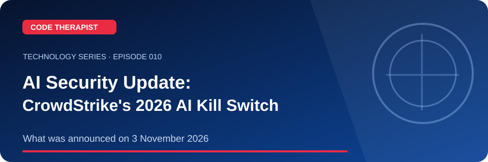
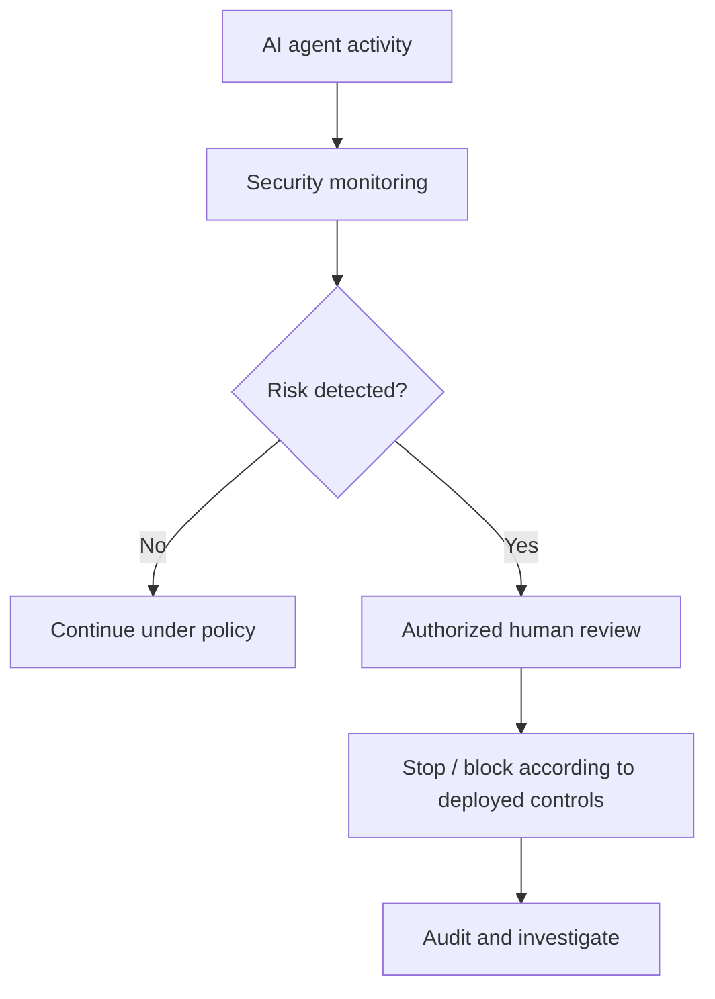

# Episode 010 · AI Security Update: CrowdStrike's 2026 AI Kill Switch

**Code Therapist · 2026-11-08 · What was announced on 3 November 2026**

[Full Technology Series](./README.md) · [Knowledge Hub](../../../README.md) · [Portfolio](https://codetherapist.netlify.app/)

> **Learning summary:** On **3 November 2026**, CrowdStrike announced an **AI Kill Switch** within Falcon Guardian aimed at allowing authorized defenders to stop misbehaving AI-agent activity and prevent relaunch. Its materials describe gateway enforcement available now and expanded endpoint capabilities as forthcoming. These are vendor announcements, not independently measured deployment outcomes.

## 01 · What viewers will learn

1. Date the primary announcement correctly: 3 November 2026.
2. Explain why agents with tool privileges introduce operational risk.
3. Differentiate claimed available functions from the vendor's proposed future enforcement.
4. Describe human approval, audit logs, and network access restrictions as control concepts.

## 02 · How it works — workflow

## 03 · Practical example / discussion

Read the press release and classify each capability as 'available' or 'planned' using only the manufacturer's stated claims.

## 04 · Ready-to-record YouTube Short (60–90 seconds)

| Scene | Narration / what to show |
|---|---|
| **00:00–00:08 · Hook** | “undefined” Show the landscape episode thumbnail. |
| **00:08–00:25 · Explain** | On **3 November 2026**, CrowdStrike announced an **AI Kill Switch** within Falcon Guardian aimed at allowing authorized defenders to stop misbehaving AI-agent activity and prevent relaunch. Its materials describe gateway enforcement available now and expanded endpoint capabilities as forthcoming. These are vendor announcements, not independently measured deployment outcomes. |
| **00:25–00:55 · Demonstrate** | Date the primary announcement correctly: 3 November 2026. Explain why agents with tool privileges introduce operational risk. Differentiate claimed available functions from the vendor's proposed future enforcement. |
| **00:55–01:12 · Key takeaway** | Show the workflow diagram and summarize the most useful action or lesson. |
| **01:12–01:30 · Close** | “For the full guide and official references, open the Code Therapist Knowledge Hub link below. Follow for the next technology episode.” |

**Recording guidance:** Use your own screen capture and source-authorized visuals. Do not imply that a concept mockup, hypothetical result or corporate announcement is an independently verified production demonstration.

## 05 · Verified source links

- [CrowdStrike official announcement (3 Nov 2026)](https://www.crowdstrike.com/en-us/press-releases/crowdstrike-introduces-ai-kill-switch-for-ai-safety/)
- [CrowdStrike implementation roadmap blog](https://www.crowdstrike.com/en-us/blog/crowdstrike-introduces-ai-kill-switch/)

## 06 · Accuracy, privacy and safety

This describes company claims at publication time. Do not assert independent performance results, universal availability or completed future features.

## 07 · Share to WhatsApp / video description

**📚 CODE THERAPIST · EPISODE 010**  
**AI Security Update: CrowdStrike's 2026 AI Kill Switch**

What was announced on 3 November 2026. Read the step-by-step article, diagram, practical example and original references:

[Open this article on GitHub](https://github.com/codetherapistpita-oss/codetherapistpita-oss/blob/main/knowledge-hub/07-SOCIAL-MEDIA/YOUTUBE/2026-11-08-TECHNOLOGY-EDUCATION/EP-010-crowdstrike-ai-kill-switch-2026.md)

**Editorial note:** This is a published article and recording script. A YouTube video has not been recorded or uploaded by this publication.

---

[← All 12 episodes](./README.md) · [Code Therapist GitHub](https://github.com/codetherapistpita-oss)
