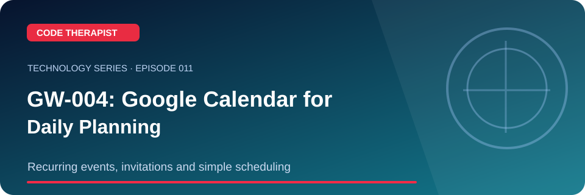
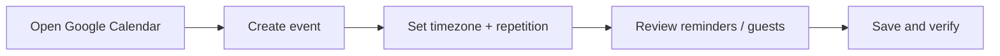

# Episode 011 · GW-004: Google Calendar for Daily Planning

**Code Therapist · 2026-11-08 · Recurring events, invitations and simple scheduling**

[Full Technology Series](./README.md) · [Knowledge Hub](../../../README.md) · [Portfolio](https://codetherapist.netlify.app/)

> **Learning summary:** Google Calendar supports events, invitations and recurring schedules. This is the next part of the existing Code Therapist Google Workspace learning series (GW-001 through GW-003).

## 01 · What viewers will learn

1. Open calendar.google.com using an account you control.
2. Create a 30-minute practice event called 'Study JavaScript'.
3. Set a future date and time, then choose a repeat rule such as weekly.
4. Add a notification, review the time zone and confirm how to edit one occurrence or the whole series.
5. Invite someone only after they agree to receive an invitation.

## 02 · How it works — workflow

## 03 · Practical example / discussion

Set a repeating study block for a week, then edit only one occurrence to see how exceptions work. Do not publish private calendar details.

## 04 · Ready-to-record YouTube Short (60–90 seconds)

| Scene | Narration / what to show |
|---|---|
| **00:00–00:08 · Hook** | “undefined” Show the landscape episode thumbnail. |
| **00:08–00:25 · Explain** | Google Calendar supports events, invitations and recurring schedules. This is the next part of the existing Code Therapist Google Workspace learning series (GW-001 through GW-003). |
| **00:25–00:55 · Demonstrate** | Open calendar.google.com using an account you control. Create a 30-minute practice event called 'Study JavaScript'. Set a future date and time, then choose a repeat rule such as weekly. |
| **00:55–01:12 · Key takeaway** | Show the workflow diagram and summarize the most useful action or lesson. |
| **01:12–01:30 · Close** | “For the full guide and official references, open the Code Therapist Knowledge Hub link below. Follow for the next technology episode.” |

**Recording guidance:** Use your own screen capture and source-authorized visuals. Do not imply that a concept mockup, hypothetical result or corporate announcement is an independently verified production demonstration.

## 05 · Verified source links

- [Google Calendar Help Center](https://support.google.com/calendar/)
- [Google Calendar](https://calendar.google.com/)

## 06 · Accuracy, privacy and safety

Calendar menus and some organizational controls vary by account and administrator. Avoid sending unsolicited meeting invitations.

## 07 · Share to WhatsApp / video description

**📚 CODE THERAPIST · EPISODE 011**  
**GW-004: Google Calendar for Daily Planning**

Recurring events, invitations and simple scheduling. Read the step-by-step article, diagram, practical example and original references:

[Open this article on GitHub](https://github.com/codetherapistpita-oss/codetherapistpita-oss/blob/main/knowledge-hub/07-SOCIAL-MEDIA/YOUTUBE/2026-11-08-TECHNOLOGY-EDUCATION/EP-011-google-calendar-gw004.md)

**Editorial note:** This is a published article and recording script. A YouTube video has not been recorded or uploaded by this publication.

---

[← All 12 episodes](./README.md) · [Code Therapist GitHub](https://github.com/codetherapistpita-oss)
