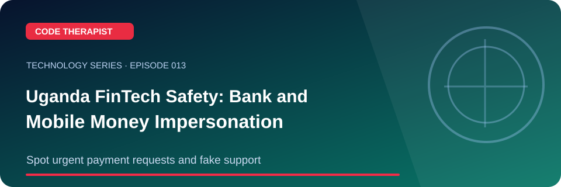
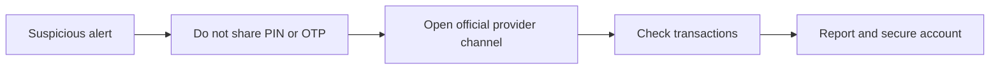

# Bank and Mobile Money Impersonation Safety

**Code Therapist · 8 November 2026 · Episode 013**

[Series home](./README.md) · [Knowledge Hub](../../../README.md)

> **Overview:** Fraudulent messages and callers may pretend to be banks or mobile-money support and demand a PIN, OTP or immediate reversal fee.

## 01 · Key concepts

Fraudulent messages and callers may pretend to be banks or mobile-money support and demand a PIN, OTP or immediate reversal fee.

**What you should remember:** Understand the key parts, their purposes, common mistakes and how to validate what you learn. This guide is designed for beginner-friendly public education, with the detailed original references below.

## 02 · Visual workflow

## 03 · Guided demonstration

Build a public awareness checklist for Uganda-focused readers: identify urgent pressure, verify through the official provider, preserve safe evidence and report quickly.

### Checklist for the video

- [ ] Explain the main term or problem in everyday language.
- [ ] Demonstrate a permitted example or show the documented historical timeline.
- [ ] Point out what the visual workflow actually means.
- [ ] Give viewers one practical question or exercise.
- [ ] Share the complete safe article URL and official sources.

## 04 · YouTube Short script (60–90 seconds)

| Scene | Spoken narration and visual direction |
|---|---|
| **00:00–00:08** | “Today on Code Therapist: Bank and Mobile Money Impersonation Safety. Here's why it matters.” Show the branded landscape thumbnail. |
| **00:08–00:26** | “Fraudulent messages and callers may pretend to be banks or mobile-money support and demand a PIN, OTP or immediate reversal fee.” Show one concept or a tightly framed source. |
| **00:26–00:55** | Walk viewers through the steps in the **Guided demonstration** above. Screen-record only owned material or the official permitted resource. |
| **00:55–01:12** | Display the diagram and explain the result and one important limitation. |
| **01:12–01:30** | “Find the full notes, original sources and next episode at Code Therapist on GitHub.” |

For a longer tutorial, expand the demonstration into a 4–6-minute walkthrough and show the checklist being completed.

## 05 · Sources and further reading

- [Primary reference 1](https://consumer.ftc.gov/scams)
- [Primary reference 2](https://www.bou.or.ug/)

## 06 · Responsible-use and accuracy note

Never publish account numbers, transaction references or unverified support phone numbers.

## 07 · WhatsApp-ready share caption

**📚 CODE THERAPIST · EPISODE 013**

**Bank and Mobile Money Impersonation Safety**

Read the clear explanation, original references, visual workflow and practical learning exercise:

https://github.com/codetherapistpita-oss/codetherapistpita-oss/blob/main/knowledge-hub/07-SOCIAL-MEDIA/YOUTUBE/2026-11-08-TECHNOLOGY-EDUCATION/EP-013-mobile-money-scam-safety.md

> **Publication status:** This is a live GitHub article and recording script—not a claim of a published YouTube video.

---

[← All episodes](./README.md) · [Code Therapist](https://github.com/codetherapistpita-oss)
